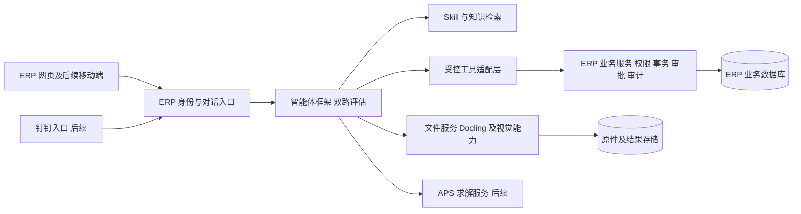

<!--
文件用途：织云 ERP AI 集成总体规划
文件版本：1.0
初始开发人员：待追溯
初始开发时间：待追溯
当前责任人：AI 集成规划文档；AI 模块负责人
最近修改人员：Codex（智能体）
最近修改时间：2026-11-20
修改标记：文档归类、交叉引用和导航更新
最近测试时间：2026-11-20
测试人员：Codex（智能体）
测试状态：内部 Markdown 路径核验通过（222 条，无失效）；不适用业务代码测试
-->
# 织云 ERP AI 集成总体规划

版本：1.0

日期：2026-11-19
性质：长期方向与分阶段建设依据，具体业务规则以专项设计和业务验收为准。

## 一、来源与适用范围

本文综合《织云_AI智能体总体方案与ERP基础建设规划_V1.0.docx》和用户提供的《AI 原生服装加工厂数字化运营平台总体架构、AI 战略及 ERP 基础建设规划》。**Snail-AI 与 Spring AI Alibaba 是当前两套并行测试的智能体框架，最终选型尚未决定。** 两套均纳入相同业务场景的对比，完成验证后选择更适合织云的方案。本文是目标规划，不将建议能力视为已上线功能。

织云长期建设 ERP 数字化管理、AI 工作助手、专业知识和资源画像、专业计算、订单履约沙盘、动态反馈及数字孪生。各阶段依据实际业务数据和验收结果推进，不要求一次建设完成。

## 二、目标与原则

1. ERP 是业务事实来源和正式业务执行系统，继续使用 RuoYi-Vue-Plus。订单、库存、人员和审批等实时事实以业务服务为准。
2. AI 负责理解、规划、查询、解释与协同。模型不能代替权限、审批、事务或确定性计算。
3. Skill 描述业务方法，MCP 提供工具连接协议，ERP 业务服务负责最终授权、校验、事务和审计。其他本地工具可按任务和权限接入，不限定只能使用 MCP。
4. 复用现有标签、知识库、对话入口和业务数据。技术方案应支持独立部署，并避免未经评估引入重复基础设施。
5. 初期采用单智能体服务多个员工和入口，保证身份与会话隔离。多专业角色、多智能体协作属于后续方向，需先验证必要性、共享上下文和成本。
6. 生产数据、个人信息和原始文件按最小权限访问，知识和附件内容视为不可信输入。

## 三、两套框架并行测试

| 项目 | Snail-AI | Spring AI Alibaba |
|---|---|---|
| 当前状态 | 已有独立服务、管理后台及 ERP 入口，部分能力完成开发环境验证 | 官方源码已作为子模块拉取，尚未完成织云服务接入 |
| 测试角色 | 作为并行测试框架，核对实际能力和缺口 | 作为并行测试框架，验证实际能力及对织云的适配成本 |
| 版本注意 | 当前项目记录为 1.1.1，具体运行包以部署核实为准 | 当前子模块上游 main 声明 Spring AI 1.1.2、Spring Boot 3.5.8；ERP 主工程为 Spring AI 2.0.1 与 Spring Boot 4 系列，需隔离并验证兼容性 |

双路测试使用相同模型、输入、ERP 数据范围、权限和验收场景，记录版本、配置、工具链、耗时、成功率、错误、资源占用和开发维护成本。先验证单智能体，不因框架支持多智能体就把它列为一期交付条件。

### 比较场景

| 场景 | 要验证的结果 |
|---|---|
| 登录与隔离 | 多员工并发时身份、会话、附件、工作区及数据范围隔离；登录状态失效后拒绝继续操作 |
| 对话体验 | 文字、流式输出、停止、失败提示、历史对话与管理员诊断可用 |
| 业务工具 | 在相同员工权限下发现并调用 MCP 或受控 API；未授权工具不可执行；结果与 ERP 一致 |
| Skill | 发现业务技能、按需读取并正确选择工具，记录实际调用链 |
| 受控写入 | 草稿、确认、拒绝、审批、超时与重复请求处理符合 ERP 业务规则 |
| 文件 | 原件保存、图片与文档处理、表格和扫描件识别、下载与历史关联；文件隔离及资源上限 |
| 语音 | 至少完成语音识别接入评估，流式语音与语音输出作为后续增强 |
| 可运维性 | 管理界面、配置、部署、升级、日志、故障恢复及二开维护难度 |

结果按安全与业务正确性、功能与体验、稳定性、维护成本、资源消耗和版本兼容性综合评估。越权、无法追溯或业务写入绕过 ERP 是不可接受项；最终框架由真实测试和用户验收决定。

## 四、目标架构与入口

ERP 网页悬浮入口负责登录态和交互。未来钉钉自建应用、移动端及框架原生入口各自建立可验证的身份映射，统一进入受控执行链路。框架后台管理身份与 ERP 员工身份分开管理，员工操作不得借用后台服务账号。

每次任务由 ERP 后端识别员工并生成短时、限定用途的执行上下文。工具通过受控适配层调用 ERP 业务服务，最终权限、组织和数据范围由服务端复核。是否采用签名票据、服务间认证或既有会话传递，应在各入口专项设计中确定并验证过期、防重放、撤权和并发隔离。

## 五、工具、Skill 与业务操作

- 工具一项对应清晰业务动作，定义名称、参数、返回类型、权限、数据范围、幂等性和错误语义。优先实现查询和草稿工具；不得开放任意 SQL、任意 API 或万能命令工具作为 ERP 操作入口。
- Skill 记录触发场景、步骤、工具、业务规则、异常和确认要求。智能体先识别相关技能，按需读取，再按实际工具 schema 调用。Skill 和提示词不能替代服务端授权。
- 工具结果应能表达业务结果、数据时间、来源、告警、确认或审批状态及 traceId。具体统一格式需要专项设计，不能假设现有接口已经统一。
- 先查询和核对目标，再展示拟执行的对象和变更。草稿、提交审批、正式生效分别记录；正式写入由 ERP 服务和审批规则决定。超时后先核对是否生效，避免重复操作。
- 日志记录员工、入口、会话、任务、工具、业务对象、调用状态和确认/审批关联。参数与结果按业务需要脱敏，凭据和不必要的敏感原文不进入日志。

## 六、文件、图片、语音与工作区

1. 用户上传原始文件，保留上传人、会话、版本、类型、访问权限和原件。模型或工具依据任务调用文档解析、表格处理、渲染或视觉能力；不把预先提取的文本当作唯一输入。
2. 文档解析由独立 Docling Serve 提供。文本、表格、页面、图片和版面信息按实际能力与模型输入条件处理，明确页码及识别不完整的提示。扫描 PDF 的 OCR 与图片视觉理解分别验证。
3. 输出文件应支持归属、预览或下载、有效期及历史对话关联。上传、处理中、成功和失败需有状态反馈；文件与任务的清理策略应明确。
4. 语音最低目标为语音识别转文字并进入现有对话流程。录音上传、识别模型、隐私、超时和失败提示由智能体后台处理；流式语音和 TTS 分阶段建设。
5. 每个员工或任务使用受限工作区，明确目录归属、生命周期和并发隔离。脚本、网络和进程权限以实际沙箱策略约束；仅指定工作目录不等于完成系统级沙箱。依赖工具优先选用可本地或容器运行、维护稳定的现有项目。

## 七、对话、记忆与知识中心

员工可查询自己的历史会话、提问结果、附件和任务状态；管理员在授权范围内查看会话及工具执行记录。对话记录、诊断日志和长期记忆分别定义用途、权限与保留策略，不能把未审核的聊天内容直接写成企业知识。

知识中心复用现有基础，逐步建设原件登记、解析、结构化、审核、发布、检索、引用、反馈和版本更新。知识条目应关联来源、页码或章节、版本、责任人、适用范围、密级与有效期。检索前按员工权限过滤；过期、未审核和冲突内容要明确标识。AI 可以提出知识草稿，正式知识由授权人员审核。

文档知识、结构化业务数据、业务规则和专业计算分别管理。库存和订单状态等实时事实查询 ERP；SMV、设备参数、技能等级等进入相应业务档案；模型不替代确定性计算。

## 八、ERP 数据与资源画像

按业务优先级完善人员技能与班组、款式和 BOM、工序与工艺路线、标准工时、物料与库存、设备与生产线、供应商和外协厂、工厂日历、质量及运输等资料。BOM 说明用料，工艺路线说明加工步骤，二者关联但分别维护。

延续现有“功能模块—标签分类—标签”体系。标签用于特征和检索，不能替代库存数量、技能等级、设备参数或可用产能。资源画像应记录依据、负责人、更新时间和有效期；AI 生成的正式标签和能力变更经业务人员审核。

标签的业务目录、对象能力判断、自动建议和待确认规则，以《地基/属性标签.md》的“面向 AI 与订单沙盘的标签体系完善”一节为统一依据。

### 基础档案与标签分类的补强

各基础档案应围绕业务用途梳理标签分组、维护责任人、授权范围和数据来源。人员信息可按家庭情况自主申报、擅长工序工艺、服装类型、设备操作、培训认证及工作时间偏好等方向设计；班组、设备、物料、供应商和外协厂也按各自业务特点设计分类。具体分组和标签由业务维护，不自动预置。

例如员工通常周六或周日需要照顾孩子时，可以由本人申报工作时间偏好。沙盘同时读取具体日期的排班、正式请假和任务状态，把可用、不可用、待确认分开处理。不能把长期偏好自动当成某日已请假，也不能由家庭信息推断人员状态。跨组支援须同时评估调出组和目标组对全部受影响订单的产能及交期。

标签支持匹配与筛选，技能等级、工时、设备产能、库存、计划时间和业务状态以结构化记录为准。各领域补强已分别记录到人员、组织、客户、标签、采购、设备、车辆、物料及生产流程规划，统一索引见《系统需求规划.md》的 AI 沙盘补充规划。

## 九、订单沙盘和数字孪生

订单沙盘以订单、BOM、库存、工艺、人员、班组、设备、日历、外协和运输等真实数据形成场景快照，模拟从接单、物料到货、生产、外协、包装到客户签收。支持多订单竞争资源、多方案比较及突发事件分析。

LLM 将用户目标整理成结构化条件并解释结果。独立计算服务负责约束、排程和优化；候选求解器与部署方式通过真实数据 POC 决定。每次模拟记录数据快照、规则及算法版本、参数、结果和风险，确保可复现。模拟方案不能直接覆盖正式计划，发布前重新校验并遵循审批。

业务事件逐步覆盖订单、物料、生产、人员、设备、外协、质量和出货，为异常提醒与重新模拟提供依据。数字孪生在数据、事件和沙盘成熟后逐步建设，先明确阈值、通知、去重和责任人。

## 十、实施阶段与验收

| 阶段 | 主要工作 | 完成条件 |
|---|---|---|
| 0 现状盘点 | 核对代码、数据库、部署、现有入口、权限、MCP、Skill、知识与文档处理；盘点不修改业务代码 | 形成现状与差距报告，区分代码、运行、发现、实际调用和业务验收 |
| 1 双路测试与 AI 基础 | 隔离搭建两套框架，完成同场景比较；落实员工身份、工具、会话、文件和审计 | 对比记录完整，普通员工与管理员权限隔离通过，形成框架选择结论 |
| 2 业务数据与闭环 | 按工厂优先级补齐工序、工艺、日历、库存、采购、生产和质量等资料及流程 | 关键数据有来源、责任人及业务验收，能追踪订单主要业务过程 |
| 3 知识治理与资源画像 | 建立知识审核版本、技能矩阵、设备及工厂能力档案 | 知识可追溯且按权限检索，画像有证据和有效期 |
| 4 专业助手与受控草稿 | 建立计划、工艺、采购、质量等专业技能，按实际需要组合 | 跨模块结论有来源；草稿、确认、审批与业务执行完整 |
| 5 订单沙盘 POC | 使用真实订单建立快照、约束、求解与方案比较 | 可复现，输出瓶颈、风险、计划和缺失数据，不改正式计划 |
| 6 动态反馈与数字孪生 | 业务事件回流、偏差分析、受影响订单重算和经营模拟 | 状态、告警、重算与责任闭环可追溯 |

ERP 基础数据、知识和 AI 基础可以按依赖关系并行推进。AI 能力等级从查询解释、分析建议、草稿审批逐步提高到明确授权下的自动执行；高级操作必须有相应业务规则、审批与审计。

## 十一、当前已知基线和待核实事项

- 已有 SnailAI 管理服务、ERP 对话入口、MCP 工具代码和本地 Skill。部分开发环境已进行工具发现、文件上传及单次文本读取验证，普通员工权限、并发、完整审批和端到端体验仍需按场景复验。
- SnailAI 管理后台与 ERP 员工入口的身份和工具配置不同；后台静态凭据不代表员工权限。框架后台登记 Skill 与 ERP 入口读取项目 Skill 是不同接入路径。
- Docling 开发容器和原生文件链路已建设，复杂扫描 PDF、文档内图片交给视觉模型、结果文件和历史预览下载仍需核实或建设。图片和文档的大小限制以当前配置为准。
- Spring AI Alibaba 当前包含官方 Agent Studio 的本地独立测试入口，使用现有 PostgreSQL 实例中的独立数据库，不启动 MySQL；ERP 系统管理中提供单独权限入口。它仍未接入 ERP 员工身份、模型凭据、MCP 或业务接口，不代表第二套 ERP 智能体链路已经打通。
- 会话记录、知识草稿、语音、工作区隔离、工具确认和管理端审计应以代码和实际运行逐项核对，历史文档中不同日期的状态不能直接相加作为验收结果。
- 客户分类与标签分离仍在开发，后续按独立业务任务完成权限、引用保护及验收。

## 十二、近期交付顺序

1. 梳理 Snail-AI 的现有链路，同时设计 Spring AI Alibaba 的测试链路，核实员工身份、文件和日志现状，形成两套框架的差距清单。
2. 保持 Snail-AI 测试入口可用，同时在独立进程搭建 Spring AI Alibaba 单智能体测试入口，解决版本兼容与模型连接。
3. 以同一员工身份及只读业务数据，完成两套框架的工具发现、调用和越权检查；补齐审计和可重复的场景记录。
4. 对比文件、语音、工作区、管理界面、运维及二开成本，给出证据、已验证范围和未解决问题，选择框架后形成专项实施计划。
5. 在框架选择和业务数据准备后，逐步开展知识治理、受控写入、资源画像及订单沙盘 POC。

# 附录：原有文档的契约和历史记录

以下记录包含 Snail-AI 已实现的接口和历史进展，以及 Spring AI Alibaba 源码登记。它们描述两套框架各自当前所处阶段，并不构成最终选型。运行状态以代码和实际验证为准。

---

## 员工入口 API 与调用契约

### Snail-AI 现有员工侧入口 API（现状记录）

> 版本：v1
> 更新日期：2026-11-17
> 状态：接口代码与后端打包完成，ERP 后端已重启且 SnailAI Agent 服务已启动；实际员工会话下的模型回复、MCP 工具发现/调用及页面验收仍待验证。

> 2026-11-17 二开：已增加 ERP 侧对话诊断管理接口及页面，权限为 `system:snailai:trace:list`，不默认授权普通角色。记录新产生的聊天轮次、附件元信息、可见工具和工具执行状态；工具参数和结果正文暂不保存，异常只记录受限信息。历史记录不回填。实际模型调用、授权、并发及页面验收仍待验证。原始文档及语音仍待智能体后台接入，后续目标和阶段见本文件“实施阶段与验收”及“近期交付顺序”。

## 1. 认证与身份

- 所有接口要求已登录的 ERP 员工会话，沿用 ERP 的 Authorization 与 clientid 认证。
- 浏览器不能提交 openId、ERP 用户 ID、权限列表或 MCP 请求凭证。后端从当前 Sa-Token 会话取得用户 ID、昵称、token、clientid 和权限。
- SnailAI OpenAPI 用户以 ERP 用户 ID 注册，openId 只在后端取得并用于当前员工自己的智能体和对话。
- 每轮流式聊天生成短时 sid，由 ERP SnailAI Client 在本机内存中关联当前员工。MCP 请求携带该员工原始 token 与 clientid 到 ERP /mcp；MCP 端再次检查登录态、客户端范围、权限、数据范围和业务校验。
- 工具定义按当前员工权限过滤；无法识别权限的工具默认不展示。所有非只读工具在 ERP 页面出现一次性确认卡，员工确认后才继续调用，拒绝或超时均不执行。
- 本功能只把 Docs/Skills/**/SKILL.md 作为只读技能目录接入 ERP 对话。文件由 read_zhiyun_skill 按需读取，不会写入或修改 SnailAI 管理端的 Skill 数据。
- 图片上传到 SnailAI 原生资源库；ERP 只向浏览器返回随机票据，服务端将票据绑定当前 ERP userId 与资源 ID，1 小时失效，聊天时拒绝其他员工的票据。图片支持 PNG/JPG/JPEG，单张不超过 5 MB。文档支持 PDF、DOCX、XLSX、PPTX、MD、TXT、CSV，PDF 单个不超过 50 MB，其他文档单个不超过 10 MB。每条消息最多 4 个附件。

## 2. 接口

| 方法与路径 | 说明 | 幂等性 | 副作用 | 前置条件 | 是否需审批 |
|---|---|---|---|---|---|
| GET /snail-ai/agents | 查询当前员工可使用的智能体；没有订阅项时使用配置的默认智能体 | 幂等 | 必要时注册 ERP 用户到 SnailAI | ERP 登录；SnailAI OpenAPI 可用 | 否 |
| POST /snail-ai/conversations | 为当前员工和指定智能体新建对话 | 非幂等；重复请求新建不同对话 | 新建 SnailAI 对话 | 当前员工可使用指定智能体 | 否 |
| POST /snail-ai/attachments | 上传图片或文档并返回当前员工专属的短时票据。文档额外传入 agentId 和 conversationId | 非幂等；重复上传创建独立资源 | 写入 SnailAI 资源存储 | ERP 登录；单张不超过 5 MB | 否 |
| GET /snail-ai/conversations?agentId={id} | 查询当前员工最近对话，最多 30 条 | 幂等 | 必要时注册 ERP 用户到 SnailAI | 当前员工可使用指定智能体 | 否 |
| GET /snail-ai/conversations/history?agentId={id}&page=1&size=20&keyword= | 按本人对话标题及消息内容搜索并分页，返回首条提问摘要 | 幂等 | 必要时注册 ERP 用户到 SnailAI | ERP 登录；智能体后台按应用、员工及智能体过滤 | 否 |
| GET /snail-ai/conversations/{conversationId}/messages?agentId={id} | 查询当前员工对话消息 | 幂等 | 必要时注册 ERP 用户到 SnailAI | 对话归属由当前 openId 校验 | 否 |
| GET /snail-ai/conversations/{conversationId}/images/{resourceId}?agentId={id} | 读取本人对话中关联的历史 PNG/JPEG 图片 | 幂等 | 无 | ERP 登录；智能体后台校验应用、员工、对话和图片归属 | 否 |
| POST /snail-ai/chat/stream | 流式发送文字及可选图片附件，并转发模型回复与写操作确认事件 | 非幂等；重复请求会产生重复对话消息 | 写入 SnailAI 对话消息；可能调用 ERP MCP | 登录员工、本人对话、可用智能体、配置可用的模型；附件票据须属于当前员工 | ERP MCP 写工具需员工逐次确认 |
| POST /snail-ai/approvals/resolve | 对等待中的一次工具操作确认或拒绝 | 一次性审批号只能完成一次 | 放行或拒绝当前 MCP 工具回调 | 相同登录员工、审批未过期、工具回调仍在等待 | 本请求就是员工确认 |
| POST /snail-ai/user/register | 手动确保当前 ERP 用户已注册到 SnailAI | 服务端按相同 ERP 用户外部 ID 注册 | 注册或更新 SnailAI 用户资料 | ERP 登录、SnailAI OpenAPI 可用 | 否 |
| GET /snail-ai/admin/traces | 分页查询员工对话轮次 | 幂等 | 无 | `system:snailai:trace:list` | 否 |
| GET /snail-ai/admin/traces/{traceId} | 查看单轮提问、回复及工具事件 | 幂等 | 无 | `system:snailai:trace:list` | 否 |
| GET /snail-ai/admin/traces/{traceId}/images | 预览该轮可唯一关联的图片 | 幂等 | 记录管理员查看日志 | `system:snailai:trace:list`；服务端核对员工、会话和图片归属 | 否 |
| GET /snail-ai/admin/traces/conversations | 按员工、智能体和对话编号聚合诊断轮次并分页 | 幂等 | 无 | `system:snailai:trace:list` | 否 |
| GET /snail-ai/admin/traces/conversations/{traceId} | 以一轮为锚点，读取同一员工及智能体的完整对话诊断 | 幂等 | 无 | `system:snailai:trace:list` | 否 |

### 聊天事件

历史消息响应中的 `attachments` 包含图片编号及名称；浏览器使用员工认证请求 ERP 图片接口，ERP 通过受应用认证的智能体后台接口读取原图，不返回资源实际存储路径。先前已保存在 SnailAI 消息 metadata 的图片可以恢复；没有消息关联或图片已被删除时无法恢复。接口实现已构建并部署至开发服务，员工页面和跨账号隔离仍待运行验收。

历史入口支持分页、按对话内容搜索和继续对话；页面切换时若有未发送输入或待发送图片，需要先处理草稿。切换对话只读取本人已有记录，历史确认卡及管理员跨员工图片预览不属于本接口的交付状态。

接口使用 text/event-stream。text、thinking、done、error 与 approval-required 事件通过 SSE 的 event 字段区分；事件 data 为 JSON。

approval-required 包含一次性 approvalId、工具名、工具说明和待执行参数。浏览器必须先展示这些字段，只有员工点击“确认执行”才调用审批接口。审批号只授权本次当前员工会话，不得复用或转交给其他员工。

## 3. MCP 与 Skill 运行边界

- ERP /mcp 不以服务器账号代办，MCP 工具沿用发起员工的原 Sa-Token 与 clientid。MCP 控制器中的 StpUtil.checkPermission 和已有业务审计仍是最终执行校验。
- 本轮 ERP 入口将当前 SnailAI Agent 的 MCP 连接收窄为 ERP MCP；不把 SnailAI 服务端保存的外部 MCP 凭证带入 ERP 会话。
- 只暴露识别到权限规则、且当前员工拥有对应权限的 ERP 工具；未登记的工具和框架 demo 工具关闭。
- Docs/Skills 由 ERP 客户端读取，聊天时只把技能目录摘要附入本轮提示词，完整内容通过 read_zhiyun_skill 按需加载。SnailAI 管理端的 Skill 列表不会因此自动出现这些文件。
- 当前只记录代码与构建状态；尚未通过 ERP 员工浏览器对话实测 SnailAI 模型回复、客户端 tools/list 或 MCP 工具调用，不能据此声称上述运行时步骤已验收。

ERP 文档上传通过本机签名接口保存原件，服务端校验员工、应用、智能体和对话归属。聊天时仅向模型提供本轮附件清单与只读工具 read_chat_document。PDF、Office、Markdown 按需调用 Docling，TXT 和 CSV 读取 UTF-8 文本。文档中的嵌入图片暂不交给视觉模型，历史消息的文档预览和下载暂未接入。

---

## 实施任务与历史验证记录

### Snail-AI 单智能体二开历史记录

> 状态：开发中；负责人：Codex；创建日期：2026-11-17
> 范围依据：用户 2026-11-17 对单智能体、多员工、文件、语音和工作区的确认。既有规范与本文有冲突时以本文为准。

## 一、目标和边界

一个智能体服务多个入口和员工。ERP 弹窗负责交互及登录态传递，智能体后台负责会话、工具编排、文件和语音处理；未来预留钉钉入口，当前不做多智能体。ERP 用户 ID 是跨系统身份关联键，工号为员工登录和展示标识。调用 ERP MCP/API 必须以发起员工身份通过 ERP 的权限和数据范围校验，写操作按既有确认及业务规则执行。

## 二、功能契约

1. **并发与隔离**：不同员工、会话和任务上下文独立；每个任务只能访问自身授权文件。后台必须强制执行文件、进程、网络及资源隔离，凭据不得进入工作区。隔离未验证前不开放任意代码执行。
2. **工具**：受控 ERP MCP/API、Skill 及文件处理工具；员工权限过滤，未知工具默认关闭，写操作确认，调用有状态及诊断。Python 等可执行工具需要隔离运行环境和明确工具权限；Git 按实际需求开放。
3. **会话与诊断**：管理员直接查看员工会话内容、附件信息、工具调用、确认、状态、耗时及失败原因；权限受控，记录不得包含凭据或原始音频。会话记录与长期记忆分开，记忆功能后续设计。
4. **原始文件**：图片、文档、Markdown 等原样交给智能体后台，后台按模型能力及任务调用文件工具处理，保留文件、任务、生成物的关联；不得在 ERP 入口统一转纯文本替代原件。客户订单识别须能处理图片和表格，生成草稿并由员工核对；翻译可接企业术语库并输出文档。原生多模态取决于具体模型和网关。
5. **语音**：第一阶段语音识别，ERP 录音上传，由智能体后台接入 ASR 并返回识别文本；TTS 和实时双向语音后续按接口能力实施。密钥仅后端持有，原始音频不写对话诊断。
6. **运行体验**：展示执行进度、错误和确认；任务停止、断线恢复及安全重试须防止重复业务写入。ERP 页面可传业务对象上下文，访问仍受权限校验。
7. **全局悬浮入口与截图提问**：登录后在 ERP 页面的顶层显示悬浮入口，新建表单及业务弹窗打开时仍可使用；对话面板不遮挡页面交互。员工主动勾选截图提问后，发送时捕获当前可见页面并排除智能体面板及入口，截图作为本轮图片附件；截图或上传失败不得静默发送。截图占一张图片额度。截图只能覆盖浏览器可以渲染和读取的页面内容，跨域资源及内嵌页面可能受限。

## 三、依赖与阶段

2026-11-18 用户要求：文件及其他智能体工具优先复用可直接由 SnailAI 或 MCP 调用的公开开源项目，不重复自行实现成熟通用工具；选择前核对许可证、维护状态、工具能力与本项目协议兼容性。工作区和员工身份隔离仍须由部署和接入层实际保障。候选：MCP 官方 filesystem（MIT，需限制目录并核对安全修复版本）、DocuFlow（文档处理 MCP，具体许可证、运行依赖和工具能力待核实）。候选不代表已经安装或接入。

| 阶段 | 内容 | 验收条件 |
|---|---|---|
| 1 | 梳理 SnailAI 服务端与 ERP 执行端边界，修复已有追踪半成品，完成会话诊断后台和员工身份隔离 | 可查每轮文本及调用；不同员工不可串身份；后台权限生效；失败有诊断 |
| 2 | 智能体后台原始附件、按任务隔离的存储和工具接口 | 原件可受控存取；跨员工和路径越界被拒绝；图片、文档与结果关联 |
| 3 | 实际隔离执行环境与文件处理、订单草稿 | 沙箱限制经验证；员工可核对草稿；重试不重复写入 |
| 4 | 智能体后台 ASR 与 ERP 录音入口 | 已配置模型可识别语音并形成文字对话，异常可见 |
| 后续 | TTS、实时语音、钉钉、词库、记忆与定时任务 | 分别制定具体契约及验收 |

阶段是交付顺序，不改变已授权的最终目标。代码、运行联调和用户验收分别记录；不将构建或文档等同于功能完成。

## 四、数据与权限

- 会话诊断表及工具事件表采用 PostgreSQL，管理员列表权限 `system:snailai:trace:list`；不自动赋予普通角色。
- 诊断记录包含员工提问和回复，属于敏感业务资料；严禁记录 Token、网关密钥及原始音频；附件原文和原件不写入诊断字段。工具参数/结果只在适当脱敏与访问控制下保存。
- 开发库迁移可按任务执行；生产迁移需另行确认。业务写入复用原 ERP 接口、权限、事务与审计；不直接开放任意 SQL、任意 HTTP 或宿主机路径。
- 文档上传、保留/清理策略、跨入口历史共享的业务规则未确定时，采用个人和任务隔离，不自动清理重要原件。

## 五、验收场景

1. 多员工并发发起查询，各自只看到本人授权的数据和附件；退出登录后旧身份不能继续调用 ERP。
2. 管理员可从列表直接查看完整会话和工具事件，无权限用户无法访问；模型和工具错误可定位。
3. 客户订单中的图片和表格能被智能体按任务查看，识别不确定项提示员工；草稿保存只发生一次并可追溯。
4. 员工上传的英文订单结合服装术语翻译并返回结果文件；原件及结果不被其他员工访问。
5. 已配置 ASR 时可录音识别；未配置或供应商失败时有明确提示且文字聊天可用。
6. 沙箱路径穿越、跨工作区读取、外网访问、资源耗尽和恶意文件均被隔离策略限制；无隔离环境时不开放任意执行工具。

## 六、当前实现状态

SnailAI 1.1.1 已有 ERP 用户映射、图片、会话代理、ERP MCP 权限过滤及写操作确认的代码；原始普通文档、隔离执行环境和 ASR 尚未接通。已有对话追踪代码及增量 DDL 是未完成改动，需审查并接入管理页面、迁移和运行验证。当前服务已启动不代表员工聊天、工具调用或多用户隔离验收通过。

2026-11-17：ERP 全局悬浮入口及自愿截图提问代码已接入，复用图片上传和员工归属票据；前端构建通过，业务新增弹窗、截图视觉效果以及模型识图结果仍待用户页面验收。

2026-11-17：悬浮球及聊天面板标题栏增加拖动，悬浮球增加流光动效；窗口尺寸变化时将已拖动组件限制在视口。排查截图提问无回复时，发现传给 SnailAI 工具解析器的 MCP 列表不可修改，已修正并重新构建、重启 ERP 后端；SnailAI 客户端重新注册成功。实际员工请求及模型回复仍需运行验收。

2026-11-17：后续截图请求已能完成 MCP 发现，但 SnailAI 1.1.1 使用旧 Spring AI 图片构造方法引发 `NoSuchMethodError`；ERP 执行端已新增适配当前 Spring AI 的消息构造器并构建重启。图片模型回复及实际员工会话仍待验证。

2026-11-17：员工截图请求已由模型完成回复；发现流式文本事件内层 JSON 被当作正文，现由 ERP 后端提取正文并用于对话和诊断记录，前端以安全过滤的 Markdown 展示。聊天框支持粘贴 PNG/JPEG 截图及当前页面已发送图片的放大预览；会话刷新后历史附件恢复、普通文件预览和下载仍待原始文件链路实现。前后端构建通过，页面和新流式回复待运行验收。

2026-11-17：悬浮球默认移至顶栏铃铛附近，聊天面板支持边角缩放和 Esc 收起。智能体后台新增鉴权历史消息和图片读取接口，按应用、员工、对话、图片归属校验，并通过 ERP 代理恢复已保存消息 metadata 中的图片。前后端及智能体服务端已构建，开发服务重启；跨账号隔离与实际页面验收待完成，普通文件预览下载仍待后续建设。

2026-11-17：后台对话记录详情的附件区域当前仅显示文件元信息，不能查看图片。诊断记录旧数据没有图片编号及消息编号；修复时须建立本轮与资源的准确关联，并在管理员权限和图片归属校验下读取。旧记录只能在关联可唯一确定时恢复，不能仅根据时间猜测；无法确定时明确标示。员工自己对话中的历史图片接口不直接提供跨员工访问能力。

2026-11-18：员工悬浮对话新增历史入口，支持本人对话按内容搜索、分页及切换，保留员工身份和图片归属校验；未发送草稿须先处理。前后端和智能体服务构建及开发环境重启完成，浏览器操作及跨账号隔离待验收。管理员后台图片预览仍待处理。

2026-11-18：需在管理后台展示织云运行时 MCP 服务、可调用工具和本地 Skill 的接入与状态；当前 ERP 对话按员工身份动态注入，并未登记到 SnailAI 后台配置列表。展示能力须保留员工权限过滤和 ERP 最终鉴权，具体管理交互待设计实现。

2026-11-19：SnailAI 可直接填写两个请求头 `X-MCP-Username` 和 `X-MCP-Password`，由 ERP 后端使用 `ZHIYUN_MCP_BASIC_AUTH_CLIENT_ID` 配置的客户端，不依赖 ERP 网页登录。跨主机连接须使用 HTTPS。

2026-11-19：织云 `/mcp` 支持 SnailAI 后台 HTTP Basic 账号密码认证。SnailAI 选择 Streamable HTTP，同机基础地址填 `http://127.0.0.1:8080`，端点填 `/mcp`，两条固定请求头为 `Authorization: Basic <账号:密码的 Base64>` 和 `clientid: <允许密码认证的 ERP 客户端 ID>`。开发配置默认允许 `SUPER_ADMIN_USERNAME`，可用 `ZHIYUN_MCP_BASIC_AUTH_USERNAME` 指定专用账号，并用 `ZHIYUN_MCP_BASIC_AUTH_ENABLED=false` 关闭。其他环境默认关闭，启用时显式配置 `zhiyun.mcp.basic-auth.enabled` 和 `zhiyun.mcp.basic-auth.username`。Basic 仅接受本机 HTTP 或 HTTPS，每次请求复用 ERP 的密码、客户端和权限校验，内部短时会话不返回客户端。请求头的 Base64 可还原为密码，作为凭证保管。开发后端已构建并重启，直接通过 HTTP 完成 initialize、tools/list 和 customer_list；SnailAI 界面保存和绑定尚未验收。

2026-11-18：管理员对话记录详情增加图片预览，要求对话记录查看权限；按员工、对话、提问、时间和附件名称大小匹配唯一的智能体消息，并校验资源上传人及类型。新记录补充资源编号；旧记录无法唯一匹配时提示无法恢复。前后端和智能体服务构建、开发服务重启完成，真实管理员页面、旧数据及权限隔离待运行验收。

2026-11-18：管理员对话记录按员工、智能体和对话编号聚合分页，大弹窗按时间展示每轮问题、回复、附件及工具调用；状态筛选匹配包含该状态的对话，详情保留全部轮次。前后端构建通过、ERP 后端重启；页面和权限待用户验收。

2026-11-18：用户确定优先选择稳定、由多人维护的文件工具。按 Docling 文档解析、LibreOffice 渲染及格式转换、Apache POI 补充的顺序验证；Excel MCP 的维护情况和实际效果待确认，暂不作为必需依赖。已新增 `scripts/docling-dev.sh`，用于创建固定版本、限制资源及外网访问、不挂载 ERP 文件目录的本地 Docling 测试容器；使用内部网络，密钥保存在用户私有配置目录，不能作为员工多租户隔离或生产部署的证明。当时开发机内存约 5.8 GB、可用内存不足 3 GB，脚本阻止启动以避免影响 ERP；镜像下载中止。普通文档目前仍不接受上传，原始文件保存、按任务隔离、Docling 按需调用、结果关联及跨员工测试均尚未实现，不能宣称已经接入或支持文件处理。

2026-11-18：WSL 内存调整后，系统识别约 15 GB，已下载并启动 Docling 测试容器；容器内带密钥的 Markdown 文件转换验证成功。原计划的 127.0.0.1:15001 端口在当前内部网络下不通；已验证 WSL 后台可通过该隔离网络中的容器地址上传测试文件并获取解析结果。容器地址可能改变，正式接入需处理服务发现、认证及员工和任务隔离；目前 ERP 对话尚未接入，不能将网络测试视为端到端验收。

## 七、SnailAI 1.1.1 原生能力核对（2026-11-18）

本节依据本地 1.1.1 依赖包及织云实际代码核对，不代表相关功能已完成运行验收。文档处理优先复用原生实现，避免重复建设。

| 方向 | 已核实的原生能力 | 织云当前状态与需补部分 |
|---|---|---|
| 知识库及文件 | 知识库支持本地文件上传、原件资源保存和后续处理；包含 Word、Excel、PDF、Markdown、文本、HTML 和 Docling 解析器。 | 知识库导入与员工对话附件是不同链路；各格式兼容性、识图及检索效果需实测。 |
| Docling | 带原生异步提交、轮询、结果解析及并发控制的客户端，使用 `/v1/convert/file/async` 等接口。 | 开发配置禁用；当前独立容器需要 API 密钥，而 1.1.1 原生客户端和配置未发现设置认证请求头的能力，需补安全认证、服务发现和实际端到端联调，不能只填地址。 |
| 对话附件 | 对话附件类型及校验目前仅有 IMAGE，校验资源归属和图片格式。 | ERP 侧仅接 PNG/JPEG；聊天普通文档需扩展原件关联、权限与按需处理，不能直接借知识库上传冒充已完成。 |
| MCP、Skill、工具 | 原生有 MCP、Skill、知识库检索、Shell 和 HTTP 工具组件，以及工具调用解析流程。 | ERP 会话目前动态注入 ERP MCP、读取本地 Skill 并按员工权限过滤；不等同于后台所有工具可用。Shell 直接启动进程，工作目录不等于沙箱，隔离未验证前不得放开；HTTP 需限定范围。 |
| 会话、记忆 | 原生有会话记录、短期记忆的内存/数据库存储及记忆管理相关接口。 | 当前配置短期记忆数据库存储；员工历史和管理员诊断已二开，长期记忆的启用、员工隔离、保留及管理策略待单独验证。 |
| 用户及模型 | 提供应用、用户、模型管理与 OpenAPI 相关组件。 | ERP 使用员工 ID 映射平台用户并在调用时携带员工身份；仍须以 ERP 权限及业务接口作为最终授权。 |
| 语音 | 已检查的服务端、OpenAPI、管理端依赖中未发现语音接口组件。 | 不能据此断言整个上游生态不支持；当前工程尚无已验证的 ASR 对话链路。 |

下一步先核实原生 Docling 客户端与现有认证容器的兼容性，基于原生资源存储设计员工、会话、任务关联及受控下载，再按需扩展聊天附件和模型工具；历史文档只读核对，未经授权不导入共享知识库。

## 八、原生 Docling 客户端与本地解析服务对照（2026-11-18）

- SnailAI 1.1.1 的 `DoclingClient` 是 Java 调用端，并不包含独立运行的 Docling 解析引擎；当前容器为官方 Docling Serve 1.18.0，内含 Docling 2.93.0。两者是客户端与服务端关系，接入时应复用客户端而非另造解析引擎。
- 原生客户端支持健康检查、异步提交、轮询及读取结果、限并发与超时；上传原始文件，请求 Markdown 和 JSON 结果，传递 OCR、表格结构、图片导出方式、OCR 语言及 PDF 后端参数。默认 OCR 语言为 `en`，需对中文场景单独评估配置和实际识别效果。知识库 Docling 解析器声明支持 pdf、docx、xlsx、xls、pptx、html、md，实际各格式支持与效果应以对应版本实测为准。
- 结果解析器支持读取正文、页码、结构元素、表格、图片及图片相关元数据；知识库解析还会生成清理后的 Markdown，不能把它作为聊天任务原始文件的替代。解析器使用系统临时文件并在结束时尝试删除；未验证异常中断清理和任务级隔离，不能直接宣称符合员工工作区隔离。
- 框架默认 Excel 知识库解析器已使用 Apache POI 读取 xls/xlsx 并生成文本；这不等于已经提供 Excel 模板保真编辑、生成或聊天文件操作工具。Docling 负责分析结构，不承诺原样编辑及输出原格式。
- 实测：绕过代理影响、在内网携带服务密钥按原生客户端参数发送异步请求，合成 Markdown、XLSX、含表格和图片的 DOCX 均成功转换；DOCX 返回 1 个表格和 1 张图片。将该响应交给原生 `DoclingResponseParser`，成功识别 1 个表格和 1 张图片。另用仅测试期间存在的本机临时认证转发，直接运行原生 `DoclingClient`，健康检查、异步提交、轮询、解析结果全部成功，含图表 DOCX 识别出 1 个表格、1 张图片。上述测试文件为合成样例，不代表中文扫描件、复杂订单、其他格式和并发可靠性均已验证。
- 正式认证转发或客户端认证支持尚未实现；临时测试转发不常驻、不作为生产方案。原生客户端请求未设置密钥，请求现有需认证的容器会被拒绝。禁止通过关闭认证来声称安全接入；正式接入还需处理可变容器地址、路径/临时文件隔离、结果权限及服务失败行为。

## 九、WSL 智能体运行框架初步实测（2026-11-18）

用户要求只使用 WSL/Linux 环境比较 DSH、OpenClaw 与 SnailAI；使用临时合成文档，不访问或修改 ERP 业务数据，不改变现有服务配置。以下是能力探测和局部实测，不等于完整验收。

| 项目 | WSL 当前环境 | 已实测 | 缺口及未验证 |
|---|---|---|---|
| DSH | 命令行 0.2.2-rc.1；Web 本机监听 3080，匿名 HTTP 返回 401；SDK profile 支持 stdio。Web 已组合 office-to-pdf，安装有 LibreOffice Kit 0.1.5 和 Linux WASM 引擎。 | 使用本机 LibreOffice Kit 将测试 DOCX 转成 PDF、渲染成 PNG，并对 XLSX 中 `37*5` 公式重算得到 185；全部直接运行在 WSL。 | 上述是底层引擎测试，不是 DSH 智能体工具端到端测试；headless 默认模型路由缺少凭据，临时复用 Web 的模型配置尝试得到 `NO_ADAPTER`，未成功运行 DSH 模型；未验证员工、会话和工作区隔离或 ERP MCP。WSL 版本和 Windows 桌面版不同，不得互相推定组件。 |
| OpenClaw | 2026.11.3；网关健康检查成功；本机网关监听 0.0.0.0:18789，配置认证方式 token。 | `agent exec` 文本测试成功；使用合成 XLSX 读取订单、尺码和数量正确，测试结果记录 3 次 `exec` 工具调用。 | 当前 `main` 智能体沙箱模式为 `off`，检查时没有已运行的沙箱容器；不能作为多人隔离的证明。监听 0.0.0.0 并配置 token 不等于已经通过网络及多员工隔离测试。MCP 配置列表只看到钉钉相关服务，未验证织云 MCP 是否能调用。 |
| SnailAI | 后台 HTTP 入口可访问；当前版本 1.1.1。 | 前述测试使用原生 Docling 客户端配临时认证转发成功解析合成 DOCX 表格和图片；织云原生上传入口目前仅允许图片。 | 本轮未完成真实会话对比、Excel 聊天文件上传、生成物返回、跨员工权限与隔离验收；不能将存量代码或单一 Docling 测试视为完整文件能力。 |

初步取舍：OpenClaw 当前有可执行的文件工具链，DSH 的 WSL Office 底层能力也已证实，SnailAI 有既有管理与 ERP 身份接入；任一方案用于多人前均需在隔离环境中验证身份绑定、工作区路径穿越、文件和会话隔离、受控 ERP MCP、工具审计、结果交付、并发及恢复。禁止据此直接开放现有 OpenClaw 无沙箱执行给员工。DSH 的模型联调需解决 profile 模型适配，不修改既有用户配置。

## 十、SnailAI 本地 Docling 认证接入（2026-11-18）

- 用户决定继续改造 SnailAI。已新增认证适配客户端，保留上游客户端的异步上传、轮询和结果解析；仅在当前线程调用指定 Docling 地址及允许路径时附加密钥，禁用代理与重定向。密钥从本机私有文件读取，不写入项目或日志。
- 开发环境启动脚本在本地 Docling 容器运行且密钥文件存在时，自动传入容器地址和密钥文件路径并启用原生客户端；容器未运行时仍保持原有禁用行为。知识库仍需选择相应解析引擎，启用服务不等于完成知识库入库。
- 针对性自动测试覆盖认证请求、异步解析及无关请求不附带密钥；实测适配客户端直接连接本机受认证 Docling，成功解析合成 Word 中 1 个表格和 1 张图片。智能体后台已重新启动，运行进程中可见认证客户端实例；真实后台知识库上传、中文扫描件、并发和隔离尚待验证。
- ERP 聊天普通文件、员工及任务文件归属、工作区隔离、生成文件预览下载仍未接通；不得将此阶段记录为聊天文件功能完成。

## 十一、智能体后台聊天文件原件基础（2026-11-18，开发中）

- 用户要求先完成 SnailAI 自身文件能力，再接 ERP。新增后台原件上传、按用户和会话查询、受控下载接口 `/zhiyun/chat-documents`；通过现有后台登录身份和原生资源服务保存原件，不在上传时转换为文本。元数据关联智能体、会话与上传人，不接受客户端指定上传人。
- 开发库已执行 `sql/SnailAI聊天文件归属_20261118.sql`，对应表结构同步到 `RuoYi-Vue-Plus/script/sql/postgres/postgres_ry_ai.sql`。仅支持单文件 10 MB 内的 PDF、DOCX、XLSX、PPTX、UTF-8 TXT/MD/CSV；类型、内容特征、文件名及 Office 压缩展开量受限。旧版 Office 格式、图片、其他类型和产物处理尚未纳入本接口。
- 已测试文件内容及路径校验、以登录用户绑定上传、拒绝跨用户会话及无归属资源读取、Docling 认证请求；后台无登录访问新接口返回 HTTP 401。智能体后台已重新构建并启动；真实登录用户上传下载、并发及真实跨账号验收未完成。
- 上游管理前端源码位于独立的 `opensnail/snail-ai-admin` 仓库，已只读核查 1.1.0 分支；本地框架运行包是 1.1.1，不能直接将不同版本的整个后台替换。本次未修改后台聊天页面，也未接通模型按需读取原件、文件结果返回或隔离工作区；用户目前看不到普通文件上传按钮，整个功能仍未完成。后续先对齐前端源码版本和后端聊天扩展契约，确保文件归属、隔离和可追溯，再接入前端，最后接 ERP。

2026-11-18 后续：新增 `POST /zhiyun/chat-documents/{id}/analysis` 后台按需解析接口，先校验登录用户、智能体、会话与资源归属，再由原生 Docling 客户端处理原件，返回结构、表格和图片；当前支持 PDF、DOCX、XLSX、PPTX、MD，单文件上限 10 MB，返回结果限制文本及图片体积。每次调用使用权限为 0700 的独立临时目录，正常和异常完成时尝试清理；这不是已验证的进程沙箱，异常终止遗留清理尚未实现。已有合成 Word 直连本地 Docling 的测试，得到 1 个表格、1 张图片；后台重启，未登录解析请求返回 401。该接口目前只提供给后台已登录用户，未注册为模型工具；前端聊天未改，跨进程安全授权、原件和结果预览下载、真正任务沙箱、实际多用户联调仍未完成。

2026-11-18 界面进展：SnailAI 原生智能体详情的“预览与调试”增加文件选择、上传、当前会话文件列表及受控原件下载；登录凭证沿用后台现有会话，普通文件仍走上述原件接口。列表仅覆盖本次原生调试会话；原生页面重新进入时会生成新会话编号，因此此入口不等同于历史附件管理。图片仍走上游原有图片附件路径。界面明确提示文件尚不能被智能体读取：当前上传不会把普通文件加入模型上下文，也没有模型按需读取工具；不得视为端到端文件问答完成。开发环境重新打包并启动，接口未登录返回 401；登录后页面及真实上传下载仍需验收。由于当前上游前端源码与运行版本不能完全对齐，仅覆盖当前 1.1.1 的智能体详情资源 `index-Dx63sx8z.js`，新增逻辑位于独立 `zhiyun-chat-documents.js`；上游升级时必须重新对照并迁移该页面改动，不能假设哈希文件名稳定。

2026-11-18 文件读取工具进展：原生后台调试对话在分发前查询当前登录用户、智能体和会话的文件，为单次请求生成临时会话标识及允许访问的文件快照，给模型提供 `read_chat_document` 工具。模型选择文件 ID 后，执行端通过服务间签名调用 SnailAI；SnailAI 再按原上传人和会话复核资源归属，PDF/DOCX/XLSX/PPTX/MD 按需交给 Docling，UTF-8 TXT/CSV 原文读取。文件内容作为不可信数据处理，用户令牌和服务器文件路径不交给模型。标识可能出现在流响应中，因此服务间使用单独的 HMAC 密钥，标识单独泄露不能访问文件；签名有效期与服务内授权绑定，最长 30 分钟。

开发机密钥位于当前 Linux 用户私有配置目录，启动脚本会在首次启动时原子创建 0600 密钥；也可通过 `SNAIL_AI_DOCUMENT_BRIDGE_KEY_FILE` 为两个服务配置同一个密钥文件。当前执行端仅允许通过本机回环地址访问此桥接接口，跨机器或容器拆分部署需要另行设计加密传输、密钥分发及服务身份，不能直接复用此开发机方案。解析返回文本、表格和页数等，文档中嵌入图片尚未作为视觉输入传给模型，工具和页面均明确说明这一限制；不代表复杂版面、扫描件及图片已识别。原生调试会话重新进入后会创建新会话，历史附件重新关联仍未完成。

验证：文件授权和签名、错误签名、其他文件访问、既有 ERP/OpenAPI sid 不覆盖的测试通过；执行端测试通过模拟本机服务验证工具参数和签名传递；开发服务重新打包启动，未授权工具接口返回 403。真实已登录用户上传并让配置模型自主调用 Docling 的端到端体验仍待验证，模型需支持工具调用；结果文件生成、ERP 对话入口和独立沙箱不在本次已验证范围。

补充实测：使用合成 MD、XLSX、DOCX 直接请求开发机受认证 Docling 服务，三种均成功；XLSX 识别 1 个表格，DOCX 识别 1 个表格和 1 张图片。该检查仅证明解析服务与样例可用，不等于真实对话中模型完成了工具调用，也不等于模型看到了文档内图片。

## 十二、原生后台知识草稿与确认入库（2026-11-18，待真实对话验收）

- 为 SnailAI 原生后台调试对话新增 `draft_knowledge_entry` 工具。仅对后台管理员且智能体已启用并绑定知识库的会话签发草稿能力；工具调用必须携带同机服务签名，目标知识库在创建和确认时均重新检查绑定。模型只能提出候选，不能直接确认或写入。ERP 员工对话入口、员工级知识库权限和代他人审批尚未接入。
- 草稿表 `zy_snail_knowledge_draft` 记录发起人、智能体、会话、知识库、标题、正文、来源、状态和确认时间；开发库已应用 `sql/SnailAI知识草稿_20261118.sql`，主建表已同步。原生页面展示草稿、目标及完全相同条目数量，管理员确认后才调用框架原有文档上传流程；重复点击通过状态原子切换拦截，拒绝草稿不会写入。只允许操作者确认自己的草稿。
- 先做精确内容查重并要求模型先尝试检索；相似语义查重并非强制保证。框架按内容查重并拒绝冲突，不自动覆盖。提交成功表示已交给文档处理流程，页面按实际文档状态展示处理中、完成或失败，不将受理误称向量化完成。提交中发生进程中断可能需要管理员检查草稿及文档状态，不自动重试以免重复。
- 已测试草稿创建不写入知识库、未绑定知识库拒绝、签名错误拒绝、确认提交、原有工具回归；开发环境 PostgreSQL vector 临时表写入和距离检索通过，测试事务已回滚。已重启两端并确认未登录草稿列表返回 401、未签名工具请求返回 403。尚未使用真实后台账号完成模型生成草稿、页面确认、真实嵌入模型向量化及检索的完整验收；不把该功能写作生产可用。当前数据配置显示智能体已绑定知识库，但不代表嵌入模型调用已成功。

---

## 历史选型与规范说明

早期关于“ERP 内置最小智能体”与“只使用 Snail-AI”的比较，以及将 Snail-AI 作为唯一框架的方案，已经被 2026-11-19 的双路测试决定取代。早期的权限、审计和业务服务边界已合并到正文，不作为独立选型结论。

---

## 双路评估源码登记

### Spring AI Alibaba 源码登记

2026-11-19 用户要求在现有 SnailAI 之外拉取 Spring AI Alibaba，进行双路测试。原始规划文件为《织云_AI智能体总体方案与ERP基础建设规划_V1.0.docx》。规划以 ERP 为业务事实和正式执行入口，强调员工身份、工具权限、审计、知识来源和审批。订单沙盘及 APS 为后续建设方向。

## 源码

官方仓库作为 Git 子模块位于 `third_party/spring-ai-alibaba`，固定在 `17e26ff6fe951d605771c1845229ca3edb043634`。新检出或部署需要执行 `git submodule update --init --recursive`。上游许可证为 Apache-2.0，具体以子模块内 LICENSE 为准。子模块指针变更应与项目版本一起提交。

## 现状和边界

- 上游 main 声明 Spring AI 1.1.2、Spring Boot 3.5.8，织云主工程使用 Spring AI 2.0.1、Spring Boot 4 系列，不能直接认定依赖兼容。
- 上游源码已获取并以独立 Agent Studio 形式运行，入口为 `http://127.0.0.1:8910`，后端为 `http://127.0.0.1:8091`。本轮已完成本地 PostgreSQL 适配及 ERP 系统管理入口；未启动 MySQL。
- Agent Studio 数据存放在现有 PostgreSQL 实例的独立数据库 `spring_ai_alibaba_admin`，配套 Elasticsearch、Nacos、RocketMQ 和 LoongCollector 由本地 Docker 运行。独立控制台使用自己的登录态；目前没有 ERP 员工会话路由或 SSO。
- 服务可启动不代表双框架选型完成。模型配置、流式对话、工具调用和页面体验尚待与 SnailAI 做同条件对比。
- 双路 POC 应使用隔离进程及配置，先验证单智能体、相同模型和只读场景。ERP 员工身份、数据权限与工具执行必须由服务端校验，写操作继续走确认及业务流程。
- 测试依次核对模型连接、流式对话、Skill、员工身份 MCP tools/list 与只读调用、文件处理、会话与审计。不同框架的输入数据、权限和模型需保持一致，记录失败、延迟和人工验收。
- 规划文档中的多智能体、知识中心、APS 沙盘及自动化是后续建设方向。
