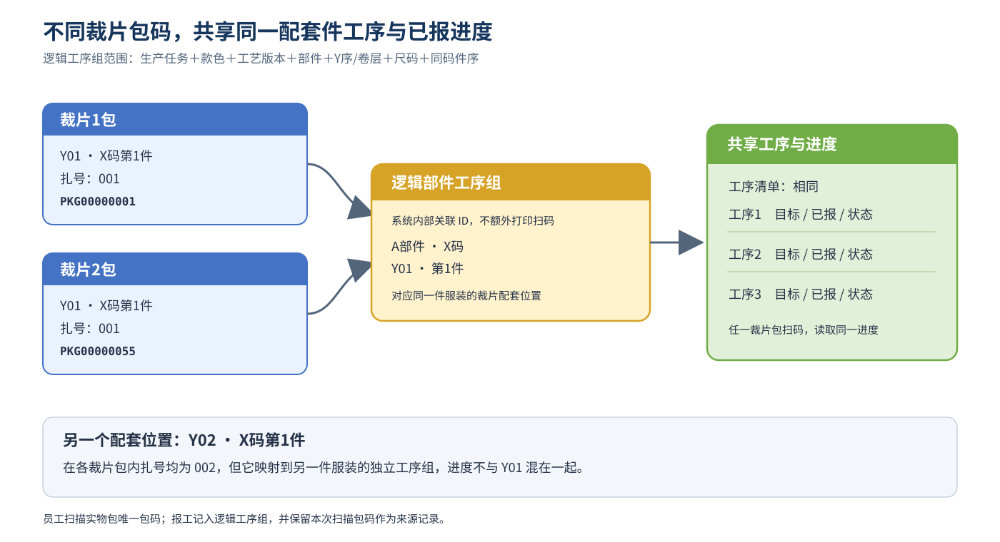
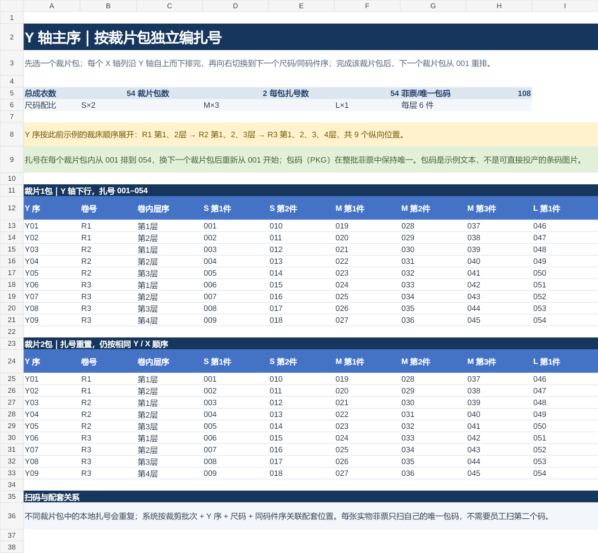

<!--
文件用途：织云 · 服装代工厂生产流程规划（需求基线 v1）
文件版本：v1
功能目的：明确服装加工从款式、订单、BOM、采购备料、生产任务到入库交付的业务基线。
设计思路：围绕本主题的目标、角色、业务流程、数据关系、模块边界和实施阶段组织内容，并区分已确认规则与待决事项。
实现方法：作为需求和实施基线维护；开发前拆分为功能任务，实施后按代码、数据库、权限和验收证据更新项目状态。
依赖与引用：Docs/规划/系统与流程/系统需求规划.md；Docs/规划/模块/模块-客户档案.md；Docs/项目记录/功能实现状态.md
初始开发人员：JY
初始开发时间：待追溯
当前责任人：JY
既有修改记录（2026-11-20）：规划文档归类；相关文档路径更新
既有修改记录（2026-11-21）：ZY-ERP-20261121-订单与生产计划联动规则；补充多计划拆分和变更影响分类
既有修改记录（2026-11-21）：部件包码报工语义；现已按实物包唯一条码与部件级报工关联修订
既有修改记录（2026-11-22）：ZY-ERP-20261122-分包模式一按裁片汇总；明确Y轴顺序、X轴尺码件序和裁片包内扎号重置
既有修改记录（2026-11-22）：ZY-ERP-20261122-部件尺码共享工序组；不同裁片包码映射到同一工序和已报进度
既有修改记录（2026-11-22）：ZY-ERP-20261122-共享工序组细化到配套件；按部件、Y序、尺码和同码件序区分每件服装
既有修改记录（2026-11-22）：ZY-ERP-20261122-分包与工序关联图示；加入模式一Y轴扎号矩阵和实物包码共享工序组图片
既有修改记录（2026-11-22）：ZY-ERP-20261122-分离包号底层逻辑与打印排序；扎号生成及报工匹配固定，模式只控制标签顺序
既有修改记录（2026-11-22）：ZY-ERP-20261122-修正分包模式二排序层级；曾记录为衣服件次→扎号→裁片包，后续由卷层排序规则细化替代
既有修改记录（2026-11-22）：ZY-ERP-20261122-记录模式二对分包计数的价值；按衣服件次组织报工，按件计提方案待复核
既有修改记录（2026-11-22）：ZY-ERP-20261122-模式二标签显示衣服件次；打印尺码件序及Y位/层位供分包识别
既有修改记录（2026-11-22）：ZY-ERP-20261122-细化分包模式二排序轴；按尺码件序、卷号层数、裁片顺序打印
既有修改记录（2026-11-22）：ZY-ERP-20261122-区分尺码配比序与实际衣服件次；标签不再把配比位称为第几件
既有修改记录（2026-11-22）：ZY-ERP-20261122-模式二打印路线示例；增加含用户原始手绘图的工作簿索引
既有修改记录（2026-11-22）：ZY-ERP-20261122-确认模式二名称；按尺码配比位纵向、整衣配套打印
既有修改记录（2026-11-22）：ZY-ERP-20261122-优化模式二名称；按尺码配比位整衣配套纵向打印
既有修改记录（2026-11-22）：ZY-ERP-20261122-确认模式二名称；按尺码配比位整衣配套横向打印
既有修改记录（2026-11-22）：ZY-ERP-20261122-模式三手绘图整理；按尺码配比位→裁片→Y轴卷层纵向打印
既有修改记录（2026-11-22）：ZY-ERP-20261122-模式一手绘图标准示例；裁片包→配比位→Y轴卷层
既有修改记录（2026-11-22）：ZY-ERP-20261122-松布记录移动端照片留存；照片关联布卷明细
既有修改记录（2026-11-22）：ZY-ERP-20261122-松布逐卷订单款号可选关联
既有修改记录（2026-11-22）：ZY-ERP-20261122-松布布卷订单款号批量编辑
既有修改记录（2026-11-22）：ZY-ERP-20261122-松布版本、工时、库位、等待和审批闭环
既有修改记录（2026-11-22）：ZY-ERP-20261122-松布由仓库常规人员执行且不计工序提成
既有修改记录（2026-11-22）：ZY-ERP-20261122-松布工价零值与未来生效版本
既有修改记录（2026-11-22）：ZY-ERP-20261122-工序计价能力与款式版本单位分层
既有修改记录（2026-11-22）：ZY-ERP-20261122-小组核算口径待确认；区分排产小组与工资核算基数
既有修改记录（2026-11-22）：ZY-ERP-20261122-工艺路线列表与画布双视图；款式路线节点及吊挂映射按企业配置
既有修改记录（2026-11-22）：ZY-ERP-20261122-工艺路线画布范围复核；列表作为主编辑，交互式路线画布待代表性路线验证
既有修改记录（2026-11-22）：ZY-ERP-20261122-前序继承与数量约束画布展示；列表维护规则，画布只读呈现
既有修改记录（2026-11-22）：ZY-ERP-20261122-区分工序顺序与前序依赖；线下缝制可独立，后整按路线建立数量关系
既有修改记录（2026-11-22）：ZY-ERP-20261122-前序继承默认关闭；继承时按前序可用数量强制拦截
既有修改记录（2026-11-22）：ZY-ERP-20261122-前序依赖支持多选；多个前序的汇合和数量计算待确认
既有修改记录（2026-11-22）：ZY-ERP-20261122-明确工段工序关联对象；裁剪关联裁床/布卷，缝制按裁剪类型关联部件，后整关联整衣/后整批次
既有修改记录（2026-11-22）：ZY-ERP-20261122-明确后整数量基准；成品检前以收货点数为基准，成品检后按合格数或逐工序承接
既有修改记录（2026-11-22）：ZY-ERP-20261122-前序关系支持批量设置；支持统一指定前序或逐节点继承紧邻前序
既有修改记录（2026-11-22）：ZY-ERP-20261122-工序顺序支持调整；列表提供上下移动及拖动排序，线上顺序用于吊挂下发
既有修改记录（2026-11-22）：ZY-ERP-20261122-工艺路线画布参与配置；画布与列表同源编辑顺序、适用对象及前序关系
既有修改记录（2026-11-22）：ZY-ERP-20261122-工价支持款式工艺磨合与生效版本；修订旧“全局当前价回算”口径
既有修改记录（2026-11-22）：ZY-ERP-20261122-工价调整范围；明确已报工后调价的三种影响范围和工资重算边界
既有修改记录（2026-11-23）：ZY-ERP-20261123-员工激励计划方向；区分基础工价调整、限期增量奖励和个人日产能阶梯激励
既有修改记录（2026-11-23）：ZY-ERP-20261123-阶梯激励算法按计划选择；计划逐单指定达档整日计算或分档累进计算
既有修改记录（2026-11-23）：ZY-ERP-20261123-员工激励增加达标定额奖励；区分按单位增量和达标固定奖金
既有修改记录（2026-11-23）：ZY-ERP-20261123-激励计划奖励类型互斥；每份计划只能选择一种奖励算法
既有修改记录（2026-11-23）：ZY-ERP-20261123-员工激励计划统一命名；不使用“活动”作为功能名称
既有修改记录（2026-11-23）：ZY-ERP-20261123-员工激励计划一期范围；师带徒纳入一期，其他候选暂缓开发
既有修改记录（2026-11-23）：ZY-ERP-20261123-报工应计工资实时预览；区分员工实时查看与工资周期结算
既有修改记录（2026-11-23）：ZY-ERP-20261123-员工工资明细分项展示；逐项列明普通提成、计划奖励、调整项及周期合计
既有修改记录（2026-11-23）：ZY-ERP-20261123-调价范围命中旧报工即重算；同步更新报工适用工价、应计金额及员工预览
既有修改记录（2026-11-23）：ZY-ERP-20261123-工价追溯采用开放式生效起点；第三种范围从已有报工日期起重算并持续生效
既有修改记录（2026-11-23）：ZY-ERP-20261123-工价追溯起点采用报工业务发生时间；按系统时间精度从指定报工起开放生效
既有修改记录（2026-11-23）：ZY-ERP-20261123-工价追溯起点支持区间内任意选时；从最早有效报工至调价生效时刻按业务时间重算
既有修改记录（2026-11-23）：ZY-ERP-20261123-生产期间新增工序影响范围；按工段、插入位置、前后依赖及生产计划选择范围
既有修改记录（2026-11-23）：ZY-ERP-20261123-工艺版本计划选择、完结计划返工分支；新增工序按依赖配置而非工段名称处理
既有修改记录（2026-11-23）：ZY-ERP-20261123-款式工艺节点停用与删除条件；计划/任务引用或已有报工时禁止删除
既有修改记录（2026-11-23）：ZY-ERP-20261123-修正工艺节点删除判断；无报工可删除且计划引用时需确认影响，有报工只可停用
既有修改记录（2026-11-23）：ZY-ERP-20261123-工序拆分专用变更；关联源工序、替代工序并承接数量与工资配置
既有修改记录（2026-11-23）：ZY-ERP-20261123-工序拆分界面及承接校验；勾选源节点拆分、配置替代节点和计划范围，保留源节点状态与工资影响预览
既有修改记录（2026-11-23）：ZY-ERP-20261123-工序拆分数量继承与工价独立设定；已完成量作为各替代节点进度基线，子工序工资合计可调整
既有修改记录（2026-11-23）：ZY-ERP-20261123-工序一对一替换及报工迁移；旧有效报工转归替代工序，按新工价重算并保留原工资审计
既有修改记录（2026-11-23）：ZY-ERP-20261123-一对一替换限定作业内容不变；作业变化转新增或拆分流程
既有修改记录（2026-11-23）：ZY-ERP-20261123-工艺方案与版本分层；既有方案修改生成新版本，只有用户手动新增才创建新方案
既有修改记录（2026-11-23）：ZY-ERP-20261123-方案默认版本视图与变更报表；作业内容变化的一对一替换支持返修重做或仅切换后续报工
既有修改记录（2026-11-23）：ZY-ERP-20261123-调整单审核通过即生效；按计划范围和生效边界切换方案版本或重算工资
既有修改记录（2026-11-23）：ZY-ERP-20261123-审核生效后按调整内容分流执行；区分版本切换、工资重算、报工迁移、返修重做与后续新报工
既有修改记录（2026-11-23）：ZY-ERP-20261123-排产任务转派与调整留痕；生效任务的修改使用独立调整单，转派只处理未完成量
既有修改记录（2026-11-23）：ZY-ERP-20261123-外协范围与供应商归属；计划可直接生成外协单，生效厂内任务转外协走排产调整单，外协厂只在外协订单维护
既有修改记录（2026-11-23）：ZY-ERP-20261123-生产计划时间调整归属；计划工段时间通过生产计划调整办理，不并入排产任务转派
既有修改记录（2026-11-23）：ZY-ERP-20261123-生产计划变更与客户订单修改联动；客户要求改订单数量时先修改客户订单，计划调整引用已生效的订单修改；对外承诺交期变化须先取得客户确认
既有修改记录（2026-11-23）：ZY-ERP-20261123-计划调整联动排产任务数量与日期读取；计划数量变化在计划调整中联动任务分配，任务工段日期读取当前计划
既有修改记录（2026-11-23）：ZY-ERP-20261123-计划数量调整由人工分配到排产任务；增减均选择具体任务/小组，生效任务通过引用计划调整的任务调整单留痕
既有修改记录（2026-11-23）：ZY-ERP-20261123-订单计划任务分层调整与引用；各层可独立发起调整单，下层变更可引用直接上层已生效调整单
既有修改记录（2026-11-23）：ZY-ERP-20261123-客户交期先改订单再改计划；内部阶段日期变化且客户承诺交期不变时只调整生产计划
既有修改记录（2026-11-24）：ZY-ERP-20261124-实裁单支持合并多订单多任务；按单床实际作业记录多条 PO、订单及裁剪任务来源
既有修改记录（2026-11-24）：ZY-ERP-20261124-客户订单多PO交期口径；当前按一个 PO 对应一个交期作为默认生产计划单位，同一客户订单内不同 PO 可有不同交期
既有修改记录（2026-11-24）：ZY-ERP-20261124-多PO合并生产至后整分流；裁剪和缝制可合并生产，进入后整时按 PO 分配数量
既有修改记录（2026-11-24）：ZY-ERP-20261124-后整分流要求每件成衣标识 PO；标识是否独立序列化及采用何种形式待定
最近修改人员：Codex（智能体，按JY确认事项整理）
AI辅助工具：Codex（智能体，执行规划文档更新）
最近修改时间：2026-11-24
修改标记：ZY-ERP-20261124-后整分流要求每件成衣标识 PO
既有测试记录（2026-11-20）：内部文档链接核验通过；未执行业务代码测试
既有测试记录（2026-11-21）：未执行代码测试；本次仅补充部件包码业务语义并交叉核对相关规划条款
既有测试记录（2026-11-21）：已按用户修正实物包条码及部件归属关系；未执行代码测试
既有测试记录（2026-11-22）：按三卷九层、S×2/M×3/L×1的示例核对Y/X编号矩阵和两裁片包重置规则；文档条款交叉核对通过；未执行代码测试
既有测试记录（2026-11-22）：共享工序组、已报进度和唯一包码的业务关系与第15.6、15.11节交叉核对；未执行业务代码测试
既有测试记录（2026-11-22）：按部件、Y序、尺码和同码件序核对跨裁片包的配套件工序组范围；未执行业务代码测试
既有测试记录（2026-11-22）：模式一扎号矩阵图目视核对通过；工序组关系SVG结构及相对文件引用核对通过；未执行代码测试
既有测试记录（2026-11-22）：固定扎号生成、工序组匹配与两种标签打印顺序分层核对通过；未执行代码测试
既有测试记录（2026-11-22）：模式二按衣服件次→扎号→裁片包顺序与当时确认内容交叉核对；该版排序层级已由后续尺码件序→卷层→裁片规则替代；未执行代码测试
既有测试记录（2026-11-22）：模式二的衣服件次计数价值与现有按裁片包计提规则标记为待复核；未执行代码测试
既有测试记录（2026-11-22）：模式二标签衣服件次标识按实裁单/床次、Y位/层位、尺码和同码件序表达；与既有配套关联字段交叉核对；未执行代码测试
既有测试记录（2026-11-22）：按3卷（2/3/4层）核对模式二的尺码件序→卷层→裁片打印顺序及001–054既有扎号；未执行代码测试
既有测试记录（2026-11-22）：尺码配比序与卷层实际衣服件次的标签术语区分核对通过；未执行代码测试
既有测试记录（2026-11-22）：模式二工作簿索引路径、导出重读及嵌入的用户手绘截图核验通过；业务验收待JY确认；未执行业务代码测试
既有测试记录（2026-11-22）：按确认名称同步工作簿总览、流程图和规划文档；导出重读、54个配套位置、324张菲票、底层扎号一致性、原始截图和文件完整性核验通过；未执行业务代码测试
既有测试记录（2026-11-22）：按最新名称“按尺码配比位整衣配套纵向打印”同步工作簿、流程图及规划文档；导出重读、54个配套位置、324张菲票、底层扎号一致性、原始截图嵌入和文件完整性核验通过；未执行业务代码测试
既有测试记录（2026-11-22）：按最终确认名称“按尺码配比位整衣配套横向打印”核验工作簿、规划文档和索引一致；通过54个配套位置、324张菲票顺序、固定扎号公式、唯一包码、原始截图嵌入和XLSX完整性检查；未执行业务代码测试
既有测试记录（2026-11-22）：模式三讨论稿按3部件、6裁片、6个配比位、3卷9层展开；36个连续打印段、324张菲票顺序、固定扎号公式、唯一包码、原始手绘图和XLSX完整性核验通过；未执行业务代码测试
既有测试记录（2026-11-22）：模式一标准示例按6个裁片包、6个配比位、3卷9层展开；36个连续打印段、324张菲票顺序、固定扎号公式、唯一包码、原始手绘图、工作簿导出重读和XLSX完整性核验通过；未执行业务代码测试
最近测试时间：2026-11-23
测试人员：未执行业务代码测试；本次为规划文档规则更新
既有测试记录（2026-11-22）：模式一示例工作簿核验记录保留；松布入口和逐卷记录要求已补入规划，松布时间含义及工资计薪规则待厂内确认；未执行业务代码测试
既有测试记录（2026-11-22）：模式一标准示例工作簿的36个打印段、324张菲票顺序、固定扎号公式、唯一包码、原图嵌入、导出重读和XLSX完整性核验通过；模式三仍为讨论稿；未执行业务代码测试
既有测试记录（2026-11-22）：松布多入口、逐卷信息和时间待确认事项已补入规划；与拉布和实裁单先后关系交叉核对；未执行业务代码测试
既有测试记录（2026-11-22）：松布多卷批量关联/修改订单规则已写入规划；款号由关联单据带出，字段非必填；未执行业务代码测试
既有测试记录（2026-11-22）：松布登记多入口、逐卷时间字段及人员关联条款与拉布和实裁单先后关系交叉核对；未执行业务代码测试
既有测试记录（2026-11-22）：松布照片逐卷关联、移动端拍摄/上传和网页端查看要求已写入规划；未执行业务代码测试
既有测试记录（2026-11-22）：松布照片是否每卷必拍及具体拍摄内容仍待现场确认；未执行业务代码测试
既有测试记录（2026-11-22）：松布逐卷订单/款号字段存在且非必填，订单关联带出款号的规则已写入规划；未执行业务代码测试
既有测试记录（2026-11-22）：松布多卷批量订单关联及变更留痕要求已补入规划；未执行业务代码测试
既有测试记录（2026-11-22）：已将松布工艺版本、地点与库存流转、多人分段计时、静置等待、提前放行审批及照片规则写入规划；松布具体时长和工资算法待厂内确认；未执行业务代码测试
既有测试记录（2026-11-22）：松布登记规则与拉布前置校验已交叉核对；本次仅修改规划文档，`git diff --check` 通过；未执行业务代码测试；具体松布时长和工资算法待厂内确认
既有测试记录（2026-11-22）：松布不计工序提成、由仓库常规人员执行的规则已写入；未执行业务代码测试
既有测试记录（2026-11-22）：松布工价零值作为当前明确不计提成配置、未来工价按生效版本启用的规则已写入；本次仅修改规划文档，未执行业务代码测试
既有测试记录（2026-11-22）：小组核算列为待确认事项；已核对其与工序基础资料、款式工艺版本及排产小组指派的分层关系；文档差异检查通过，未执行业务代码测试
既有测试记录（2026-11-22）：工艺路线统一节点/依赖关系、列表与画布同源双视图及企业自定义吊挂工序映射已补入规划；文档差异检查通过，未执行代码测试
既有测试记录（2026-11-22）：复核路线编辑器范围；保留列表主编辑，交互式路线画布改列待验证项，裁片组合拖拽画布范围不变；文档差异检查通过，未执行业务代码测试
既有测试记录（2026-11-22）：每道工序可独立配置是否继承紧邻前序数量；后序无前序可用数量时拦截报工，累计报工受前序可流转数量限制；只读画布按列表规则展示依赖；文档差异检查通过，未执行业务代码测试
既有测试记录（2026-11-22）：确认列表顺序与工序依赖分开配置；线下缝制可无前序依赖，后整链按配置继承前序数量；画布只展示实际依赖边；文档差异检查通过，未执行业务代码测试
既有测试记录（2026-11-22）：继承默认关闭；启用节点继承时前序无可用数量必须拦截，后序累计报工受前序可流转数量限制；更新后整旧有默认继承/软提示口径，文档差异检查通过，未执行业务代码测试
既有测试记录（2026-11-22）：款式工艺节点可配置一个或多个更早工序为前序；多个前序的全满足关系与数量合并方案列为待确认，文档差异检查通过，未执行业务代码测试
既有测试记录（2026-11-22）：同步修正后整章节的紧邻前序旧表述，使其支持选择一个或多个更早工序；多前序汇合及数量折算仍列为待确认；`git diff --check` 通过，未执行业务代码测试
既有测试记录（2026-11-22）：工段工序关联对象已按裁剪、缝制、后整区分；缝制部件下允许没有适用工序；与款式工艺、包码工序组规则交叉核对；`git diff --check` 通过，未执行业务代码测试
既有测试记录（2026-11-22）：后整收货点数作为工序数量基准、成品检后按合格数或逐工序承接已补入；区分数量上限与工序前置约束；成品检前置节点仍待确认；`git diff --check` 通过，未执行业务代码测试
既有测试记录（2026-11-22）：工艺节点前序关系支持批量统一选择指定的更早工序，或按每个节点单独选择路线中紧邻的前序工序；默认仍关闭，`git diff --check` 通过，未执行业务代码测试
既有测试记录（2026-11-22）：工艺路线列表增加上移、下移和拖动排序要求；核对其与线上工序下发顺序、显式前序依赖及画布只读范围一致；`git diff --check` 通过，未执行业务代码测试
既有测试记录（2026-11-22）：工艺路线配置改为列表与可编辑画布双视图同源；校核画布顺序、适用范围、数量来源和显式前序关系各自表达，保留列表批量设置能力及画布布局不单独生成第二套数据；`git diff --check` 通过，未执行业务代码测试
既有测试记录（2026-11-22）：款式工艺草稿可在磨合期调整工价；正式版本价格快照及工资核算规则已修订为版本化，替换旧有全局当前价回算条款；生产中途变更的适用边界列为待确认；交叉核对松布工价规则和样衣工艺版本，`git diff --check` 通过，未执行业务代码测试
既有测试记录（2026-11-22）：工价调整单已按“追溯已有及后续报工、仅影响调整后新增报工、按报工日期范围生效”三种方式补入规划；核对与工艺版本、报工价格依据及工资单留痕条款一致；`git diff --check` 通过，未执行业务代码测试；已结工资差额处理待确认
既有测试记录（2026-11-23）：JY确认追溯调价命中已结工资时，差额进入下一工资周期；补充限期增量奖励和个人日产能阶梯激励规划方向，阶梯计价口径待确认；`git diff --check` 通过，未执行业务代码测试
既有测试记录（2026-11-23）：已确认每个阶梯激励计划自行选择达档整日计算或分档累进计算，系统按计划所选规则核算；仅修改规划文档，`git diff --check` 通过，未执行业务代码测试
既有测试记录（2026-11-23）：新增达标定额奖金作为独立奖励类型，不改工价；记录阶梯奖金最高档/逐档累计的计划口径及报工更正后的奖金重算要求；`git diff --check` 通过，未执行业务代码测试
既有测试记录（2026-11-23）：JY确认每份激励计划只能选择按单位增量奖励或达标定额奖励中的一种；同一奖励类型可设置多个档位，不混合两套算法；`git diff --check` 通过，未执行业务代码测试
既有测试记录（2026-11-23）：按JY确认将该功能统一称为“员工激励计划”，清除“活动价/激励活动”作为功能名称的表述；`git diff --check` 通过，未执行业务代码测试
既有测试记录（2026-11-23）：按JY确认将师带徒计划纳入员工激励计划一期；连续达标、急单/瓶颈支援、工段协同、多能工和节料改善仅记录待评估、不进入一期代码实现；`git diff --check` 通过，未执行业务代码测试
既有测试记录（2026-11-23）：明确有效报工保存/更正/作废后实时更新报工关联应计工资及激励明细；员工预览与工资周期结算、结算锁定分开；`git diff --check` 通过，未执行业务代码测试
既有测试记录（2026-11-23）：员工手机端工资预览明确按工资项目和激励计划逐项展示金额、计算依据、周期合计及结算状态；`git diff --check` 通过，未执行业务代码测试
既有测试记录（2026-11-23）：已明确工价调整单命中既有报工时须重算报工当前适用工价和应计金额并更新员工预览；已结工资单保留原结算并以工资调整项补差；`git diff --check` 通过，未执行业务代码测试
既有测试记录（2026-11-23）：第三种工价调整范围改为仅选已有有效报工的业务日期作为追溯起点，无结束日期；当日起重算既有报工并更新当前有效基础工价，未来报工继续使用新价；`git diff --check` 通过，未执行业务代码测试
既有测试记录（2026-11-23）：将第三种模式起点粒度修正为已有报工的业务发生时间，按系统记录精度匹配并包含起点报工；不以报工录入/保存时间作为范围条件；`git diff --check` 通过，未执行业务代码测试
既有测试记录（2026-11-23）：第三种模式改为可在该节点最早有效报工业务发生时间至调价生效时刻之间任意选择起点，不要求命中已有报工时间；核对所选区间内既有报工重算、区间外既有报工不变、后续新报工持续用新价；`git diff --check` 通过，未执行业务代码测试
既有测试记录（2026-11-23）：已把生产期间新增工序按线下无依赖与后整有依赖分别定义；确认旧菲票扫描可提交正常工序报工、后序历史报工保留且新依赖只约束后续报工，并记录生产计划版本展示和多选范围；`git diff --check` 通过，未执行业务代码测试
既有测试记录（2026-11-23）：补充新建计划默认最新已发布工艺版本但可选历史版本；完结计划纳入时提示工资结算及重算选择并进入整批返工分支；新增工序统一按依赖配置处理所有工段；`git diff --check` 通过，未执行业务代码测试
既有测试记录（2026-11-23）：工艺节点仅在所属工艺单/版本未被任何生产计划或任务引用且该节点无报工时允许删除；其他情况只能在限定范围内停用，并保留历史报工和依赖记录；`git diff --check` 通过，未执行业务代码测试
既有测试记录（2026-11-23）：修正工艺节点删除条件为无对应报工记录即可删除（即使有计划引用也可，但须确认并更新受影响计划依赖），存在对应报工记录时只能停用；`git diff --check` 通过，未执行业务代码测试
既有测试记录（2026-11-23）：工序拆分已定义为专用变更流程，需关联源/替代节点、范围、排序及依赖，并提供数量与工资依据继承/分配配置；具体承接算法待确认；`git diff --check` 通过，未执行业务代码测试
既有测试记录（2026-11-23）：补充工艺列表勾选源节点发起拆分、配置多道替代工序属性/工价/依赖及计划范围；源节点有报工时保留“已拆分”历史状态，无报工时从当前路线移除且留变更记录；历史报工工资不回写，数量与工价继承算法列为待确认；`git diff --check` 通过，未执行业务代码测试
既有测试记录（2026-11-23）：确认原工序已完成数量默认作为每个替代节点的不计薪进度基线，源节点历史报工工资不回写；各替代工序独立设置工价，合计不强制等于源工价，需展示按单位和计划量估算的工资差额；`git diff --check` 通过，未执行业务代码测试
既有测试记录（2026-11-23）：补充一对一替换工序流程，迁移所选计划范围内有效旧报工至替代节点，工价变化时重算应计工资；已结工资通过后续工资调整项补差；`git diff --check` 通过，未执行业务代码测试
既有测试记录（2026-11-23）：明确一对一替换仅适用于实际作业内容不变的名称/节点规范替换；作业内容变化转新增或拆分流程；`git diff --check` 通过，未执行业务代码测试
既有测试记录（2026-11-23）：明确款式、工艺方案、工艺方案版本的层级；既有方案的调整单审批后生成该方案的新版本，只有用户手动新增方案时才建立另一方案；计划按方案及版本引用，范围外计划保留原引用；`git diff --check` 通过，未执行业务代码测试
既有测试记录（2026-11-23）：方案详情默认展示当前最新版本和工序内容，历史版本经独立入口访问；新增独立工艺变更记录报表字段与筛选口径；一对一替换扩展为同内容更名迁移及作业内容变化后的返修重做/仅后续报工两分支，并保留原记录和工资依据；`git diff --check` 通过，未执行业务代码测试
既有测试记录（2026-11-23）：确认工艺/工价调整单审核通过即生效，无独立二次发布步骤；草稿和待审核状态不改变生产引用，按单据计划范围及生效点执行；`git diff --check` 通过，未执行业务代码测试
既有测试记录（2026-11-23）：明确调整单审核生效后按调整内容与所选分支触发对应流程，覆盖方案版本/计划切换、工资重算、报工迁移、返修重做或仅新报工切换；处理结果关联调整单留痕；`git diff --check` 通过，未执行业务代码测试
既有测试记录（2026-11-23）：确认订单审核后自动生成生产计划草稿，计划与工段排产任务分层；裁剪组自行决定床次和拉布量，实裁单引用裁剪任务；生效任务的修改走独立调整单，完工任务排除在转派范围外；本次为规划整理，未执行业务代码测试
既有测试记录（2026-11-23）：确认外协可覆盖整条路线、整个工段或指定工序；生产计划阶段外协可直接生成外协订单，生效厂内任务转外协通过排产任务调整单关联外协订单，外协厂仅在外协订单维护；`git diff --check` 通过，未执行业务代码测试
既有测试记录（2026-11-23）：确认生产计划的阶段时间变更归生产计划调整单，排产任务调整单处理任务分配/转派；更新后执行 `git diff --check`，未执行业务代码测试
既有测试记录（2026-11-23）：补充生产计划与客户订单变更联动；生产目标数量的内部调整记录订单需求与投产差异，客户要求修改数量时先审核客户订单变更，再由计划调整引用该变更；涉及客户承诺交期时须先记录客户确认，内部阶段时间变化且不影响承诺交期时不要求客户确认；`git diff --check` 通过，未执行业务代码测试
既有测试记录（2026-11-23）：确认生产计划数量调整须在计划调整单中联动调整各关联排产任务的数量分配，保留已完成报工；排产任务的交期和工段日期从当前生产计划只读获取，不在任务单维护；`git diff --check` 通过，未执行业务代码测试
既有测试记录（2026-11-23）：明确生产计划增减量均由经办人选择具体小组/任务手动调整；生效任务数量通过引用生产计划调整的排产任务调整单留痕，减少量不得覆盖已完成或已锁定在制数量；`git diff --check` 通过，未执行业务代码测试
既有测试记录（2026-11-23）：确认客户订单、生产计划、生产任务均可独立发起调整单，计划调整可引用客户订单调整、任务调整可引用生产计划调整；上层调整不静默改写下层，日期继续由任务读取当前计划；`git diff --check` 通过，未执行业务代码测试
既有测试记录（2026-11-23）：明确客户承诺交期变更须先经客户确认并通过客户订单调整单更新交期，再由生产计划调整单引用并调整阶段日期；仅改内部节点日期且客户交期不变时不改客户订单；`git diff --check` 通过，未执行业务代码测试
既有测试记录（2026-11-24）：确认一张实裁单/一床可合并多个订单、PO 和裁剪任务，按款号及录入人员授权部门/小组筛选来源；保留单床仅一个料种并记录多来源任务的色码数量归属；`git diff --check` 通过，未执行业务代码测试
既有测试记录（2026-11-24）：补充客户订单与 PO 的交付口径：一个客户订单可包含多个 PO，默认一个 PO 对应一个交期/交付批次；生产计划按 PO 默认拆分，同一订单内各 PO 的交期分别维护，并为单个 PO 的多交期保留扩展口径；`git diff --check` 通过，未执行业务代码测试
既有测试记录（2026-11-24）：确认多 PO 合并生产的 PO 分流节点为进入后整时；记录车缝成衣现以颜色线区分 PO，系统标识方式及单件/扎包/框箱粒度待细化；`git diff --check` 通过，未执行业务代码测试
既有测试记录（2026-11-24）：确认 PO 分流后每件成衣都须有可识别所属 PO 的实物标识；尚未决定标识形式、是否每件唯一编码或是否需要逐件扫码；`git diff --check` 通过，未执行业务代码测试
既有修改记录（2026-11-24）：ZY-ERP-20261124-衣拿吊挂 PO 识别打印工具一期方案；新增一号车间独立工具规划，明确直读吊挂产线数据库及尾查合格后自动打印。
既有测试记录（2026-11-24）：记录用户提供的衣拿计划选择页验证截图；同一测试线计划号的多颜色尺码明细可显示，现场产线数据回传和标签打印尚未测试。
既有修改记录（2026-11-24）：ZY-ERP-20261124-车间能力与生产方案适配；生产任务按车间/产线能力筛选工艺方案，AGV 与吊挂外部系统实例分层绑定。
既有测试记录（2026-11-24）：新增车间/产线能力、路线选择及多版本吊挂/AGV 集成规划；本次仅整理需求文档，未执行软件或现场接口测试。
既有修改记录（2026-11-24）：ZY-ERP-20261124-多系统集成数据契约标准化；明确 ERP 统一业务字段、稳定标识、类型/单位/枚举口径及吊挂/AGV 外部标识映射要求。
既有测试记录（2026-11-24）：新增多系统字段契约与适配器映射约束；文档格式检查通过，未执行代码、数据库或现场接口测试。
既有修改记录（2026-11-24）：ZY-ERP-20261124-裁剪多 PO 柔性合并与分流；实裁单支持多选兼容订单/PO/任务，不强制按 PO 拆床，裁剪数量可在来源明细分配或留待后续 PO 分流节点确认。
既有测试记录（2026-11-24）：补充多 PO 合并裁剪、来源数量分配与待分配数量约束；`git diff --check` 通过，未执行实裁单代码或现场流程测试。
测试状态：工序基础资料的计价方式能力、款式工艺版本的核算基数/执行方式/计量单位/工价、报工取版本及逐节点前序依赖配置已写入；工序节点默认不设前置依赖，支持批量统一指定一道更早工序，或逐节点批量设置为所在路线的紧邻前序；路线顺序支持列表上下移动、拖动排序及画布内调整，线上节点按生效顺序下发；列表与画布编辑同一款式工艺版本，列表支持精确字段及批量设置，画布展示/配置工段与适用范围、业务顺序、数量基准和显式前置依赖；调整顺序不自动改写前序依赖，依赖次序冲突及企业配置的吊挂首末工序约束须校验；款式工艺在草稿/磨合期可调整工价，正式生产中途调整节点工价通过工价调整单，并选择全量追溯已有及后续报工、仅影响调整后新报工或在该节点最早有效报工至调价生效时刻之间任意选择追溯起点并持续生效；命中范围内既有报工的适用工价和应计金额重新计算并更新员工实时预览；报工保存工价调整依据，调价后重算受影响报工的应计提成并更新未结工资预览，已结工资单不静默覆盖，追溯差额生成工资调整项并进入下一工资周期；工资核算不得追取全局最新价覆盖历史报工；员工激励计划与基础工价分开；有效报工保存/更正/作废后实时更新员工未结应计工资预览，工资端按项目显示金额、依据、周期合计和结算状态，正式结薪按工资周期复核并锁定；一期包含按单位增量、达标定额、个人日产能阶梯奖励和师带徒计划；师带徒使用定额奖金并根据徒弟有效报工达标触发；连续稳定达标、急单/瓶颈支援、工段协同、多能工、节料改善仅记录待评估、不进入一期代码实现；激励计划奖励类型可设为按单位增量或达标定额奖金；单位增量可选达档整日计算或分档累进；定额奖金可选只发最高档或逐档累加；每份激励计划只能选择一种奖励类型，同一类型内可设多个档位；跨午夜班次的归属日期口径待确认；裁剪工序按布卷/裁床等对象、缝制工序按裁剪类型关联部件、后整工序按整衣/后整批次关联；后整成品检前各工序可各自以收货点数作为数量上限基准，成品检后可按检验合格数或逐工序承接；数量基准不代替必须完成的工序依赖，成品检自身的前置节点待确认；缝制部件可无适用工序；小组核算的具体工资含义和组内分配算法待厂内真实工资样本确认；前序依赖启用后按前序可流转数量拦截；多前序为少数扩展场景，其全满足关系与数量合并规则待实际路线确定；工艺路线布局细节待代表性款式验证；生产期间新增工序根据节点是否配置前后依赖处理，计划默认最新已发布工艺版本且保留历史版本选择；变更可按工艺版本多选关联计划，旧菲票可报正常新增节点记录，后续依赖变更不影响历史报工；已完结计划纳入时提示工资结算状态及重算选择并进入整批返工分支；款式工艺节点有任何对应报工时只能停用；无对应报工时可删除，即使计划已引用也须先确认计划影响并更新依赖；工序拆分由列表勾选源节点发起，配置多个替代节点属性、工价、依赖和计划范围；有报工的源节点保留“已拆分”历史状态，无报工时从当前路线移除并留变更记录；已完成量默认承接到各替代节点作为不计薪进度基线，源节点历史工资不回写；替代节点工价独立设定、合计不强制等于原工价，并预览工资差额；一对一替换支持实际作业内容相同的更名迁移（按新工价重算）及作业内容变化后的返修重做/仅后续报工切换两分支；后者不伪迁移旧报工，返修产生新报工，旧记录与工资依据留痕；工艺数据按款式、工艺方案、工艺方案版本分层，修改既有方案审批发布后递增该方案版本，不自动新增方案；仅用户手动新增方案时创建新方案，计划按方案和版本留存引用及生效切换记录；本次仅修改规划文档，未执行业务代码测试
-->
# 织云 · 服装代工厂生产流程规划（需求基线 v1）

> 版本：v1（定稿基线）
> 更新日期：2026-11-24
> 说明：本文档为**织云**项目的生产流程需求基线，记录与用户逐条确认后的全流程设计，作为开发蓝图。
> 旧项目（ponytail_erp）已废弃，新项目从零起步，本文档 + 吊挂对接字典（7R/IDS）为唯一交接基线。

---


> **单据"归属公司"字段**：订单/采购申请单/报销单/发货单 每张单据带一个 `归属公司`（选 品牌档案 里的一项），**开单时定、之后锁定**；打印/报表抬头、开票主体、走哪个公司账 都读它（见 前端规范 A.0"业务层"），**不随全局展示品牌切换而变**。
## 一、订单与跟单

### 1.1 业务模式
- 主做**代加工**，小部分是厂内自主加工。
- 接单链路：业务员接客户订单 → 分配给跟单员/理单员 → 跟单员创建生产订单 → 业务部主管审核。

### 1.2 客户提供资料
- 款式图、工艺单、BOM。
- 面料辅料大部分**客供**，小部分**自采**。
- 每个颜色每个尺码的数量由客户指定。

### 1.2a 套装订单配码与配色

套装档案维护组成和生产方式，各子款档案提供可用颜色尺码及有效规格组合。订单选择套装后，在订单／PO明细中设定本单各子款的颜色、尺码组合和套数，允许上衣与下装使用不同尺码。默认匹配明确的同名或均码选项，支持人工修改，保存时校验组成完整及规格有效。

订单确认后锁定实际配套快照，用料、裁剪、生产、吊挂及包装沿用同一组合关系。包装按订单组合核对配齐情况。已下发订单变更配套需核对实际执行数量并留痕。

系统按本单实际配套自动计算各子款的计划生产件数。每条套装规格明细按“订购套数 × 对应子款的每套件数”展开，再在订单／PO 内按子款、颜色、尺码汇总，相同子款的相同颜色尺码累加，并保留原套装规格明细以便包装核对。合并生产时在套装任务下展示子款数量明细，分开生产时按子款生成任务并带入各颜色尺码的数量。计划件数与实际完工件数分开记录。

### 1.3 冗余策略
- 裁剪按次品率**多裁一部分做冗余**；物料客户也按预算比例多给。
- 多裁比例由厂内定（技术部/厂长与裁床协商），**人工按比例计算**，系统只记录（比例值、多裁件数）；由谁填写通过角色权限控制。

### 1.4 供料标识
- 订单上打供料标识：**全客供 / 自采 / 混合**。
- “混合”表示订单或 PO 允许客供和自采两种入库来源，不在订单阶段把所有物料默认认定为客供；同一物料可以分不同来源收货。实际来源由入库单记录，并据此处理客户归属、采购订单和财务关联。
- 自采物料不做独立采购模块，走**轻量采购申请单**：物料、数量、金额、要求到货日期、状态（待采/已采/已入库），入库来源标记"自采"。
- 物料档案可维护库存单位及采购单位的参考价；采购、入库单分别保存可修改的实际价格和换算快照。成本核算默认移动加权平均，批次管理默认关闭且独立可配；按批次个别计价必须启用批次管理。详细业务口径与待实施边界见[采购价格、入库计价与库存成本](../模块/模块-财务与采购.md)。

### 1.5 交期
- 订单含**客户交期**。
- 交期前默认 **3~5 天**（配置项，不写死）产线需下线准备发货。
- 排产需结合交期双向核算（见第五节）。

### 1.6 订单拆分
- 订单可拆单（排单时指定，后期支持修改）。
- 支持**分批发货**：一个订单对多个 PO。

### 1.7 国家/地区与目的地（2026-11-03）
- 客户所在国家/地区、订单预计目的地、每批实际发货目的地分别记录，不能用客户所在地区替代目的地；例如国内外贸客户的订单可以发往国外。
- 三者引用统一国家/地区基础资料的稳定编码。选择地址时可带出目的地供人工确认和修改；单据应保存必要的名称与地址快照，基础资料改名或停用不改写历史事实。
- 一个订单可能有多个 PO、批次或实际目的地；订单录入时的多目的地颗粒度及必填规则，在订单功能开发前与订单/PO 模型一起确定，不预设一个客户只对应一个国家。
- “订单预计目的地”统计和“实际发货目的地”统计分开，实际发往哪里以发货明细为依据，避免一个多目的地订单重复计入件数或金额。
- 目前仅国家/地区资料和客户/地址选择已实现；订单、PO 和发货字段与报表在相应功能开发时实现。

---

## 二、到料计划（独立单据，不挂在生产任务单上）

### 2.1 定位
- 到料时间由跟单员与客户沟通后确定，**独立于生产任务单**存在，且比任务单更早产生。
- 原因：一个订单可能多 PO、多批物料，到料时间不同；到料时间会动态变化（客户迟了、船期变），需留痕。

### 2.2 单据内容
- 关联订单/PO，按物料类型（面布/里布/衬布/辅料）或批次登记：
  - 预计到货日期、实际到货日期、数量、备注
  - 支持修改留痕（谁改的、何时、从几号改到几号）

### 2.3 与计划部的联动
- 计划部排产视图自动汇总引用到料计划单数据（"该订单预计到料 X 月 X 日"）。
- 到料时间一旦修改 → 排产链自动重算，并提示"到料时间变动，排产需复核"。

---

## 三、生产计划与排产任务（按订单拆分计划、按工段分配任务）

### 3.1 生成与内容
- 客户订单审核通过后，按该订单下的 PO/交付批次生成一张或多张**生产计划草稿**。当前业务默认一个 PO 对应一个交期，生产计划以 PO 作为主要交付计划单位；同一客户订单下不同 PO 可分别设置交期。一张订单或一个 PO 均可按生产安排拆成多张计划，不设置禁止拆分的全局开关；若以后同一 PO 出现多个交期，可在该 PO 下再按交付批次拆分计划。生产计划确定实际投产数量、颜色尺码明细、款式工艺方案及版本，以及到料收仓、裁剪、缝制、后整包装等阶段的预计起止时间。
- 生产计划与排产任务分层：计划确认后，排产员按工段把计划工作量分配成一个或多个**排产任务**，明确对应车间/小组及任务数量。一个计划可在同一工段分给多个车间或小组；任务分配量按 PO、交期批次、款式、颜色和尺码等计划明细核对，不因分组而改变计划总量。
- 排产任务是现场执行的责任范围，不细分指派每一床、每次拉布或具体布卷。裁剪组接收裁剪任务后自行安排床次、布卷和拉布量；后续实裁单可按现场需要合并多个订单、PO 或裁剪排产任务，并在来源明细中分别记录实际分配量，以汇总各任务完成进度。
- 生产计划保留 PO 号、颜色尺码数量和各阶段时间节点；排产任务保留工段、车间/小组和分配数量。任务上展示的交期及工段预计起止时间，直接读取当前生产计划对应节点，只读显示，不在排产任务或任务调整单中另行维护。指派按具体工段适用的组织小组进行，不限定为缝制小组。
- **款式工艺方案与版本引用**：层级为“款式 → 工艺方案 → 工艺方案版本”。同一款式可有多个工艺方案，但只有用户手动执行“新增工艺方案”才创建另一方案；修改既有方案的工序、依赖、执行配置、工价等内容时，调整单审核通过后即在该方案内生成新版本和递增版本号，并按单据指定范围生效，不自动新建方案。每张生产计划记录并锁定采用的方案及精确版本；新建计划先选择方案，再默认带出该方案最新已发布版本，也可选择仍可用的其他版本。生产计划列表和详情显示方案及该计划当前实际引用的版本。生产计划列表支持按款式、方案和版本筛选。进入工艺方案时默认只显示该方案当前最新版本号和最新工序内容；查看历史版本通过单独入口进入，不在默认页面混列历史内容。修改产生的新版本不会静默替换已有计划的引用；变更单可明确选择纳入调整的计划及生效点，未纳入的计划继续引用原方案版本。

### 3.2 指派粒度
- 排产任务可按 PO、交付批次及颜色尺码等计划明细分配到车间和小组；需要跨组分配时，明确每组承担的数量。任务预计时间从当前生产计划对应工段读取，不在任务上单独设定。
- 任务下发支持按 PO 分批生产和多 PO 合并生产两种方式，按生产任务/任务组选择。按 PO 分批时，各 PO 的目标数量与交期独立跟踪；多 PO 合并时，可将兼容的 PO 生产计划按款式和颜色尺码等维度汇总数量下发，任务保留每个来源 PO/计划的数量、交期和阶段时间明细。裁剪及缝制阶段可按合并任务生产；进入后整时，经办人按 PO 和颜色尺码分配接收数量，建立 PO 专属的后整流转批次，保证后续进度和交付仍能分别核对。现行车缝成衣使用颜色线区分 PO；分流时每件成衣都必须带有可识别所属 PO 的实物标识。标识的具体形式、是否给每件成衣赋独立序列号，以及是否需要逐件扫码，待进一步确认。
- 系统结合任务量、生产计划当前工段时间和小组可用产能提示按期完成风险。超负荷时由排产人员选择加班/增班、员工激励计划、内部转派、外协或调整生产计划的工段时间等处置方式；系统记录处置结果并滚动更新完成预测。激励计划复用员工激励计划功能，外协走外协订单，内部任务分配/转派走排产任务调整单，计划工段时间调整走生产计划调整单。

### 3.3 数量口径与变更联动
- 客户订单数量是客户要求交付的数量；生产计划数量是厂内拟投产数量，可根据已确认的加放/损耗规则包含额外投产量。计划数量和客户订单数量分开保存，调整生产计划不得反向改订单。
- 客户订单的数量、款式/套装配套、颜色尺码或 BOM 变化时，系统展示影响并通知生产计划负责人复核所有关联计划；交期/交付批次变化通知计划员复核排期。复核后可确认无需调整，不要求每次订单修改都改写生产计划。
- 客供/自采/混合供料变化优先通知物料计划、采购和到料责任人；只有物料到位时间影响排期时才要求生产计划调整。业务员、跟单员、联系人、备注等责任或说明变化不触发生产计划数量或排期变更。
- 生产计划本身调整数量后，按订单、PO、款式色码汇总全部有效计划，核对预计合格量与客户需求，并同步复核物料需求；同时逐工段展示关联排产任务的原分配量、可调数量和计划调整后的目标分配量。无论计划量增加还是减少，都由经办人手动选择具体任务/小组及增减数量，系统不自动猜测由哪个小组承担新增量或被削减工作量。未生效的草稿任务可直接修改；已生效任务（即使尚未开工）的数量变化必须通过排产任务调整单办理，并引用对应的生产计划调整单。减少量不得超过任务尚未完成且未锁定在制的数量；已完成报工、实际产量、人员、时间和工资依据以及已登记锁定的在制数量不得被改写。若新计划目标低于已完成量或已锁定在制量，保留实际记录并提示超计划数量，转入后续处理，不强行压低任务量。调整车间、小组、批次或日期时只联动受影响的产能和物料需求时间，不无故改变订单数量或物料总量。
- 订单和生产计划均保留独立修订、前后值、调整原因及操作者。已投产、已完成、已领料或已有采购/收货记录的部分保留原事实；计划变更通过剩余量调整、补充计划或差额处理，不静默覆盖实际记录。若计划合计不足以满足订单，标示短产风险；若超过订单需求，标示预计余量并记录处理方式。
- **订单、计划、任务分层调整单**：客户订单、生产计划和生产任务各自支持独立发起本层调整单，也可在处理上层变化时引用直接上一级已生效调整单，关系为“客户订单调整单 → 生产计划调整单 → 排产任务调整单”。订单数量等客户要求变化时，先完成客户订单调整，再由计划调整引用该订单调整；客户承诺交期变化时也先在客户确认后通过客户订单调整单更新交期，再由计划调整单引用该调整并更新阶段排期；计划数量变化需人工调整已生效任务时，任务调整引用对应计划调整。引用只用于说明变更来源、建立追溯和核对影响，不改写上级单据，也不表示下级数据已自动调整；计划日期由任务读取当前计划，不另行产生任务日期调整。没有上级调整来源的内部计划/任务调整，需记录自身原因和影响范围。
- **排产任务生效后的修改**：排产任务尚未生效、仍处于草稿时可直接修改；任务一旦下达并生效，修改小组或任务数量都必须通过独立的排产任务调整单办理，不直接覆盖已生效任务字段。由生产计划目标数量变化引起的任务数量调整，也由经办人手动办理排产任务调整单，并引用对应生产计划调整单，确保计划变更和组别分配两边可追溯。任务的交期和工段预计日期始终读取当前生产计划，不作为任务调整字段；任务调整单及执行结果进入排产任务调整记录报表。调整单的审核/确认流程和生效节点另行细化。
- **生产计划时间调整**：各工段预计起止时间属于生产计划。调整工段时间、生产计划节点或计划整体时间范围，使用独立的生产计划调整单办理，不并入排产任务转派。关联排产任务上的日期随当前计划只读更新，不在任务单再次修改。若只调整内部工段时间且不改变客户承诺交期，只做生产计划调整，不改客户订单，也不要求客户确认；若要改变客户承诺交期，必须先与客户沟通并取得确认，再通过客户订单调整单更新订单交期，随后由生产计划调整单引用该订单调整并更新各阶段排期。客户确认人、时间、结果及沟通凭据保存在客户订单调整中，并由计划调整单关联追溯。计划调整单展示受影响的关联排产任务、后续工段时间及交期风险，并保留计划时间调整前后记录。
- **计划数量调整及客户订单联动**：生产计划调整单按变更类型显示所需字段，避免每类变更填写无关信息。仅因内部生产安排调整款式/颜色/尺码的投产目标数量，且不改变客户订单承诺数量时，无需客户确认；保留客户订单需求量、调整前后投产量、差异及原因，便于区分客户需求和厂内投产安排。若因客户要求修改订单数量或订单尺码明细，必须先通过客户订单修改流程形成已生效的订单变更记录，再创建生产计划调整并引用该订单变更；计划调整选择受影响的计划，按 PO、交付批次、款式、颜色和尺码核对订单新需求与关联计划数量，避免遗漏或重复调整。订单可拆成多张计划时，系统应展示本次变更覆盖的计划及调整后的汇总数量。
- 排产任务调整单处理排产任务的车间/小组分配、生产计划数量变化引起的任务增减、计划总量不变时的任务数量重新分配和内部转派；通过引用生产计划调整单，说明任务增减所依据的计划目标变化。任务日期从当前生产计划读取，不设独立执行窗口。
- **内部转派**：转派通过排产任务调整单办理，适用于尚未完工任务；已完工任务不进入转派范围。调整单记录来源任务、原小组、接收车间/小组、转派数量明细、原因和制单人。接收任务的工段日期读取当前生产计划对应节点。转派数量不得超过来源任务未完成且未重复转出的数量，并按 PO、交付批次、款式、颜色、尺码等维度校验；接收任务与来源任务建立关联，计划总量不变。
- 任务开工后只转派未完成工作量；已完成产量、报工人员、实际时间及工资归属保留在来源任务。涉及已形成在制品时，交接标识、数量和接收确认方式按对应工段继续细化；若实物存放位置随之变化，需关联相应库存/在制品位置流转记录。各转出、转入数量应可对账，不能重复计入两组的任务余额。
- **生产期间工艺变更的计划范围**：工序变更单默认选中引用目标方案及版本的全部关联生产计划，经办人可多选或取消选中以限定范围。审核通过是调整单进入生效状态的触发点：未审核通过的草稿/待审核单不改变计划路线、报工和工价；审核通过后，系统须根据调整内容、所选计划范围、生效点及替换分支，分流执行对应业务处理，不以单一“切换版本”动作代替全部处理。未另设生效时点时，以审核通过时间为生效点。结构或路线变更生成原方案新版本并按范围切换计划；工价变更按所选追溯范围重算报工金额并更新员工预览；作业内容相同的更名替换按报工迁移规则处理；作业内容改变时按经办人选择生成返修重做任务，或只让生效点后的新工作使用新工序和新工价。各处理结果均关联调整单留痕。调整单审核通过后即生成目标方案的新版本并生效；纳入计划按单据记录的生效点切换到新版本，未选计划继续引用原方案版本，历史报工、工价依据和已发布版本均保留。每张计划显示方案及版本供核对。若所选计划中含已完结计划，系统提示是否纳入，展示关联工资是否已结算，并询问是否需要重新核算工资；纳入时进入独立的整批返工分支，保留原计划和原报工记录，已结工资不静默改写，差额按工资调整规则处理。此处的版本调整不等同于新增工艺方案；只有用户显式新增方案时才创建新方案。

### 3.4 样衣环节
- 样衣**厂内制作**：需管控工期、制作阶段、报工、提成。
- 大货裁剪默认**锁在样衣确认之后**，做成**配置开关**（订单级或全局级），不写死。

---

## 四、动态产能核算模型

### 4.1 基本单位
**组 × 节点 × 产品难度系数**

`
订单在该组的预计完成天数
  = 订单件数 / (组基础产能 × 难度系数 × 工艺系数 × 品控系数)
`

### 4.2 产品难度标签（排产时打在订单上）
- 工序数（工艺单）
- 裁片数（BOM）
- 难度分级（A 简单 / B 中等 / C 复杂）
- 品控等级（普通 / 高 / 极高，如品牌客户 AQL 差异）
- 标签一旦定下，修改触发重算。

### 4.3 基础产能值来源
- 历史同类标签产品的实际产出（按标签匹配），订单完工后回写实际数据，逐步修正基础值。

### 4.4 边界
- 先做**组级产能**，不到工位级（3 车间多线时再细化）。
- 产能系数允许计划员手动覆盖，覆盖值留痕。

---

## 五、排产推荐（排产前系统给建议，人拍板）

按优先级降序加权：

1. **交期压力**：交期缺口风险分（预测完成 vs 交期差距、订单金额/客户重要度），高风险优先占组。
2. **组可用性匹配**：组可用日期 = 前序订单预测完工 + 换款洗机时间（配置项）；订单可开工日期必须 ≤ 组可用日期。输出示例："组 A 10/20 可用，缺口 0 天；组 B 11/1 可用，缺口 7 天"。
3. **产品标签匹配**：按历史做过的相似标签产品给组打匹配分（擅长品类、做过类似款）。
4. **负载均衡**：满足交期和匹配度前提下，优先派给负载低的组。

**输出形式**：
- 推荐方案 Top 1（建议组 + 建议开工日期 + 预计完成日期 + 交期风险标记）
- 备选方案 Top 2/3（如"交期紧张可拆 50% 给组 B"）
- 计划员接受 / 手动调整 / 记录不用推荐的原因（留痕用于优化推荐模型）

**边界**：推荐是建议不是自动执行；规则加权打分，不上机器学习；不做自动重排求解。

---

## 六、交期双向核算

- **正向**：到料时间 + 各节点标准时长 → 最早可发货日期。
- **反向**：交期 - 3~5 天下线准备期 → 最晚必须完成日期 → 倒推各节点最晚完成/最晚开始日期。
- **缺口校验**：最早可发货 > 最晚完成 → 标红"缺口 X 天"，提示动作：压缩节点 / 加组 / 拆单分流 / 提前到料。
- **交期修改**：客户改交期 → 跟单员修改 → 全链重算 + 重新提示风险；修改留痕。
- 完不成时生成**交期风险预警**，推送跟单员 + 业务主管，提醒与客户沟通；沟通结果在系统留痕（沟通内容本身不在系统做）。

---

## 七、组内订单串行联动

1. 组是最大产能单位，组内订单**串行**（同组同一时间做一条订单）。
2. 每组维护**订单队列**（按开始日期排序），含"当前订单剩余预计工时"（已完成件数、标准工速、难度系数估算）。
3. 前序订单实际延误 → 自动把"组可用日期"后移 → 后续订单开始日期顺延 → 传递到交期校验 → 打破交期则触发预警通知跟单员。
4. 前序订单完工关闭 → 滚动预测自动重算，后续订单可能提前恢复。

**每张任务单展示两组日期**：
- **计划日期**（最初排的）
- **滚动预测日期**（考虑组内前序延误后的预测），差异用颜色区分

**边界**：联动做提示 + 自动重算，不做自动重排；未来 3 车间再加"跨组/跨车间调单"辅助建议。

---

## 八、生产中动态监控与滚动预测

### 8.1 实际产能核算
- 进行中订单持续跟踪各节点实际完成件数 vs 计划速度。
- 实时产能 = 近 N 天实际产出（按产品标签、按组）；持续低于排产假设值标记"产能偏差"。

### 8.2 节点完成日期预警
- 每天（或实时）重算"按当前速度，该节点预计 X 月 X 日完成"。
- 超原计划日期 → 黄色预警；开始影响交期 → 红色预警。
- 推送计划员、车间主任、跟单员。

### 8.3 交期滚动预测
- 每天给出**滚动预测交期**（当前实际进度 + 剩余工时产能估算，算法先简单：剩余件数 ÷ 近 3 天实际速度）。
- 预测交期 > 客户交期 → 自动触发：通知跟单员 + 业务主管 + 建议动作清单（加组/加班/压缩节点/谈延期）+ 预测交期历史曲线。
- 预测交期富余 → 正常，不骚扰。

### 8.4 实际 vs 计划看板
- 订单维度：计划 vs 预测完成日期，偏差天数。
- 组维度：各组当前负载、延误状态。
- 节点维度：瓶颈定位（裁剪/缝制/后整哪个拖了）。

**边界**：预警阈值可配置（偏差超 X 天才报警，避免噪音）。

---

## 九、订单全生命周期三层闭环

| 阶段 | 内容 |
|------|------|
| 排产前 | 静态计划 + 排产推荐 + 交期双向核算 + 组内联动校验 |
| 生产中 | 动态监控 + 滚动预测 + 节点/交期预警 |
| 完工后 | 实际数据回写 → 修正基础产能值 + 历史参考，反哺下次排产推荐 |

---

## 十、来料收货（库管）

- 到料后库管**收货并核验**。
- 布料按**卷**入库，基本单位**米**；登记：卷编码、颜色、缸号、米数。
- 库存查询可看每卷明细 + 合计。
- 客供料也管库存（不分客供仓），供料来源区分（客供/自采）；后续支持**领用**、**盘点**。

### 10.1 客供来料单据
- **不走采购订单**，走独立的"来料接收单/收货单"，来源标记"客供"。
- 自采料才有"采购申请单"前置。
- 两条入口，**收货动作合一**，库存口径统一；财务对账时客供/自采分开拉数。

### 10.2 仓库类型与位置（仓储基础）
- 仓库使用统一档案，以可维护标签分类，首批至少包含：成品仓、面料仓、辅料仓、消耗品仓、设备仓、样衣仓；按实际可扩展标签，不为每种类型复制一套库存功能。
- 仓库记录所属车间、楼层和区域。二号车间一楼作为主要仓库所在地；三个车间可各自配置小仓库，一车间设置样衣仓，支持样衣制作完成后就近入库。
- 库位层级为“仓库 → 区域 → 货架 → 货位”，三级位置档案（区域/货架/货位）完整建设并统一维护。仓库配置入库定位深度（仓库级/区域级/货架级/货位级），控制入库单至少填写到哪一级；默认货架级，可按仓库放宽或提高，不把货位设为全局必填。货架/货位为通用位置；位置档案预留稳定编码、AGV可达性、容量/单位、维护状态和外部映射，AGV动态占用与调度后续建设。
- 客供/自采是物料来源与批次属性，不通过不同仓库类型区分；两种料可在同一仓库存放并分别追溯。设备仓标签不替代设备资产台账，设备本体仍按物业资产管理。

---

## 十一、裁剪链路（旧项目 Sprint 17 实现，新项目重新设计参考）

`
入库建布卷(每卷:物料+颜色+缸号+总米数)
  → 整卷领料(状态转移，不重复扣库存)
  → 拉布(选卷多选、每卷填层数+拉几米、拉剩短段填余料米数)
      拉完自动扣该卷 used_meters；可用 = total - used - surplus
  → 实裁单(调取拉布记录自动带出布料/卷/颜色，填版长、单件用量、尺码配比 S:1,M:2,L:3)
  → 裁完确认
`

裁剪构成单（cut_order）：料种挂明细层、支持多选裁片批量设料种；裁片档案纯片名全局共用，不挂料种。

---

## 十二、已覆盖环节索引（15 章）

- 缝制/吊挂实际运转 → 15.15（线下工序、上吊挂、吊挂线路、线内返修）
- 后道 → 15.16（后整分段节点式、点数打码、质检分流码逻辑、质检界面与出码）
- 质检与返修闭环 → 15.16.3/15.16.4（返修流转码 RK、多轮动态工序、二次检、报废双入口）
- 外协/委外 → 15.17（外协订单/出入库/费用/收货校验）
- 成品入库与发货 → 15.18（扫后道码入库、次品仓、装箱方案 PO 自动带出+混装、发货扫箱码）
- 全流程总图 + 码体系 → 15.19

## 十三、技术边界共识

- AI 需求走 OpenAI 兼容 API（/v1/chat/completions）+ 程序查 SQL Server 组装上下文，不上向量库。
- 排产/产能/预测全部基于**规则**（加权打分、简单速度估算），不上机器学习、不做优化求解。
---

## 十四、后期方向预留（暂不实现，仅记录）

### 14.1 智能产线 / AGV / 机器人送货
- 方向：后期可能引入智能产线、机器人（AGV）物料配送、周转箱管理。
- 预留设计点：
  - 物料/裁片流转环节预留"配送任务"抽象（人送货 / 机器人送货统一为配送任务，配送方字段区分）。
  - 周转箱：预留容器编码（箱号）与批次绑定能力，周转箱作为流转载具可独立登记（进/出/清洗/报废）。
  - 工位/线边仓：物料到线边仓的交接点预留扫码或自动识别（RFID/视觉）接口位。
- 当前设计不绑定人工操作方式，避免后期改造大动干戈。

---

## 十五、裁剪→打码→分包 码体系与单据（讨论定稿，2026-10-21）

### 15.1 裁剪前的领料与松布
- 领料：裁剪前仓库领料，本质是库存从一仓转到另一仓（调拨），是否关联业务对象由**领料类型**决定。
  - 一张**通用领料单** + 领料类型（裁剪领料关联任务单/PO/布卷；样衣领料关联样衣任务/打样子任务；耗材/设备领料不关联订单）；按类型动态显示关联字段。样衣领料按物料批次和客供/自采来源出库；余料通过通用退料流程退回并恢复对应库存。
  - 款式 BOM 记录单件计划用量；样衣子任务按颜色、尺码和数量计算计划需求。样衣物料流水分别记录计划用量、实际领用量、实际耗用量、退料量和未退余料，满足“领用量 = 实际耗用量 + 退料量 + 尚未退回余料”；不以领用量代替耗用量。
- **松布要求与工艺版本**：每个订单是否需要松布、适用哪些布料类型以及各卷要求的静置时长，来源于订单生产前确认采用的工艺要求版本；ERP 不把“所有订单都必须松布”或固定时长写死。订单或生产任务关联后，系统自动带出款号和其采用的工艺版本。订单与款号字段在松布单逐卷明细中提供但不设通用必填；未关联订单时，可选定适用的工艺要求版本。参与订单放行校验的布卷必须能解析出有效版本及其松布要求；要求松布但版本或时长缺失时，系统提示修正并拦截拉布。
- **版本快照与变更**：生产开始前锁定订单采用的工艺要求版本。每卷松布记录保存实际引用的版本及要求时长快照；后续工艺版本调整不得回写或重新计算已经开始、完成的松布记录。新版本只按修订后的订单规则用于尚未开始松布的布卷，并保留修订历史。
- **登记入口与批量操作**：ERP 网页后台、小程序和 APP 共用同一套松布业务单据、校验和历史记录。松布单按布卷建立明细，记录布料类型、布卷号/批次、订单/生产任务、款号、作业点、参与人员和逐卷时间。支持扫码或从库存多选布卷；选择订单或生产任务后自动带出款号和工艺版本。支持多选布卷批量设置或修改订单/任务、作业点和参与人员，并允许逐卷覆盖；每卷时间、照片和状态继续独立保存。批量修改留存各卷修改前后值、操作人和时间。
- **松布区域与自动移库**：配置多个松布作业点，区分自动松布机和人工松布区；每个作业点绑定实际库存库区/库位。人员在逐卷明细选定作业点并启动松布计时后，系统自动将该卷库存从当前库位转移到作业点对应库位，记来源、目标、布卷和时间，库存数量不变。草稿选择不提前改变库存位置。自动松布机完成设备内作业后，为释放机器并转入静置等待区，人员另做移库单；其间布卷仍处于松布中。等待期间再次调整位置也走移库单，松布时间和历史记录保持连续。
- **位置与状态分开管理**：库存位置记录布卷当前实际所在仓库/库区/库位；工序状态独立记录为原始、松布中、松布完成。布卷从松布区移到静置区时只变位置，状态仍为松布中。等待时间达到工艺要求后，系统将该卷标为松布完成/可拉布。进入裁剪区但尚未开裁时，位置更新为裁剪区，状态仍为松布完成。
- **逐卷、多人员工时**：任何有权限的人员均可办理松布单，不预先固定指派人员；单据和每卷明细都登记实际参与松布的员工，同一卷可由多人共同完成。每位员工扫码开始自己的该卷计时，逐人记录作业起止时间并按人、卷分别汇总；机器运行时间和面料静置时间不计入人员工时。个人计时策略由系统参数控制：严格模式下，员工上一卷未结束时不能开始下一卷；连续模式下，员工扫描下一卷时系统在该时点结束其上一卷计时并开始新卷计时。多名员工的计时相互独立，一个人切换布卷只结束自己的计时。提交松布单时，系统在提交时点结束该单所有仍开启的个人计时并标记为系统结束；自动结束计时本身不替代整卷作业完成确认，也不代表静置完成。
- **整卷完成与静置计时**：员工或系统确认某卷人员铺布作业完成时，记录该卷的完成确认时间，并以该时间作为工艺静置计时起点；静置时长按该卷引用的工艺版本计算，与人员作业工时分别保存。该卷达到要求时长后才标记松布完成并允许拉布。若订单要求松布但该卷尚未达到时长，拉布被拦截；经有权限人员发起、审批通过的提前取用申请可放行该卷，申请、批准人、原因、时间和实际取用均留痕。审批放行记录为工艺时长未达标的例外，不伪装成正常松布完成。
- **照片留存**：松布单支持在单据级上传照片，也支持在布卷明细级上传照片；整单一张照片可以作为该单现场留存。默认不要求照片；系统参数“松布单照片必填”开启时，校验整张松布单至少有一张照片，照片可在单据级或任意布卷明细级提供。小程序和 APP 支持拍摄或上传，ERP 网页后台可查看和追溯。
- **裁剪后的余布与再次松布**：裁剪完成后，已用尽的原布卷库存转为相应裁片库存。剩余原布仍保留已松布状态及历次松布记录；回到原料仓的目标库位由盘点或移库单确认，不由松布单猜测。系统提示该余布已经松布，由现场人员判断下次使用是否需要二次松布；再次松布新增一条松布事件，不覆盖原记录。
- **人员与工资口径**：松布由仓库常规人员执行，不设置松布工序提成，不按松布卷数、米数或本单工时另计工序提成。松布工序工价明确记录为 `0`，代表当前不计该工序提成；`0` 是有效业务值，不得当作未配置。逐卷参与人员和个人作业起止时间用于作业追溯及工时统计；人员工资按仓库现行薪酬和考勤制度处理，不在松布单另建计件提成规则。机器运行时间和面料静置时长不计作人员劳动时间。若未来启用松布提成，新增带生效时间的工价版本并沿用现有人员、布卷和工时记录；历史工时和已结工资不按新工价追溯重算。工价字段应支持以配置启用有效单价，避免为同一计价方式改动代码。

### 15.2 拉布
- 拉布记录按**卷**分组：选卷多选，每卷独立填 实际版长/用量米数/层数/余料米数；一卷用完到下一卷之间铺**隔层**（网布/塑料布）。
- 隔层耗材不进实裁单裁剪数据，同走通用领料（耗材类型），拉布时按实际版长真实出库。
- 实际版长 ≠ 设定版长（含布头多出来的部分），不能只用设定版长算余料；余料支持正算/反算（填版长+用量算余料，或填余料反算版长）。
- 库存口径：领料整卷转车间可用（状态转移不扣仓库库存）；拉布时仓库**只出实际用料米数**；余料自动回**裁剪仓库**挂"余料料头"，下次拉布可与整卷并列直接领用（标注来源"余料"）。
- 支持裁剪车间**盘点**，盘剩尾料走**报废出库**清零，留痕（报废米数/经手人/时间/原因）。
- 拉布支持**小程序端**：扫订单码 → 选布卷 → 每卷填层数/版长/余料。
- **松布前置校验**：订单工艺版本要求松布的布卷，只有达到该卷静置时长并标记松布完成后才能开始拉布；已审批的提前取用例外按审批记录放行。松布要求不适用于该订单/布料时，不增加松布拦截。
- **色差约束（卷批次）**：同件衣服所有裁片只能取自同一卷铺出的层，不跨卷拼；卷批次号带到扎包/缝制/质检全程。

### 15.3 实裁单
- 实裁单由裁剪组按实际裁床作业开立。录入员选择款号后，系统列出该款待裁的订单、PO、生产计划及裁剪任务，并依据录入人员授权的部门/小组筛选可操作任务；支持多选兼容的订单、PO 和裁剪任务，一床可合并多个来源，不强制按 PO 拆床或一床对应一个任务。
- 同一床仍只裁一个款号和一个料种；实裁单调取相关拉布记录，自动带出设计版长、实际版长、各卷层数、单件用量和料种。具体可并床的颜色、布卷批次、版型等相容条件按实际工艺规则校验，不能把不相容的来源混成同一床。
- 人工填：**每个卷批次/铺布段**的物理尺码配比（如前3卷 11:1、最后一卷 11:2；一床可只裁订单全部尺码中的某几个码），用于计算这一床实际裁出的各尺码总量，不等同于任一订单或 PO 的需求配比。实裁单记录可供本床使用的来源订单、PO、任务及色码需求；裁剪完成后可在来源明细中登记各来源实际分配量，也可将尚未确定 PO 归属的裁片数量标为待分配，在后续设定的 PO 分流节点完成分配。已分配来源数量合计必须与实裁有效数量对得上；待分配数量不得计作某一 PO 的已完成生产量，后续分配时须校验 PO 需求余额并防止重复占用。
- 系统自动算：各卷批次可裁件数 = 实际版长 ÷ 单件用量 × 层数；按本卷批次配比拆各尺码件数；整床汇总 = 各卷批次各码相加。
- 一床可包含多个订单、PO 和任务来源，但只允许**一个料种**（面布/里布/衬布/配色布/配布/其他辅料）；不同料种分别开立实裁记录。
- 裁完确认：自动登记已裁件数（=理论件数），人工只填**裁损/报废件数**，有效件数 = 理论 - 报废；裁剪进度报表直接读。

### 15.4 工序基础资料与款式工艺方案及版本（打码的前置）
- **统一工序基础资料**：所有工段的工序统一维护在工序基础资料中，每个工序有稳定编码、名称和所属工段。工序资料中的**支持计价方式**用多选能力标记，例如“计时”“计数”；它声明该工序允许采用哪些计价大类，不在基础资料中固定本款的报工对象/粒度、核算基数、执行方式、具体计量单位或款式工价。
- **工艺方案与版本是两层概念**：工艺方案代表同一款式下用户有意建立的一套独立工艺路线；工艺方案版本代表该方案随磨合或生产调整形成的修订历史。用户显式新增工艺方案才创建新的方案记录；对既有方案的工序、顺序、依赖、执行属性、工价等修改，对应调整单审核通过后即生成该方案的新版本和版本号并生效。工序调整单和工价调整单均指向既有方案及其版本，不能因修改内容或仅部分计划切换而自动另建方案。不同计划可以同时引用同一方案的不同版本；计划每次切换均记录方案、版本、生效点和变更依据。
- **工艺方案按车间能力筛选、由生产任务确认引用**：同一款式可因车间设备、产品方向或物流路线不同，建立多套独立工艺方案；同一路线的调整仍通过既有方案版本递增管理。生产车间维护多选的产品方向和能力标签（如针织/梭织、裁剪、线下工序、吊挂、后整、包装、AGV），产线可继承车间能力或维护自己的设备、工位与能力。创建/分配生产任务时先选择车间和产线，系统按款式/产品类别及车间、产线能力筛选适配工艺方案；只有一套时可默认带出，多套时由有权限的计划人员选择，无适配方案时禁止下发。每条任务固定引用一套工艺方案和准确版本；同一 PO/生产计划分配到不同车间或路线时按色码数量拆成多条任务，分别引用适配方案并校验任务合计。已生效任务变更车间、产线或工艺方案时走生产任务调整单留痕。
- **历史版本入口与工艺变更记录报表**：工艺方案默认详情只呈现最新版本和当前工序内容；通过“历史版本”入口查看既往版本快照，历史版本为只读。另提供独立的“工艺变更记录报表”，汇总工序新增、停用/删除、顺序/依赖调整、拆分、替换、工价调整及版本发布等变更；支持按款式、工艺方案、版本、变更类型、计划、状态、生效时间和经办人筛选。报表展示变更单号、原/新版本、变更原因、前后工序/属性/工价、影响计划范围、生效点、审批与生效状态、返修数量及工资重算/差额摘要，并可进入变更单和对应版本查看详情。
- **款式工艺版本配置计量单位与工价**：款式工艺版本引用工序基础资料中的工序，并从该工序支持的计价方式中选择本款实际采用的方式。每个启用的计价方式在款式工艺版本中分别指定计量单位、单价及必要的数量来源：计时可选秒/分钟/小时，计数可选米/卷等。不同款式可对同一工序采用不同计价方式和单位；一个款式版本需要组合多种计价方式时，应分别配置对应单位、数量来源和工价。款式工艺处于草稿/试做/磨合阶段时，工价可随现场验证调整并保留修订记录；审核发布后形成供生产订单引用的正式版本。
- **工序节点按款式配置报工和执行方式**：款式工艺版本的每个节点配置本款是否报工、报工对象与数量粒度，以及执行方式。线下节点由员工扫码相应菲票/包码，在 ERP 内选择节点报工；吊挂线上节点按本款路线顺序映射并传送给企业连接的吊挂系统。线上/线下不固化在工序基础资料中，同一工序可因款式路线和现场做法不同而采用不同执行方式。
- **吊挂工序名称和映射按企业维护**：工序名称及编码由企业工序资料维护，ERP 不内置或强制“挂片”“尾插检验”等名称。吊挂系统通过企业级集成配置，将本地稳定工序 ID 映射到对应外部系统的工序标识和要求顺序；如某条产线要求指定首个或末个线上节点，由该企业的集成配置或工艺模板设置。当前工厂可将“挂片”配置为首个线上节点、“尾插检验”配置为末个线上节点，其他企业可使用自己的名称和规则。
- **工艺路线列表与画布双视图同源编辑**：款式工艺版本的节点、适用范围、业务顺序、数量基准和工序前置关系只保存一套数据，列表与画布都编辑这一版本。列表用于精确维护字段和批量设置；可编辑画布用于按工段及适用对象分组查看/配置路线、调整节点顺序并建立明确的数量前置关系。画布可按工艺范围分组呈现：裁剪节点关联布卷/裁床等对象，缝制节点按裁剪类型及部件展示，后整节点按整衣/后整批次展示；具体泳道和布局由代表性款式验证后确定。
- **顺序编辑与依赖编辑分离**：路线列表支持上移、下移和拖动排序，画布支持在同一适用路线内拖动调整业务顺序；线上节点保存后的顺序用于吊挂系统下发。节点的显示位置或顺序只表达业务排序，不自动产生数量依赖；画布连线只表示明确配置的前序约束。后道收货点数、成品检验合格数等数量基准用与工序依赖不同的标识展示。移动节点到其他适用范围须明确修改其适用对象，不能因视觉移动而静默改变部件或执行范围。
- **前序批量配置与顺序变更校验**：列表支持批量设置前序关系：将所选节点统一指定为继承某一道更早工序，或让每个所选节点分别继承其所在路线中紧邻的前一道工序。批量操作须校验被选前序在对应节点之前且属于适用路线；不适用或不存在前序的节点应明确提示，不得静默套用。调整顺序不自动改写已经配置的前序关系；若调整后依赖指向当前节点之后的工序，或违反企业配置的吊挂首末工序约束，保存前必须提示并要求修正。节点详情维护本款的报工、执行方式、核算、工价、工时和质量规则。排产任务的车间/小组、厂内/外协分配不放入款式工艺路线编辑器。
- **数量基准与工序前置依赖分开配置**：工序可选择业务数量基准（如后道收货点数）限制累计报工量，也可单独配置必须先完成的工序。继承收货点数只表示累计报工不得超过该批收货数量，不代表其他工序已经完成，也不自动产生先后顺序。列表顺序只用于展示、排序和下发，不自动形成依赖。每个款式工艺节点默认无工序前置依赖；需要时可选择一个或多个更早工序，不限定为紧邻前序。线下缝制工序可互不依赖；后整按本款路线配置。关闭某节点的工序前置约束，只放开该节点，不改变后续节点各自保存的规则。删除或停用工序后须核对并保存新生效依赖，不静默推断新的前序；已投产路线变更按版本/变更规则处理。
- **多前序汇合规则待实际路线确定**：多道工序同时作为前置的情况较少，常见后整流程优先使用一个数量基准或一道前置工序；系统保留为少数真实汇合路线选择多个前序的能力。出现具体路线时，再明确多个前序是全部必需还是可选，以及单位和用量比例如何折算；不把多前序汇合作为日常配置的默认路径。
- **工艺路线画布的配置规则**：画布根据款式工艺节点、适用范围、排序、数量基准和显式前置关系展示路线。用户可在画布上新增引用工序基础资料的节点、调整路线内顺序，并为节点建立从前序工序到当前工序的依赖连线；连线须从较早节点指向较后节点，依赖的数量拦截规则由节点字段配置。无工序依赖的节点仍可按顺序显示但不绘制依赖箭头。数量基准（如后道收货点数、成品检合格数）使用单独标记，避免被误认为前序工序。画布与列表共享同一数据和校验，不能另存第二套路由；节点详细计价、报工、执行和质量参数可在列表/节点详情中编辑。多前序汇合仍属于少数路线，按真实例子验证后再细化操作。
- **工艺路线画布与裁片组合画布分开**：部件/裁片组合的拖拽画布用于表达“哪些裁片组成一个分包”，工艺路线画布用于配置和查看“各工序适用于哪些对象、如何排序、哪些前序数量必须满足”。二者的数据结构、连线含义和业务用途分别设计。
- **核算基数与计价方式分开配置**：款式工艺版本中的具体工序节点配置本款的核算基数（个人或小组）、实际采用的计价方式、计量单位和工价；工序基础资料只声明其可支持的计价能力，不预设某款按个人或小组结算。排产时指派到生产小组属于任务分配，不自动代表工资按小组核算。
- **小组核算口径待确认**：当前尚未确认“小组核算”在厂内的具体工资含义及组内金额分配算法，不照搬现有 ERP 中尚未实际使用的做法，也不默认均分。报工需保留实际参与人员及个人报工数量、工时等明细；小组工资的计提与分配规则待取得并核对厂内真实工资样本后确定。确认前不启用小组工资自动计算；此待定项不阻塞工序基础资料、款式工艺路线和排产小组指派的规划。
- **报工读取工艺版本**：订单或生产任务锁定采用的款式工艺版本。工人登记报工时，系统按订单版本及所选工序自动带出有效计价方式、单位和工价，并采集该方式要求的实际工作量；普通报工人员不临时改变计价方式或单位。计价方式与单位不匹配、工艺版本缺项时提示并阻止错误计算。
- **生产期间新增工序与依赖变更**：新增工序按工段、插入位置及本次是否配置前后依赖处理，并记录目标工艺版本、所选生产计划、变更前后依赖、生效时刻及操作人；不覆盖已发布的款式工艺版本基线。新增节点须按该款工艺补齐执行方式、报工对象、数量单位、工价及必要的质量规则。所有工段统一按变更节点是否设置前后依赖处理：无前后依赖时，可按实际业务顺序自由插入并报工；已有菲票和包码继续有效，员工扫描原菲票、选择新增工序并提交一条正常报工记录即可完成，无须清除原报工或重扫其他工序。业务口径可称补报，但不另建补报单或特殊报工类型，常规报工界面也无需显示“补报”标记；尚未实际完成的工序必须先执行再报，尚未开工的计划直接纳入新增工序。需要前后依赖时，由经办人手动选择本工段第一道或其他合适前序，以便已有报工的在制品进入新增节点；新增节点之后的工序可保留原依赖，也可按需改为依赖新增节点。依赖变更只影响所选计划中变更生效后的新报工；既有报工、已完成数量及当时依赖依据均保留，不要求清除或重报。选择更新依赖的后序节点后，新报工按新依赖关系及可流转数量校验；未更新的后序节点继续使用原依赖。
- **款式工艺节点停用与删除**：常规处理以停用为主，停用范围按款式工艺版本或指定生产计划限定，不全局停用被多个款式共用的工序基础资料。只要该节点曾产生过任何对应报工记录（包括后续作废但仍保留的记录），就只能停用，不能删除；没有产生过对应报工记录时，即使已被生产计划或任务引用，也允许从工艺单中删除。删除前须展示受影响的计划/任务，由经办人确认后同步更新其工艺路线，并核对、修订受影响的前序/后序依赖；不静默推断替代关系。停用时保留已有报工、工资依据和当时依赖记录。
- **工序拆分专用变更**：在款式工艺列表勾选一个源工序并选择“拆分”，指定两道或更多替代工序，再逐项配置替代节点的适用对象、执行/报工方式、工价和前后依赖，并选择影响的生产计划范围；系统预览影响后一次性提交源节点替换和依赖变更，不能让经办人把停用旧节点与独立添加新节点当成互不关联的操作。源节点有报工记录时保留历史节点，在历史/路线列表显示“已拆分”状态及替代关系，并禁止继续新增旧节点报工；源节点无报工时可从当前路线移除，但变更记录仍保留来源和替代关系。拆分不回写或重算源节点已有报工及其工资；原节点已完成数量默认承接到每个替代节点作为进度基线，不生成新报工或工资。每个替代工序的工价独立设置，工价合计不要求等于源工序工价；系统按各节点的计价方式、计量单位及计划量展示拆分前后的预计工资和差额，供经办人确认。
- **工序一对一替换（支持更名及作业内容变化）**：款式工艺调整单提供一对一替换操作，指定源工序、替代工序、计划范围、生效点、替代工序的适用对象/顺序/依赖/计价方式/单位/工价，并明确替换分支。① **仅更名或规范调整、实际作业内容相同**（如“套里布全活”改为“里布全活”）：所选计划范围内的有效报工迁移归属到替代节点统计，不新建重复报工；保留原报工ID、源节点身份、数量、员工、实际时间和新旧节点映射。工价不变时应计工资不变；工价变化时按替代工序新工价重算应计金额，已结或已支付工资不静默改写，差额生成工资调整项进入下一周期。② **实际作业内容改变**（如三线包边改成五线包边或另一道工序）：禁止把旧工序的报工直接伪装成新工序已完成；由经办人按计划范围选择以下处理：A. 已报工数量需要返修/重做时，保留原有效报工和工资事实，按对应数量生成返修重做任务，返修完成后由员工对替代工序提交新的实际报工；返修工资按返修工资规则处理，避免把旧正常工资静默改写或重复计发。B. 旧工序已报工记录和工价保持不变，仅从指定生效点起让后续尚未完成的工作使用替代工序及新工价；旧报工不迁移、不重算、不生成返修任务，范围内新产生的替代工序报工按新规则记录。调整单须明确已开始但尚未报工的在制数量归属，避免仅按报工录入时间误分旧工序/新工序。两种作业内容变更分支均保留源节点与替代节点的变更关系；源节点到达生效边界后停止新增报工，并在新版本中由替代节点承接。作废报工保留作废状态，不计入有效数量和工资；新旧单位或数量基准无法直接换算时，须先配置换算或人工处理规则。
- **工段与工序报工对象分开配置**：一个款式工艺版本统一维护各裁剪类型涉及的工段和工序，不拆成彼此独立的面布、里布、衬布工艺版本；需要区分时，在工序节点上按裁剪类型和部件配置适用范围。裁剪工段工序不关联部件，按具体业务关联布卷、裁床或实裁单等对象；缝制工段工序按裁剪类型关联部件，工序归集在部件层，不要求员工逐张裁片选择或建立工序，某部件没有适用工序时允许留空；后整工段工序不关联裁剪部件，按整衣或后整批次管理。工序基础资料在各工段共用，适用对象和报工粒度由款式工艺节点按本款配置。
- **工价零值、版本留痕与调整范围**：款式工艺方案版本中的工价允许明确填写 `0`，代表当前该计价方式不计提成；零值与未配置需区分。正式版本发布后，生产计划锁定所用工艺方案、版本和工序节点；已发布版本不被静默覆盖。草稿/磨合阶段可直接修订节点并留存旧值、新值、修改人、时间和原因。正式版本发布后，工价调整统一通过针对具体方案版本及工序节点的工价调整单处理；调整单审批/发布后在原方案内生成新版本和递增版本号，不另建方案。纳入范围的计划按生效点引用新版本，范围外计划继续引用原版本。若已产生有效报工，调整单须提示选择影响范围：①追溯所有已有及后续有效报工；②仅影响调整后新建的报工；③从历史任意时刻起追溯并持续生效，起点可在该节点关联报工最早有效业务发生时间至本次调价生效时刻之间任意选择，按系统支持的时间精度确定，不要求命中某笔报工时间。第三种方式将起点（含）至调价生效时刻之间的既有有效报工按新价重算，区间外既有报工不变；不设结束日期，后续新报工持续使用新价。调整范围按方案版本、工序节点及计划匹配关联任务报工；保存前展示涉及订单、计划、员工人数、报工数量及应计提成差额。调整记录保留原版本、新版本、旧价、新价、范围、原因、操作人和时间，原报工事实与原价格依据均可追溯。原工价、原工艺版本和历次调整记录保留可查。计量单位换算、舍入规则以及按卷/米计价时多人之间的提成分配，按统一工资规则配置，不由工人现场决定。
- 对需菲票/部件工序组联动的工序，技术部在款式工艺版本中定义**部件内裁片组合**（分包依据）：如袖子部件下 {大袖,小袖} 一组、{袖口,袖袢} 一组，几组就出几种包；支持后期调整（改组合带版本，已裁按原规则、新裁按新规则）。

### 15.5 各类"号"定稿
| 号 | 定义 | 示例 | 进包条码？ |
|---|---|---|---|
| 机台号 | 裁床切割机设备固定编号 | 01/02/03 | 否，实裁单字段 |
| 裁床流水号 | 该款该料种实际裁了几床的流水 | MB:01/02/03，LB:01/02 | 否，实裁单字段 |
| 实裁单号 | 单据编码：前缀+日期+类型+当天该类型流水 | SCD20261021MB00034 | 否（包条码为其全局ID） |
| 部件码 | 部件缩写 | QP(前片)/X(袖子) | 是 |
| 扎号/包号 | 按固定底层规则在每个裁片包内独立从001开始编号，三位显示；不同裁片包允许重复。标签打印模式不改变扎号 | 001 | 是（裁片包内查询号，与实物包全局唯一包码关联；扎号本身不作为全局唯一键） |

- 实裁单号规则：系统前缀 SCD + 日期8位 + 类型编码(MB/LB/CB/PS/FB/FL 字典可配) + 当天该类型流水（各类型独立从 00001 起）。纯字母数字，无特殊字符。

### 15.6 包条码（最终定稿）
- **包条码 = 系统全局唯一 ID**：前缀 + 全局流水（不按天重置、不截断业务字段）
  示例：PKG00000123（11位，一维码舒适区）
- 设计原因：靠业务字段拼接（实裁单号+部件码+包号）会出现"末几位相同"冲突；包码作为全局唯一 ID 永久不冲突，业务字段（款/料种/PO/卷批次/实裁单号/部件码/包号）全部存库，扫码后查表带出。
- **实物包码与逻辑部件工序组分层**：每个实际裁片包/菲票只印一个独立全局唯一条码；条码记录该实物包的裁片清单、裁剪类型、色码、尺码、件数、卷层和本地扎号等信息。不同实物包使用不同包码，包码直接定位具体实物包。
- **同一具体配套件共享工序与进度**：在同一生产任务、款色和工艺路线版本内，按“部件＋Y序/卷层＋尺码＋同码件序”建立逻辑部件工序组，例如“A部件、X码第1个配比、Y01”是一组。这里的尺码配比表示该尺码在配比中的位置，不表示整床衣服的第几件；实际卷层位置由卷号和层数（Y序）区分。代表这同一件服装的前片、袖片等不同裁片包码映射到同一组；不同Y序、同码件序或部件各自建立独立组。工序组ID只在系统内部使用，不额外打印成让员工扫描的第二个条码。
- 扫描该具体配套件下任一裁片包码时，系统显示当前实物包信息，并加载该配套件共享的工序清单、各工序已报数量和完成状态；同一配套件的其他裁片包码进入相同工序组，显示相同进度。
- **报工归集与来源留痕**：报工数量记录到具体配套件工序组及工序，按该配套包的实际件数校验；同时保留本次扫描的包码作为来源，供追溯实物裁片。扫描同组的另一个裁片包只切换实物包上下文，不重建或重复累计已报进度。本地扎号可在裁片包间重复，系统关联须同时依据生产任务、部件、Y序、尺码和同码件序等配套位置。



- **扎号/包号生成规则**（固定底层逻辑，与标签打印排序模式无关；人工可读扎号不等同于实物包唯一条码）：
  - 每个裁片包的扎号都独立从 `001` 开始，显示三位。本地扎号允许跨裁片包重复，不能单独当作全局唯一标识。
  - 固定的X/Y生成顺序为：每个“尺码×同码件序”作为X轴一列（业务与标签称“尺码配比序”，如S码第1个配比、第2个配比），按裁床Y轴从上到下连续排完本列，再向右排下一列；一个裁片包的全部列完成后，再为下一个裁片包从 `001` 开始生成。
  - 尺码配比序只标示该尺码在配比中的位置，不称作整床衣服的第几件；实际衣服件次按实裁单中的卷号和层数（Y轴位置）识别，例如第一卷第二层是沿Y轴向下的第二个卷层位置。
  - 同一生产任务内，同一具体配套位置的不同裁片包使用相同本地扎号；系统另按生产任务、部件、Y序、尺码和同码件序等字段关联工序组，扎号不单独充当关联键。
  - 每个实物裁片包仍打印自己的全局唯一包码。不同裁片包中的同一扎号是否对应同一生产配套位置，由系统依据裁剪批次、Y序、尺码和同码件序等明细关联；不得只凭重复的本地扎号判定配套关系。
  - 报工粒度 = 件×部件×工序：扫描任一实物包唯一包码后，系统解析其裁片包并关联到相应部件作业包及工序；该部件工序的已报数量汇总校验，不能因扫描不同裁片包而重复累计。
- 标签打印内容（模板可配置）：唯一实物包条码 + 人眼可读文字（款号/颜色/PO/实裁单或床次/卷批次/部件包名/尺码/尺码配比序/本包裁片清单/工序提示可选）；一维码或二维码在打印模板里自由选择。模式二必须显示便于人工识别的衣服件次位置，至少包含Y位或层位、尺码和尺码配比序，例如“第2卷第1层 / S码第1个配比”；标签上的“第几个配比”不写成“第几件衣服”，同一实际卷层位置及尺码配比序关联的不同裁片包显示相同信息。该信息是已有配套位置字段的人眼可读呈现，不额外生成扫码码或改变包码、扎号及工序组匹配。

### 15.7 分包/打码执行
- **打码在分包之前完成**：实裁单确认 → 系统按规则生成实物裁片包清单及唯一包码 → 标签机打印 → 每个实际裁片包贴自己的唯一条码（小裁片可捆扎后贴该实物包码）→ 辅工按逻辑部件包及包组完成分包。
- 分包由**缝制组内辅工**完成，计件提成（每件固定单价，工资模块统一算）；分包**不走小程序报工**，纯物理动作，包被缝制第一次扫到即代表分包完成并进缝制。
- PO 号：各单据均带字段，**不做强校验**——裁床不按 PO 严格裁剪，精细管理才填，粗放生产仅作备注。

### 15.8 固定扎号生成逻辑示例及分包模式（菲票打印排序模式）
示例按此前确认的数量展开：3卷分别为2层、3层、4层；每个Y位置的尺码配比为S码2件、M码3件、L码1件；共3个部件、每个部件2个分别打包的裁片，合计6个裁片包。Y轴位置依次为R1第1层、R1第2层、R2第1至3层、R3第1至4层，共9个位置。以下扎号矩阵是固定生成结果，打印模式不会改变矩阵中的任何扎号或配套关系。

模式一讲解表：[按裁片包优先纵向打印示例（含用户原始手绘图）](示例/分包模式一菲票打印顺序_三部件六裁片.xlsx)。工作簿按3个部件、每部件2个裁片包展开，包含打印路线总览、逐张菲票清单、固定扎号矩阵和流程图；“原始手绘截图”页保留用户图中2个部件、3个裁片包和4个Y位置，标准示例扩展为6个裁片包和9个Y位置。

模式二讲解表：[按尺码配比位整衣配套横向打印示例（含用户原始手绘图）](示例/分包模式二菲票打印顺序_三部件六裁片.xlsx)。工作簿统一按3个部件、每部件2个裁片展开，包含打印路线总览、逐张菲票清单、固定扎号矩阵和流程图；“原始手绘截图”页保留用户提供的讨论示意，图中2个部件、4个裁片仅作原图记录，不替代统一示例。



| X轴列（尺码×配比序） | 每个裁片包内的Y轴扎号范围 |
|---|---|
| S码第1个配比 | 001–009 |
| S码第2个配比 | 010–018 |
| M码第1个配比 | 019–027 |
| M码第2个配比 | 028–036 |
| M码第3个配比 | 037–045 |
| L码第1个配比 | 046–054 |

- 排号时先固定一个裁片包；每个X轴列从Y01向下排到Y09，再切换到右侧下一列。比如“裁片1包”的S码第1个配比，Y01=001、Y02=002……Y09=009；S码第2个配比再从010开始。这里的“第2个配比”不表示第一卷第二层；第一卷第二层是Y02。
- 完成裁片1包的全部54个位置后，裁片2包重新从001开始，并使用相同的Y/X配套顺序。两包中的本地扎号可以重复，但每张实物菲票的包码仍为不同的全局唯一值。
- 同一配套件在不同裁片包中的扎号相同，例如“裁片1包”与“裁片2包”的Y01、S码第1个配比均为001；两张菲票的全局包码不同，但映射到同一部件工序组。Y02、S码第1个配比均为002，对应第一卷第二层的配套位置，因此属于另一个工序组。
- 系统以实裁批次及裁片包明细识别实物包，并通过Y序、尺码和同码件序等配套位置关联；标签扫码只使用该实物包唯一包码。

#### 分包模式一：按裁片包优先打印
- **打印循环**：先固定一个裁片包，打完该包所有尺码和卷层位置后再切换到下一个裁片包。当前裁片包内按尺码配比位从左到右；每个配比位从Y01沿Y轴向下打印到Y09。循环层级为“裁片包 → 尺码配比位 → Y轴卷层”。
- **扎号关系**：每个裁片包均按“扎号 =（配比位序 - 1）× 9 + Y序”映射。以裁片A1包为例，S码第1个配比位的Y01–Y09为001–009，S码第2个配比位为010–018，依次到L码第1个配比位的046–054；打印下一个裁片包时，同一矩阵重新从001映射。
- **配套关系**：不同裁片包在相同尺码配比位和Y轴位置使用相同扎号，并映射到同一逻辑部件工序组；每张实物菲票仍有自己的全局唯一包码。
- **原图与标准示例**：用户手绘图题注为“按裁片整合分包-竖向”，图中展示4个Y位置；工作簿按统一的三卷九层、六配比位、三部件六裁片参数展开，保留原图供讲解。

#### 分包模式二：按尺码配比位整衣配套横向打印
- **模式定义**：分包模式就是菲票打印排序模式。模式二先固定一个“尺码×配比序”X轴列，例如“S码第1个配比位”；每到一个卷层位置，先依裁片顺序横向打印代表同一件衣服的全部裁片菲票，再按Y轴卷层位置向下（第1卷第1层、第1卷第2层、第2卷第1层……）完成该配比位的全部卷层，之后才切换到下一个配比位。名称强调配比位分组和每个卷层位置内的整衣裁片横向配套；Y轴卷层顺序仍按固定顺序向下。
- **实际衣服件次与配比序**：尺码配比序表示该尺码在一层配比中的第几个位置，不表示整床衣服的第几件。实际衣服的纵向先后按卷号、层数确定；例如这一床的下一层衣服是第1卷第2层。标签应把卷层位置与尺码配比序分开显示，避免把“S码第2个配比”误读为“这一床第二件衣服”。
- **具体顺序**：先打印“S码第1个配比、第1卷第1层”的裁片A-001、裁片B-001……直到最后一个裁片；再打印“S码第1个配比、第1卷第2层”的裁片A-002、裁片B-002……；继续按卷号和层数向下，完成S码第1个配比的全部卷层。之后打印S码第2个配比的全部卷层，再依次打印M码第1、2、3个配比及L码第1个配比。

| 尺码×配比序（X轴列） | 卷号/层数（Y轴位置） | 该位置的菲票打印顺序（A、B为两个不同裁片包） |
|---|---|---|
| S码第1个配比 | 第1卷第1层 | A-001 → B-001 |
| S码第1个配比 | 第1卷第2层 | A-002 → B-002 |
| S码第1个配比 | 第2卷第1层 | A-003 → B-003 |
| S码第1个配比 | 第2卷第2层 | A-004 → B-004 |
| S码第1个配比 | 第2卷第3层 | A-005 → B-005 |
| S码第1个配比 | 第3卷第1层 | A-006 → B-006 |
| S码第1个配比 | 第3卷第2层 | A-007 → B-007 |
| S码第1个配比 | 第3卷第3层 | A-008 → B-008 |
| S码第1个配比 | 第3卷第4层 | A-009 → B-009 |
| S码第2个配比 | 第1卷第1层 | A-010 → B-010 |

- 完成上表中S码第1个配比的9个卷层位置后，才开始S码第2个配比（该列扎号范围010–018）；再按固定X轴次序处理M码第1个配比（019–027）、第2个配比（028–036）、第3个配比（037–045）和L码第1个配比（046–054）。
- **模式与底层逻辑分离**：上表只是同一批已生成菲票的打印遍历顺序。每个裁片包原有扎号、每个实物包的唯一包码、共享逻辑工序组匹配及已报工进度均不因选择模式二而改变；同一尺码配比序和卷层位置的不同裁片包扎号相同、全局包码不同。
- **对分包报工的价值**：标签按尺码配比序和卷层位置把同一件衣服的不同裁片连续输出，便于分包人员清点和记录衣服件次完成量。报工可保留衣服件次完成数与各裁片包明细；打印标签本身不直接计为完成产量。
- 当前明确模式一和模式二；模式三仍为讨论稿。后续可增加其他菲票打印排序模式，但新增模式只定义标签遍历顺序，不另建扎号生成或报工匹配规则。

#### 分包模式三讨论稿：按尺码配比位逐裁片纵向打印（暂定说明名）
- **讨论来源**：根据用户提供的模式三手绘图整理。工作簿保留该原图，并按统一示例参数扩展，便于对照讲解：[模式三菲票打印顺序示例（含用户原始手绘图）](示例/分包模式三菲票打印顺序_三部件六裁片.xlsx)。
- **遍历层级**：先固定尺码配比位，再按部件和裁片顺序固定一个裁片，沿Y轴从Y01到Y09打印该裁片的所有卷层；当前配比位下六个裁片都打印完成后，再切换到下一个尺码配比位。循环顺序为“尺码配比位 → 裁片 → Y轴卷层”。
- **示例**：S码第1个配比位先打印裁片A1的第1卷第1层至第3卷第4层（Y01–Y09、扎号001–009），再打印裁片A2的全部九个卷层，然后依次打印B1、B2、C1、C2；之后开始S码第2个配比位。每个“配比位×裁片”对应9张连续打印的菲票。
- **与模式二的区别**：模式二按“尺码配比位 → Y轴卷层 → 全部裁片”遍历；模式三按“尺码配比位 → 单个裁片 → Y轴卷层”遍历。两种模式都覆盖同一批菲票。
- **底层规则不变**：仍按“扎号 =（配比位序 - 1）× 9 + Y序”映射；同一配比位和Y位置下，各裁片使用相同扎号，每张实物菲票包码仍然唯一。工序组关联也不由打印排序改变。
- **当前状态**：模式三的排序结构已按手绘图展开成标准示例；“按尺码配比位逐裁片纵向打印”仅为便于说明的暂定名称，名称和正式规则仍待用户确认。模式一、模式二继续作为当前明确规则。


### 15.9 分包报工与提成（定稿补充）
- **分包报工扫的是打码单整单码**（一张实裁单=一张打码单=一个单码），不是逐张扫包码；包码是打印贴到裁片上的，分包人按分配的部件/尺码扎包贴码即可，全程只扫单码。
- 打码单上带总件数，支持**按尺码×件数分配给多个分包人**（2~3人同时分一单）；报工粒度 = 人×部件×尺码×件数；**分包完成的包即逐包转入缝制环节（边做边转，不等整单 100%）**，每包转缝制时记一次分包完成。
- **菲票打印排序模式**：当前明确模式一“裁片包优先”和模式二“按尺码配比位整衣配套横向打印”；后续可扩展其他排序模式。所有模式共用固定扎号生成、实物包唯一包码和逻辑工序组匹配规则。
- **分包报工计数口径待复核**：模式二便于按完成的衣服件次清点分包数量；工资提成有较大可能按分包人员完成的衣服件数计算。此口径会影响下节既有的按实际裁片包计价方案，待进一步确认后再定工资规则；报工应保留件次与裁片包明细，以支持对账。
- 打码工序：实裁单确认后系统自动生成全单包码清单，打码岗打印贴码；打码本身不单独计件（裁床环节附带动作），但打码单留痕（打印人/时间/作废记录，重打生成新码、旧码标作废不回收）。

### 15.10 分包提成口径（既有方案，待复核）
- 本节此前记录的按实际裁片包计价属于既有方案。用户最新提出工资提成较可能按分包完成的衣服件数计算，计价单位尚待进一步确认；确认前不得将两种口径混合计算或据此固化开发逻辑。
- **计价维度 = 款 × 部件 × 裁剪类型 × 包（实际扎成几包）**。
- 基础档案（部件库/裁片库）**保持纯名称，不挂裁剪类型**；裁剪类型只在**款配置层**绑定。
- **款 × 部件 × 裁剪类型 为多对多**：同一部件可同时挂多个裁剪类型（如前片既面布裁、又衬布裁补强）；同一裁片可被多个裁剪类型使用。一个"款×部件×裁剪类型"组合 = 一条绑定记录，记绑了哪些裁片各几片。基础档案不膨胀。
- 分包时按"款×部件×裁剪类型"最细组合统计包数（同一部件因挂多个裁剪类型会出多个包）；包码标签文字区必须印裁剪类型（面布/衬布），避免分包扎混。
- **整件分包预算拆分**：整件分包总价 ÷ 该件总包数 = 默认包单价（简单平均到每个包）；技术部可手动调某包单价，**系统硬校验：Σ(该件所有包单价) 必须等于分包工序整件总价，超/低于都不允许保存**。
- **分包提成 = 包单价 × 该人实际扎的包数**；分包人**跨裁剪类型/跨部件均可分包**，工资按"人 × 扎的包 × 对应包单价"跨类型累加。

### 15.11 码体系要点回顾（速查）
| 项 | 定稿 |
|---|---|
| 实裁单号 | SCD + 日期8位 + 类型编码 + 当天该类型流水（纯字母数字无特殊字符），如 SCD20261021MB00034 |
| 包条码 | 每个实物裁片包一个系统全局唯一 ID（前缀+全局流水，不按天重置、不截业务字段），扫码查出实物裁片清单并关联逻辑部件包 |
| 扎号/包号 | 每个裁片包独立从001起；X轴按尺码及同码件序排列，各列沿Y轴自上而下编号；下一个裁片包重置为001。扎号是裁片包内局部号，不具全局唯一性 |
| 衣服位置标签 | 模式二标签分开显示卷号/层数（Y位）与尺码配比序（如“第2卷第1层 / S码第1个配比”）；配比序不称为整床第几件衣服，同一卷层位置及配比序的不同裁片包显示相同信息，不生成额外扫码码 |
| 分包/菲票打印模式 | 分包模式就是菲票打印排序模式。模式一按裁片包顺序打印；模式二“按尺码配比位整衣配套横向打印”，即按配比位分组，在每个卷层位置内先横向打印同一件衣服的全部裁片，再沿卷层Y轴完成当前配比位后切换下一位。模式可扩展，均不改变底层扎号生成、唯一包码映射或逻辑工序组匹配 |
| 逻辑部件工序组 | 同一生产任务、款色和工艺路线版本内，按部件×Y序/卷层×尺码×同码件序建立；同一配套件的不同裁片包唯一包码映射到同一组，扫描任一码均显示其共享工序及已报进度 |
| 报工粒度 | 件 × 部件 × 工序；报工归集到具体配套件工序组及工序，记录扫描来源包码并按该组目标件数校验，避免同件不同裁片重复累计 |
| 部件码 | 系统按部件名自动生成拼音首字母（撞码自动加序号，如 X→X2），技术部不可自定义 |
| PO | 各单据均带字段，不做强校验（裁床不按PO严格裁剪，精细管理才填） |


### 15.12 分包→缝制组 交接与入库（定稿）
- **分包即流转**：分包由缝制组内人员做（谁闲谁干，可能跨组顶包），分包完成即视为包流转到缝制环节，不单设"交接缝制单"。
- **分包报工后弹窗选库位**（交接动作并入报工动作）：分包人扫单码报工（计件）→ 弹窗选择入哪个小组的缝制仓/货架。
  - 默认值 = **排产指派的缝制组**（取自排产，不取自分包人，避免 2 组的人分 1 组的单时选错）。
  - 可改选其他组货架；实际存放组 ≠ 排产组时系统记"实际≠排产"标记（事后对账，不阻塞）。
  - 开关控制：开 = 必选库位才完成报工；关 = 可跳过，按排产组自动记。
- **库位三级档案（为 AGV 预留）**：区/仓库 → 货架 → 货位。当前管理粒度到**货架级**（组×货架号）；三级结构已建模，将来接 AGV 时启用货位级，表结构不改。
  - 库位档案字段：所属区、所属货架、货位号、状态（空闲/占用/锁定，AGV 预留"在途"状态）、AGV 可达标识（预留，当前默认全可达）。
- **组内入库单自动生成 + 审核**：分包报工选库位 → 自动生成"组内入库单"（来源=分包、目标库位、包清单、时间）→ 待审核 → 组长/库管审核（审核开关控制：开=必须审，关=自动过审）→ 库位状态更新为占用。
  - 入库单留痕（哪个包、进哪个库位、谁审核、何时），作为将来 AGV 调度/盘点的数据源。
- **AGV 精细管理预留**（记录方向，暂不实现）：配送任务抽象（人送/AGV 送同表，配送方字段区分）、货位级库位、AGV 可达字段、库位状态机扩展，均已在库位档案/配送任务模型中预留。


### 15.13 AGV 预留补充：周转箱概念
- 接 AGV 后流转单元从散包升级为**周转箱**（箱 = 包的上一层聚合容器，AGV 按箱配送到线边，开箱取包）。
- 预留概念（当前不实现）：
  - **箱码**：全局唯一 ID，复用包码发号逻辑，前缀区分（如 BOX000012）。
  - **箱-包绑定**：装箱扫箱码+包码（或扫单码批量装），开箱解绑。
  - **配送任务对象**：预留 包/箱 两种粒度，AGV 调度时按箱路由到库位。
  - **箱生命周期**：空箱→装箱→配送在途→到线边开箱→空箱回收→清洗/报废。
- **兼容粗放模式**：未接 AGV 时箱层不用（散包直接放货架），箱为可选聚合层，不影响现有 分包→入库 流程；接 AGV 才启用装箱动作。
- 与 15.12 库位三级档案（区-货架-货位 + AGV 可达字段）、十四节 AGV 预留（配送任务抽象/库位状态机）合并为 AGV 阶段完整预留。
- **AGV 集成按车间与产线分层配置（后续能力）**：AGV 控制系统实例可按车间配置；车间下各产线分别配置取货/放货点、目标货架或线边库位、工位关系及触发规则。若一套 AGV 控制系统服务多个车间/产线，系统实例只配置一次并绑定多个范围；若产线使用独立控制器，则可单独绑定。生产物料搬运记录库位和在途状态，不替代款式工艺路线中的生产工序。

### 15.14 吊挂系统对接（衣拿 INA Hanger + 中继库，定稿）
- 吊挂系统：衣拿 INA Hanger System（Chip Technology，双星新加坡机械）v7.42.35.10。
- 对接字典：docs/7R标准公共数据库对接字典说明V2.0.xlsx（11 张表）+ docs/IDS视图字段说明-20241223.xlsx（3 张视图）。

#### 15.14.1 ERP → 吊挂（ERP 写中继库，吊挂导入工具拉取；推送状态留痕+补推机制，定稿）
| 表 | 内容 | ERP 侧数据来源 |
|---|---|---|
| ToIna_Employee（TIE） | 员工/产线/车间/组别/RFID | 人员档案 |
| ToIna_Style（TIS） | 款号/描述/品牌/计划数量 | 款号档案 |
| ToIna_Style_Operations（TISO） | 工序码/顺序/单价/标准工时/机台类型/在线离线标识 | 技术部工序建模 |
| ToIna_Route_Map（TIRM） | 款-工序-产线-工位 路线图 | 排产/产线布局 |
| ToIna_Style_Planned_Orders（TSPO） | 计划订单号/款/客户/计划数量/色码/计划起止/计划等级/产线 | 生产任务单 |
| Tag_Info（TGI） | 标签码/对应件数/批次/扩展字段 | 包条码（PKG 全局唯一 ID） |

- TGI_TagID 即 ERP 生成的包条码；TGI_Quantity 为该标签对应件数；TGI_Org/TGI_Trim 为扩展字段（可放卷批次号）。
- TIS/TSPO 带 Used/UsedTime：吊挂导入后回写已导入，ERP 侧可查推送状态。

**套装下发**：按套装档案明确设定的生产方式分流。合并生产时，TIS 写套装款号和套装资料，TSPO 关联该套装款号，计划数量按套记录。TISO 使用同一套装款号，将任务锁定的上衣、下装、帽子等子款版本的工序汇总，并按套装执行顺序一并下发。若有适用的整套工序，一并纳入。各子款在同一页面分别维护工艺、部件和裁片，同名工序保留各自唯一的下发工序码及原子款、版本、工序对应关系。工序保留线上或线下标识，吊挂路线使用线上工序。ERP 通过下发映射将回传记录定位到具体子款或整套。分开生产时，各子款按自己的款号、工艺版本和计划独立下发。

#### 15.14.2 吊挂 → ERP（中继库回传，ERP 适配器拉取落本地表）
| 视图 | 内容 | ERP 落库表 |
|---|---|---|
| V_ProductData（VPD） | 天×员工×产线×工位×款色码×工序 的数量/工资/工时聚合 | hanger_production_log（报工） |
| V_ReworkData（VRD） | 天×员工×产线×质检/瑕疵/修复工位×工序 的上架/返修/修复数量、质检员 | hanger_rework_log（线内返修统计） |
| V_ScrapData（VSD） | 天×员工×产线×质检工位×工序 的上架数量、质检员 | hanger_scrap_log（次品统计） |
| V_Hanger_Routing_Details（VHRD） | 衣架级：衣架ID/上架数/操作员/工位/起止时间/是否已计入工资/批次/款色码/工序/当前产线 | hanger_item_log（件级追溯主数据） |
| V_QC_Rework_Info（QCRI，IDS） | 件级返修：瑕疵人员/时间/数量/款色码/订单号/工序/瑕疵原因/质检员/修复人员/修复数量 | qc_rework_log（驱动返修闭环） |

- VPD/VRD/VSD 为**天级聚合**（工资核算/返修统计/报废统计）；VHRD 为**衣架级明细**（件码↔衣架绑定 + 工序追溯）；QCRI 为**件级质检返修明细**。

#### 15.14.3 件码↔衣架绑定（定稿）
- 绑定发生在**吊挂侧**：ERP 推 Tag_Info（包条码）→ 吊挂上线时给包/件分配衣架号（VHRD_HM_ID）→ 回传 VHRD → ERP 适配器按 VHRD_HM_Item_Card（吊牌卡号=包条码）+ VHRD_HM_ID（衣架号）建件码↔衣架映射表（hanger_item_binding）。
- ERP 不预生成衣架号；衣架号是吊挂分配的回传数据。
- 追溯链：扫包条码 → 映射表 → 衣架号 → VHRD 衣架流水（各工位/操作人/时间/工序）。
- VHRD_HM_Garments_Per_Hanger = 一件衣服挂几件（挂衣数）；VHRD_HM_Loaded_On_Line / VHRD_HM_Current_Line = 上架产线/当前产线。

#### 15.14.4 线内返修 vs 质检返修（定稿）
- 线内/工序返修：读 VRD，粒度到 天×员工×工位×工序，**不含件码**（天级聚合），用于返修统计与责任工序粗定位。
- 质检返修（件级）：读 QCRI，可定位到 款色码+订单号+工序+瑕疵原因+质检员/修复员，驱动 ERP 返修码生成、返修派工、二次质检闭环。
- 口径：VRD = 线内自动回传返修统计（粗，只进报表）；QCRI = 质检工位判定返修件级明细（细，建 ERP 返修单）。ERP 本地返修单以 QCRI 为准建单，VRD 只做统计。

#### 15.14.5 同步机制（定稿）
- 频率：ERP 适配器定时从中继库拉 VPD/VRD/VSD/VHRD/QCRI（1~5 分钟可配）。
- 幂等去重：VHRD 按 VHRD_HRD_Key（uniqueidentifier）主键去重；VPD/VRD/VSD 按 日期+员工+产线+工位+款色码+工序 组合去重（聚合表重拉覆盖当日值）；工资口径用 VHRD_HRD_ODP_Credited（是否已计入工资）过滤，避免重复计薪。
- 补传：中继库掉线期间数据攒本地，恢复后补拉；ERP 按时间戳排序消化，不依赖到达顺序。
- ERP 侧落本地表：hanger_production_log/hanger_rework_log/hanger_scrap_log/hanger_item_log/qc_rework_log/hanger_item_binding；业务层只读 ERP 本地表，不直接读中继库，SQL Server 复杂性全部收在适配器。

#### 15.14.6 待确认（现状缺口，4 项）
- ERP↔中继库逐字段取值口径（TIE/TIS/TISO/TIRM/TSPO/TGI 的 ERP 侧来源字段）尚未定死。
- 中继库表结构可动性（加字段/唯一键）待与吊挂供应商确认。
- 3 条产线 3 套吊挂，中继库是 1 个总的还是每线 1 个，待确认。
- **TSPO_ID 当前业务口径已确定为 PO 号**：当前一个 PO 对应一个交期/交付批次；同一 TSPO_ID 可有多条颜色尺码行，已用测试款在衣拿计划选择页验证。仍需在产线数据库实测挂片选中的 PO/TSPO_ID 是否完整回传到尾查记录字段。


#### 15.14.7 字段类型约束（定稿，ERP 写库前硬校验）
| 字段 | 字典上限 | 实际值 | 约束 |
|---|---|---|---|
| TIS_StyleID（款号） | nvarchar(25) | WOVWSTCHEM00773（15位） | 锁 ≤25，留 10 位余量 |
| TIE_ID（员工号） | int ≤999999 | 6 位数字 | 锁 6 位 |
| TGI_TagID / VHRD_HM_Item_Card（包条码） | nvarchar(20) | PKG+8位流水=11位 | 锁 ≤20 |
| TSPO_ID / ODPI_STPO_ID（订单号） | nvarchar(50) | 够用 | 锁 ≤50 |
| TGI_LotNumber（批次号） | nvarchar(25) | 够用 | 锁 ≤25 |
- ERP 侧写中继库前统一做长度硬校验：超长直接拒绝+提示，**禁止静默截断**（SQL Server 非严格模式超长会截断不报错，件码/款号被截一半即追溯链断裂）。
- 重点三条：款号(25)、员工号(6位)、包条码(20)。

#### 15.14.8 一号车间衣拿吊挂 PO 识别打印工具（一期）
- 独立方案见[《衣拿吊挂 PO 识别打印工具一期方案》](../专项功能/衣拿吊挂PO识别打印工具一期方案.md)。一号车间当前软件为衣拿 INA Hanger System（Chip Technology）7.42.35.10，版本信息来自用户提供的关于窗口截图。
- 工具独立部署在吊挂线服务器，**直接只读吊挂产线运行数据库**；不读取 192.168.1.254 的 IDS 中继库作为现场打印触发源。ERP 从中继库拉吊挂数据仍独立运行。
- 一期在尾查明确合格后自动打印；PO、款号/款名、颜色、尺码、生产小组、尾查人员及下线时间从可配置模板选择。下线时间使用产线数据库中经确认的时间字段。
- 一期不实现单件唯一码、逐工序人员/工时履历、ERP 单件扫码详情及后整返修责任追踪；第 15.14.3 等规划保留为后续范围。
- 直接产线数据库的表/视图、尾查合格状态、事件粒度和字段语义尚未核验；开发前按专项方案第八节确认，禁止用“未发现返修记录”推断尾查合格。

#### 15.14.9 多车间、多厂商与多版本吊挂适配
- 吊挂软件连接按“系统实例/版本 + 产线绑定”配置，至少登记厂商、产品名称、软件版本、连接方式、外部系统中的线号及可用数据范围。一个系统实例可以服务多条产线；不同车间、产线也可分别绑定不同实例。
- ERP 业务不按“一号车间/二号车间”或特定数据库表名硬编码。各厂商和版本由独立适配器映射到 ERP 统一的款色码、PO/外部线计划、员工、工序、工位、尾查结果和生产事件语义；字段和状态口径须按实际版本验证。
- 一号车间的 INA Hanger 7.42.35.10 与独立 PO 打印工具是首个现场适配对象；新版 INA 或其他吊挂系统按各自数据库、接口和部署方式单独适配，不能直接复用未验证的字段假设。
- 一个 PO 只对应一条目标吊挂计划时可令 `TSPO_ID=PO`；若同一 PO 拆到同一系统实例内的多条车间/产线计划，外部计划号须在目标系统范围内可区分，ERP 分别映射到同一 PO 下的生产任务及色码数量。

#### 15.14.10 ERP 统一数据契约与外部字段映射
- **ERP 内部业务语义是唯一标准**：对接吊挂、AGV 或其他厂商系统前，ERP 先定义自己的稳定业务对象、字段含义、数据类型、长度、单位、精度、状态枚举、时间语义和必填规则。厂商字段名称相同不代表语义相同，外部字段不得直接成为 ERP 业务字段定义。
- **内部业务标识与外部标识分开保存**：ERP 业务对象使用稳定内部 ID；款号、PO、任务号、工序编码等业务编码按各自规则管理；吊挂线计划 ID、AGV 任务 ID、厂商员工号、工位号等外部标识另行保存，并按“厂商/软件版本/系统实例/产线”范围建立可审计映射。不得仅凭字符串相等推断两个系统中的对象相同；例如只有经过明确配置和校验时，外部线计划号才可复用 PO 号。
- **跨系统事件使用统一口径**：ERP 内统一记录来源系统与实例、外部事件唯一标识、业务对象关联、事件类型、发生时间与接收时间、数量及单位、状态和必要的版本/修订信息。对接适配器负责单位和时区转换、枚举映射、精度校验、幂等去重、重复/乱序处理及断线补传；保留外部原始标识以供追查。
- **适配器按厂商和版本隔离**：每种吊挂/AGV 厂商产品及其不兼容版本实现独立适配和契约验证，转换为 ERP 统一数据模型；新增厂商或版本优先新增/调整适配器映射，不在 ERP 核心业务表中引入厂商专属字段或按车间名称硬编码逻辑。厂商特有且暂不能归一的扩展字段放在有版本、来源和用途说明的扩展映射中。
- **写入前严格校验、映射变更留痕**：类型、长度、枚举、单位、数量精度、必填关系或映射缺失时应拒绝该条数据并给出可定位错误，禁止静默截断、猜测转换或写入默认业务值。映射配置变更记录操作者、时间、旧值/新值和生效范围，并支持追查历史数据使用的映射版本。
- **先形成标准字典与契约清单再扩展集成**：首批至少覆盖组织与车间/产线、员工、款式/产品、颜色尺码、订单/PO/生产计划/生产任务、工艺方案/工序/工位、物料/单位、库位/周转箱，以及吊挂和 AGV 的外部系统标识、任务状态与事件字段。具体字段表、接口版本和各厂商映射在专项对接设计中维护，不能仅靠本规划段落代替接口契约。

### 15.15 缝制：线下工序 → 上吊挂 → 吊挂线路（定稿）

#### 15.15.1 缝制完整链路
分包完成（包码世界）
  → **线下工序**（不上吊挂，手工做）：大袖小袖拼合、模版区、断松紧等
  → **上吊挂**（挂片岗放包上衣架，吊挂自动绑衣架号）
  → **吊挂线路缝制**（组内线路图：站位↔工序，衣架出站自动记录）
  → 下线

- **包码世界**（上吊挂之前）：分包 + 线下工序，靠包码追溯。
- **衣架号世界**（上吊挂之后）：吊挂工位、返修、质检，靠衣架号追溯。
- 两世界的连接 = 上吊挂时扫包码建 包码↔衣架号 绑定（方案 B）。

#### 15.15.2 上吊挂动作
- 挂片岗把包放上衣架，**吊挂软件自动分配衣架号**（挂片工不需要操作吊挂系统）。
- **方案 B（定稿）**：上吊挂时扫一次包码，系统建 包码↔衣架号 绑定。
  - **默认关闭（粗放，当前开发主做）**：上吊挂不扫码，包码与衣架号各管各的，靠款色码+批次粗关联，批次级追溯。
  - **方案 B 开启（精细，预留）**：上吊挂扫包码，建单件级绑定，单件追溯完整。开发时做预留（接口/表结构/扫包码页面），默认关，基本用不到，后期再启用。
- 挂片岗是组内的人；上吊挂动作不单独计件（吊挂上线附带动作）。

#### 15.15.3 线下工序（包码世界的最后一段）
- 线下工序**不上吊挂**，做包码管理：大袖小袖拼合、模版区域、断松紧等。
- 固定工序（拼袖/装松紧/模版）vs 每款不同（技术部按款定义）→ 线下工序清单在技术部工序建模里维护。
- **报工 = 扫实物包码 + 选工序 + 填件数 + 记操作人（计件提成）**。同一部件作业包下不同裁片实物包使用各自唯一条码；系统通过条码关联到同一部件作业包，因此扫描任一实物包都显示该部件工序清单。报工仍汇总到该部件作业包，不按单片裁片另建路线或重复累计数量。
- **操作记录支持修改和删除后重新扫码报工**（线下做错了改、删了重扫，留痕）。
- 包状态：分包完成 → 线下工序中 → 待上吊挂 → 已上吊挂。

#### 15.15.4 吊挂线路图（组内自治）
- 线路图**组内先定**（不是 ERP 排），规定 站位↔工序，存组内（纸面/吊挂自带）。
- 支持：跳过某工序、同一工序多站位、一个工号登录多站位做多工序或同工序。
- 吊挂数据回传 = V_Hanger_Routing_Details（衣架级：衣架ID/操作员/工位/起止时间/工序/当前产线），ERP 适配器落 hanger_item_log。
- ERP 不管线路图细节（组内自治），只消费回传的工位/操作人/时间数据做追溯和报工。

#### 15.15.5 线内返修（质检员在半检/质检发现 → 打回原工序生产人）
- 流程：质检员在**半检**或**质检**工序发现问题 → 打回给**原工序生产人** → 标记为返修 → 返修工修完。
- **返修产量不重复登记**：正常过工位记一次，返修再过不重复记件。
  - 机制：靠 V_Hanger_Routing_Details.VHRD_HRD_ODP_Credited（是否已计入工资）过滤；返修那趟工位过的是"不记账"状态，ERP 侧工资核算只算 ODP_Credited=1 的记录。
- 线内返修（自动回传）= V_ReworkData（天级统计，进报工统计，不建 ERP 返修单）。
- 质检判定返修（件级）= V_QC_Rework_Info（驱动 ERP 返修码/返修派工/二次质检闭环）。

#### 15.15.6 一件衣服多部件包上线
- 大部分情况：**一次挂上所有片**（前片包、袖子包、里布包一起挂一个衣架）。
- 少数情况：按工序先后分部件陆续上挂（前片先挂做身片，袖子做完上袖工序时再挂）。
- 整包挂时，多个包码绑同一个衣架号（包码↔衣架号 多对一）。

**严格控色差的合并生产套装**：现场按一套一架执行，工艺仍区分子款及整套工序。配料、分包、补裁与返修按原套装的色差和配套要求核对。当前衣拿对接尚不具备完整衣架绑定条件，保留绑定入口和扩展位置，先以现有任务、批次及现场配套确认记录执行。后续实际具备绑定条件时，再启用套号与衣架关联及自动上架校验。报表按实际数据标明批次追溯或衣架级追溯。

#### 15.15.7 吊挂线上/线下 = 缝制车间前后两条线（定稿）
- **认知模型**：吊挂线上 + 线下工序 = 缝制车间的**前后两条线**。
  - 前段（线下）：先做线下工序，**组合成缝制半成品**（拼袖/模版/断松紧等做完）。
  - 后段（线上/吊挂）：半成品上吊挂，**直接开始最后的缝制成品工序**（到吊挂下线=缝制成品完成）。
- 大部分场景是"先线下组合半成品 → 上吊挂做最终缝制"；少数款可能顺序不同（按技术部线路定）。

#### 15.15.7b 线下工序可选（按款配置定，不强校验）
- 复杂款（部件多/工艺复杂）：分包 → 线下工序（拼袖/模版/断松紧，组合半成品）→ 上吊挂做最终缝制。
- 简单款（如儿童短裤，就几个片）：分包 → **直接上吊挂**（无线下工序，分包即半成品，吊挂从第一道缝制工序开始）。
- **判定方式 = 看技术部是否配置了线下工序**：配了走"分包→线下→吊挂"，没配走"分包→直接吊挂"。不设单独勾选框，不写死。
- **不做"线下工序是否做完"的强校验**：上吊挂动作不检查线下是否全做（现场赶工可能线下没全做就上吊挂，系统不拦）。
  - 包状态机里"线下工序中"只作标记，不做强转；上吊挂是独立动作（方案 B 预留扫包码建绑定），不依赖线下完成标记。
  - 线下工序报工与上吊挂各自独立记录，追溯时各查各的，不做前置校验。

#### 15.15.8 缝制成品 → 后道（点数 + 生成后道报工二维码）
- 吊挂下线 = 缝制成品完成。
- **后道流程人员来点数**（清点缝制成品件数），点数时**生成"后道报工二维码"**。
  - 后道报工二维码 = 后道/后整环节的报工入口，后整人员扫这个码做**后整工序报工**。
  - 后道报工二维码的内容：款/色/码/件数/来源吊挂下架批次/PO（关联缝制成品）。
- 后道/后整 = 缝制成品的**下一个车间环节**（整烫/剪线头/包装等），报工体系从"包码/衣架号"切换到"后道报工二维码"。
- 后道报工二维码的生成时机：后道人员点数时（吊挂下线 → 点数 → 出后道码 → 后整扫码报工）。

#### 15.15.9 线下工序分类（定稿）
线下工序在技术部工序建模里加一个**分类字段**区分两类：
- **类 1 按包码走（裁片级）**：拼袖、模版区等。挂部件，报工=扫包码+选工序+件数。
- **类 2 整单批量走（辅料/贴条级，不挂部件）**：断松紧、断主标、断号标等。来货是整盘（一盘松紧带/主标/号标），辅工按标准用量一次性断成"一件衣服用量"那么多份，**没法逐包扫**（500件扫500个包码太费劲）。
  - **不挂部件**（挂部件会被裁床裁剪时算进裁片清单，所以独立分类）。
  - **报工码 = 生产任务单级**（或按工序各一个码，扫哪个码做哪个工序，现场不用选、防错）：任务单创建时按款配置的批量工序生成报工码，扫它带出 款号/整单总件数/工序/辅料物料。
  - **报工动作**：辅工扫报工码 → 填"今天做了 X 件"（按天按人记件数，不逐件扫）→ 累计到整单件数即该工序完成。
  - **计件提成**：批量工序也计件（做了多少件算多少件），进工资，只是报工方式是按天填数不是逐包扫码。
  - **数量来源 = 生产任务单数量，支持任务单调整后的最新数量**（报工码调取任务单当前件数，任务单改了数量报工码同步更新，不锁死创建时值）。
  - 按天记：每天扫报工码填当天件数，系统按 日期×人×工序 累加（算工时和提成）。

#### 15.15.10 批量工序报工码粒度 + 报工记录删除规则（定稿）
- **批量工序报工码按工序分开**：一个工序一个码（断主标一个码、断松紧一个码、断号标各一个）。辅工做几个工序就几个码，扫哪个做哪个，**防错**（不选工序、不混淆）。
- **报工记录删除 = 逻辑作废留痕，不物理删**：
  - 删除动作记录为"作废"，保留原记录 + 作废标记 + 作废人 + 作废时间 + 作废原因。
  - **谁删的、什么时候删的、为什么删，全程可查**（防有权限的人偷偷删别人报工记录、工资对账可追溯）。
  - 作废记录**不计入工资**（作废=不算数），但记录本身留底。
  - 作废后如需重做，**重新扫码报工**生成新记录，不复活旧记录（旧的作废留痕，新的独立记）。
  - **采用软删标记（方案 A，定稿）**：不搬数据、不物理删，原记录加状态字段。
    - 主表字段：报工ID | 人 | 工序 | 件数 | 时间 | **状态(有效/作废)** | 作废人 | 作废时间 | 作废原因。
    - 有效记录 `状态=有效`；作废记录改 `状态=作废` + 作废人/时间/原因，记录留在原地不搬表。
    - 统计/工资/进度报表只查 `状态=有效`，作废自然被过滤，不污染结果。
    - 审计追溯直接查 `状态=作废`（同表），不联第二张表。
    - 作废操作 = 单表改一个状态字段（无跨表原子性风险，数据永不丢失）。
    - 重新报工生成新记录（新的有效），旧作废记录保留作痕，二者独立。

#### 15.15.11 返修记录口径（定稿）
- **吊挂线上返修（V_ReworkData 回传）**：
  - **只记录，不算实际产量**：返修趟工位记录不计入"合格产量"（不进产能/进度统计分子）。
  - **不给提成**：返修产量不计件工资（正常做那件已计一次，返修不重复给钱）。
  - **单独算返修率**：返修记录单独存，算 返修率 = 返修件数 ÷ 总件数（质量考核指标，定位哪道工序/哪组返修多）。
- **正常产量与返修的隔离**：
  - 正常过工位 = VHRD_HRD_ODP_Credited=1 = 计件 + 计入合格产量。
  - 返修过工位 = 不记账/ODP_Credited=0 = 不计件、不计合格产量，但记录留存算返修率。
- **返修率报表维度**：按 工序/组/款/日期 算返修率（工序多→工艺问题；组多→人员问题）。产量、工资、返修率三块隔离：产量看合格数、工资看计件数、返修率看返修数。
- **返修率是质量考核指标，进组/工序考核**（定稿）：返修率按 工序/组 维度挂考核，不只进报表。
- **线内返修（线下工序）/ 质检返修（V_QC_Rework_Info）同理**：只记录算返修率，不计合格产量、不重复计件；质检判定返修生成返修单走派工，原工序责任人记返修责任（考核用）。
- **返修工资口径（定稿，配置化）**：全局开关 `返修是否计入工资`（默认关=返修不计钱，将来可开）。
  - **开关关（默认，按当前实际）**：返修不算工资，只记录+算返修率+原责任人考核，返修工/返修趟一律不计钱。
  - **开关开（激励返修时用）**：返修计件/工时单独算工资，单价取**返修单独配置的工价**；若未单独配置返修工价，**默认走原工序工价**。
  - **两条不变（开关只影响给不给钱，不影响产量/返修率口径）**：
    1. 返修永远单独记录、单独算返修率（质量考核，与工资无关）。
    2. 返修永远不计入合格产量（一件衣服返修不变成两件合格品）。
  - **工资核算读开关**：关 → 工资=正常合格件数×单价（返修0钱）；开 → 工资=正常合格件数×单价 + 返修件数×(返修工价 or 原工序工价)。
  - **留痕**：返修记录带"是否计钱"标记（按当时开关状态记），工资对账可查该条返修当时计不计钱。
  - 开关层级：**全局默认**（订单/款级覆盖暂不做）。

#### 15.15.12 工价调整与工资核算
- **工价归属工艺方案版本的节点**：工序基础资料只声明支持的计价能力；实际计价方式、单位和工价按款式工艺方案版本中的节点配置。同一基础工序在不同款式、不同方案或同一方案的不同版本中可以有不同单价，不使用一个全局工序当前价覆盖所有款式。
- **款式工艺草稿期允许磨合**：首次编制、样衣试做及产前磨合期间，工艺版本处于草稿/修订状态，技术和管理人员可按现场验证调整工价、单位或计价方式。每次修订保留旧值、新值、修改人、时间和原因，草稿变化不影响已发布的生产订单。
- **正式版本发布后调整当前工价**：生产中途调整工价时，建立针对具体工艺方案版本和工序节点的工价调整单，记录原工价、新工价、调整原因、生效范围、操作人和时间。调整单审核通过即在原方案内生成新版本和递增版本号并按所选范围生效；不得自动新建工艺方案。纳入范围的计划自记录的生效点起引用该方案新版本，范围外计划继续使用原版本。调整单按计划范围和工序节点匹配关联生产任务与报工；保存前展示受影响的订单、计划、报工汇总及工资差额，避免误以为只影响当前页面的一张订单。
- **已有报工时必须选择影响范围**：如果该工序节点已有有效报工，系统提示“此工序已有报工，请设定工价调整范围”，提供三种方式：① **追溯已有及后续报工**：将本次新价应用于该版本节点所有已有有效报工，逐笔重算其当前适用工价和应计金额，并持续用于此后新增报工；② **仅影响调整后新增报工**：已有报工继续按原价格依据计提，新建报工从调整单生效时间起使用新价；③ **从自选起点追溯并持续生效**：起点可在该工艺版本节点关联报工中最早有效报工的业务发生时间至本次调价生效时刻之间任意选择，按系统支持的时间精度确定，不要求与已有报工时间相同；报工录入/保存时间不作为范围条件。系统将所选起点（含）至本次调价生效时刻之间的既有有效报工逐笔按新价重算，并立即更新其当前适用工价和应计金额；早于起点或晚于调价生效时刻的既有报工不变。不设置结束时间。调整单生效后，工艺节点的当前有效基础工价更新为新价，后续新增报工持续使用该价，直至后续工价调整单再次变更。原工价和每次调整记录均保留供追溯。第二种方式仍按新报工记录创建并提交的时间生效，不追溯更早已保存的报工。
- **无报工时的调整**：正式版本节点尚无有效报工时，也通过工价调整单留存新价、生效时间、原因、修改人和时间；审核通过后即生成原方案的新版本并生效，无需选择追溯范围；后续报工使用调整后的工价。草稿/磨合版本仍可直接修订节点工价。
- **应用范围及重叠校验**：调整单按工艺方案、方案版本、工序节点、计划范围及报工业务时间定位记录，不改动报工数量、员工、工作时间等原始事实；重算后保存被调整报工的新版本/工价依据及原引用的审计历史。同一报工只允许一个最终生效工价；新调整与既有调整范围重叠时，保存前显示重叠的日期和报工，要求明确本次是否覆盖重叠部分，不能静默产生两个适用价格。更晚的调整记录只覆盖其明确选择的范围，其他范围继续沿用此前有效工价。工艺方案版本升级不代表所有旧报工自动改价，只有调整单明确命中的报工才重算。
- **调价影响预览与员工可见金额**：提交调整前，系统汇总受影响的订单、员工、有效报工笔数/数量、调整前后应计提成和差额，并区分未结工资周期与已结工资周期。调整生效时，范围内既有报工明细的当前适用工价和应计金额立即按新规则重新计算，并刷新员工手机端实时预览；范围外记录不变。保留原始报工数量、原工价依据和调整前后差额，供复核、追溯及效率工资分析使用。
- **实时应计预览与周期结薪分开**：每笔有效报工保存后，系统立即按该记录适用的工艺工价版本和激励计划版本更新员工本结算周期的未结应计金额；工价调整单生效时，也须重算其影响范围内的既有报工并即时更新相关员工的未结预览。员工端分别显示普通计件提成、按单位增量奖励、已达标定额奖金、阶梯/师带徒计划进度及合计预估额；尚未达标的定额奖金只显示进度和预计档位，不提前记作已赚取。报工新增、更正或作废造成日产量档位或师带徒达标状态变化时，立即重算受影响的未结预览。实时预览代表当前累计应计收入，不等同于工资已结算或已支付；正式工资仍按既定发薪周期复核、审批并锁定。实时预览先覆盖报工关联的计件和激励部分，其他工资项目只有在接入其数据后才纳入完整工资汇总。
- **工资明细分项展示**：员工手机端按工资周期汇总，并逐项列出普通计件工资、各员工激励计划奖励和工资调整项；每项展示来源/计划名称、统计期间、数量或达标依据、单价或固定奖金金额及本项金额。页面显示本周期应计合计、未结金额、已结算金额和已支付金额；任一金额均可下钻查看对应报工或计划记录，避免只显示合计而无法对账。其他已接入工资项目也按同一明细与合计结构展示。
- **追溯调价命中已结工资**：范围内的报工明细仍按新工价重算其当前应计金额，但已结工资单和已支付记录保留原结算版本，不静默改写或重复支付。系统将新旧应计金额差额作为可追溯的工资调整项，列明应补/应扣金额并进入下一工资周期；未结工资直接按调整后的工价更新预览并在本周期结算。
- **报工保存价格依据**：每笔有效报工保存其生产订单、款式工艺方案及版本、工序节点、工作量、单位、计价方式、当前适用工价和生效工价调整记录；调价命中旧报工时更新其当前适用价格引用及应计金额，并保留原版本、原价格引用和差额审计历史。工资核算按报工当前有效的价格依据计算，不在月度核算或重算时回取全局最新价覆盖未命中调整范围的历史报工。
- **工资核算周期与版本留痕**：工资按已确认的发薪周期独立核算，核算结果记录涉及的报工明细与各自单价依据，生成可追溯工资单版本。报工更正或明确批准的工资调整可生成新工资单版本；已结工资和旧版工资单保留，不因款式工价新版本自动重算或静默改变。
- **零工价与未配置区分**：工价允许明确填写 `0` 表示该节点当前不计提成；`0` 是有效值，不得当作未配置。计量单位换算、舍入、多人分配和小组工资分配按相应工资规则配置；小组核算分配算法仍待厂内真实工资样本确认。
#### 15.15.13 员工激励计划（一期范围与后续候选）
- **一期开发范围（已确认）**：一期开发员工激励计划的配置、发布、生效范围、奖励计算、员工端明细和工资结算联动；沿用按单位增量奖励、达标定额奖励及个人日产能阶梯规则。每份计划只选择一种奖励类型，同一类型可设多个档位。
- **师带徒计划（一期纳入）**：由管理人员建立师带徒计划，明确师傅、徒弟、培训工序、训练起止日期、徒弟需达到的个人有效产量目标及质量条件、师傅达标后的固定奖金。徒弟的有效报工是考核数据来源，师傅是奖金领取人；徒弟达到计划条件后，系统按达标定额奖励记一笔奖金给师傅，不改变师傅或徒弟的工序基础工价。首期以一名师傅对应一名徒弟、一项达标条件、达标后一次性奖励为简化口径；多阶段师带徒奖励和多人共同带教的奖金分配留待后续评估。报工更正及工资调整沿用本节统一的重算、留痕和结算规则。
- **后续候选（仅记录、待评估，不进入一期代码实现）**：连续稳定达标计划、急单/瓶颈工序支援计划、工段/车间协同达成计划、多能工/跨岗计划、节料与改善计划。后续逐项评估数据是否可准确归属、奖励预算和工资分配口径，确认后再安排开发。
- **与基础工价分开并实时展示**：员工激励计划用于在明确的目标范围和有效期间内额外奖励产出，不临时覆盖款式工艺节点的基础工价。基础工价继续按原规则计提；符合激励条件的报工另计激励金额。计划到期后激励金额自动停止，基础工价自然继续生效，无需手工恢复旧价。员工手机端在报工保存后实时显示未结的基础提成、每份激励计划的奖励金额和达标进度，并提供本周期各项目金额及合计预估额；结算后可区分已结算和已支付金额。
- **奖励类型由计划配置**：每份计划至少指定款式工艺版本中的工序节点、适用人员、计量单位、统计周期和生效起止日期，并选择激励类型：① **按单位增量奖励**，每个符合条件的计价单位在基础工价之上增加该计划的奖励单价；② **达标定额奖励（满额奖）**，个人在统计周期内达到产量门槛后获得一笔固定金额，金额不乘以产量，也不改变工序单价。每份计划只能选择其中一种奖励类型，同一奖励类型内可配置多个产量档位；系统不允许在同一计划中混用按单位增量和达标定额两种算法。
- **按单位增量奖励**：可配置固定有效期内的增量单价，也可按个人日产能档位配置不同增量单价。单位增量档位的计算方式由计划自行选择：① **达档后整日产量按该档计算**，员工当日累计有效产量达到某档后，当日全部符合条件的产量使用该档激励增量；② **按档位区间累进计算**，各档激励增量只作用于落入该档的产量区间，达到更高档后不回头改算前一档产量。基础工价始终独立计算；计划发布前展示样例产量的计算明细，系统按已发布计划选择的方式执行。
- **达标定额奖励**：计划可配置一个或多个“统计周期产量门槛—固定奖励金额”档位。每个符合条件的员工在对应统计周期达到门槛后，系统按计划选择的发放口径记一笔固定奖金：① **只发已达到的最高档**；② **逐档累计已达到的档位奖金**。计划明确档位边界和奖励金额，系统按员工、工序、统计周期和档位防止重复发放；达到目标后增加的报工只更新该周期的达标状态及适用奖金，不按新增数量重复乘算定额奖金。
- **产量与人员归属**：阶梯或达标奖励按员工、目标工序和计划指定的统计周期汇总有效报工量。只有报工能明确归属到个人时，才能计算个人档位；仅有小组汇总量不能推算组内个人产量。计量单位必须一致，跨款式或多节点合并前须确认单位可比及数量来源。报工作废不计入产能；返修量是否参与激励需按计划规则明确，默认不计入正常产能。每日计划按报工业务日期统计；跨午夜班次是否按班次归属日汇总，后续结合实际排班规则确定。
- **奖励重算及工资留痕**：计划应在生效前发布，报工按生产业务日期匹配有效期；报工保存其命中的激励计划和版本。新增或更正报工导致个人累计量跨档时，未结工资周期内重算该统计周期的激励金额；作废报工使产量降档时同步调整未结预览。已经结算或支付的激励不静默改写，批准的补发/扣回差额生成工资调整项进入下一工资周期。已生成的报工保留当时命中的计划版本；结束计划只停止结束日期之后的奖励，不删除已赚取的激励。
- **计划重叠控制（建议）**：为减少重复奖励，首期建议不允许同一员工、同一工序和同一统计周期出现多份激励计划；若业务确需在同一期间叠加不同计划，应先定义叠加顺序和工资明细展示。每份计划本身仍严格只选一种奖励类型。
- **激励与普通工价调整分工**：工价调整单处理基础工价的变更及其追溯范围；员工激励计划处理临时奖励和产能目标，不临时覆盖基础工价字段。两者都在员工工资明细中留有独立来源，便于解释、复核和分析。
### 15.16 后整工序（场内）
- 入口：后道收货点数（接收吊挂下线缝制成衣）→ 分颜色/尺码（+可能分 PO）→ 打码（每捆出码，批量设每捆数量）→ 后整流转。收货点数是本段的起始数量基准，不是计件工序。
- 后整工序**模板化**：有预设工序模板（整烫/剪线头/锁眼钉扣/成品检/挂吊牌/折叠/包装/装箱等），调用后按款调整（加/减/换）。
- 后整工序通常按线性顺序处理；每款工艺需逐节点明确数量基准和必须完成的前置工序，列表顺序本身不自动产生依赖。依赖可指向业务数量基准（如后道收货点数）、紧邻前序或一项/多项更早的工序。
- **后整数量基准和工序前置关系按节点单独配置**：
  - 每个新配置的工序节点默认不设置工序前置依赖；数量基准独立选择。企业保存的后整工艺模板可以记录已明确配置的数量基准和前置关系。
  - 某工序未配置工序前置，只表示不等待其他工序完成，**不影响后面工序**；后续节点仍按各自已保存的依赖执行，不会因前一节点未配置依赖而自动改接更早节点。
  - 成品检之前的各后整工序可分别以本批后道收货点数为数量上限基准；这允许工序各自报工，但不表示它们之间存在先后完成约束。若成品检必须等待某道关键后整工序完成，应为成品检单独配置该工序为前置。
  - 成品检之后的工序可直接以成品检的**合格数量**为数量上限基准，表示这些工序不超过质检放行数量；如果还要求挂吊牌、折叠、包装等必须逐道按序完成，则逐节点继承紧邻前序的可流转数量。检验不合格数量进入返修闭环，在复检合格前不计入下游可流转数量。
  - 配置数量基准或前置工序后均按其可流转数量强制校验：无可用数量时不得报工，累计报工不得超过适用上限；不提供“仅提示仍允许超量报工”的放行模式。多工序同时作为前置时的合并细则按第15.4节处理。
- 行业调研对齐（标准后整顺序）示例：锁眼钉扣→剪线头→整烫→成品检→挂吊牌→折叠包装→装箱→入库。成品检之前各工序可用后道收货点数分别控制数量；成品检须等待哪些具体工序，按本款显式配置。成品检之后可统一受合格数量约束，或配置为逐道继承。
- 后整报工：后整人员扫后道码+选工序报工（计件）；系统按节点配置的数量基准和前置关系分别校验批次数量上限与工序先后条件。

#### 15.16.1 后整分段节点式 + 码生命周期（定稿）
**核心原则：每段独立"点数→打捆→打码→报工→码结束"，外协段是独立小流程，段的边界就是码的生死边界。**

**场景 A（外协工序能放最前，最完美）**：
```
吊挂下线 → 后道收货点数 → 整体委外(需外协工序先外发,外协小流程)
  → 外协回厂: 点数/打捆/打码/收货入库 → 走厂内标准后整一段(剪线头/整烫/检验/挂吊牌/折叠/包装/装箱)
  → 段码结束 → 成品入库
```
外协在最前，厂内只走**一段**完整标准流程。

**场景 B（外协不能放最前，分段三段走）**：
```
吊挂下线 → 【厂内第1段】点数/打捆/打码/段内扫码报工 → 第1段码结束(封存)
  → 整体外发(外协小流程) → 外协回厂: 点数/打捆/打码(新码)/收货入库
  → 【厂内第2段】段内扫新码报工 → 第2段码结束 → 成品入库
```

**关键定死**：
1. **码按段重新生成**：每经一次"点数→打捆→打码"出一套新码；上一段码在该段做完时**封存（不再用）**，不跨段复用。场景 B 第1段码 ≠ 第2段码，是两套码。
2. **段间衔接**：靠 款/PO/批次 + 外协回厂收货 关联，不靠同一张码跨段。
3. **外协段 = 独立小流程**（15.17），不接场内二维码报工流。
4. **场景 A/B 按款配置**（技术部/计划定"这款外协放最前走一段"还是"分三段走"），不是现场临时定；不是所有款都一样的流程。
5. **段完成判定**：段内"必须工序"全报工 = 该段完成（本段码封存）；可配"人工确认段完成"开关（赶工时不强卡，沿用风格）。
6. 每段内部：点数→打捆（批量设每捆数量）→打码→段内工序报工；工序继承按 15.16 逐节点配置，默认不继承，启用后强制校验前序可流转数量。

**数据结构骨架**：
```
后整段(后整段号=款+段序号)
  ├─ 段类型：厂内段 / 外协段
  ├─ 厂内段：[点数]→[打捆打码]→段内工序报工→[段完成,本段码封存]
  └─ 外协段：[整体外发(外协订单)]→外协在制→[外协回厂收货验数]→[点数打捆打码(新码)]→收货入库
码生命周期：生成本段码 → 段内报工 → 段完成封存(不再用)
```

#### 15.16.2 点数/打码提成（定稿）
**本质**：点数+打捆+打码是后整段入口动作，**码在此动作生成/打印**，操作员手里没有可扫的码，**无法走扫码报工路径**，提成必须**挂在"点数打码单"上按单计**。

- **点数打码单**（后整段入口单据）：
  - 记录：点数打码人、款/色/码、点数件数、打码捆数/码数、时间。
  - 本单自带一个**单码**（整单唯一，扫它定位这张点数打码单，同打码单整单码逻辑）。
- **点数/打码 = 同一个动作、同一个人做**（点数完顺手打码），提成记给该"点数打码人"一人（不拆两笔）。
- **点数打码提成 = 按单计**：
  - 当前口径：**按点数件数**（`点数件数 × 点数打码单价`）。
  - **预留**：后期可能**按打码捆数**计，做成可配置——计价法（按件/按捆）为可配项，单价读取适用的款式工艺/工价版本或工价调整记录（同 15.15.12），计法切换不改数据结构（点数打码单同时记件数与捆数/码数两个量，按配置取哪个量×单价）。
  - 确认单时系统自动记该条提成（人×量×单价），进工资。
- **与段内其他工序的区别**：段内工序（剪线头/整烫…）= 扫后道码+选工序报工；**点数打码 = 例外**（码的出生点），挂点数打码单按单计，不走扫码报工。
- 工资核算时，点数打码提成与段内工序提成**合并进同一工资单**（同一人既点数打码又做段内工序，累加）。

#### 15.16.3 质检分流的码逻辑（定稿）
**质检时，原来那一捆（如 10 件）分成三条线**：
- **合格线**：原捆码**重新打印、数量改小**（10→8），原码身份不变只变数量，这 8 件继续走后续后整/装箱。
- **返修线（唯一新出现的码）**：需返修的 2 件**拆分出一个全新"返修流转码"**（RK 前缀独立号段），带：需返修工序 + 责任组（默认带出生产组/吊挂工序带订单指定组，质检可改）+ 返修履历（每轮修了哪些工序、几轮）。这 2 件走**返修小流程**（多轮动态工序：上轮未修好工序自动带出+新发现工序，质检员可增减；责任组按工序带出）。
- **返修完成后**：这 2 件**挂上后续后整流程**继续向后流转（装箱/入库），用返修流转码（带返修履历，装箱/入库扫码可见"这件返修过 N 轮"）。
**关键认知**：
1. "新码"只有质检时拆出的**返修流转码**一个；合格件不是新码（是原捆码改量重印）。
2. 返修码**全程复用**（多轮返修都在它上面追加记录，不重新打码），修完合格挂回后整流程。
3. 误导装箱问题天然解决：合格线码上写真实可装箱数（8），返修线单独一个码，各扫各的，不存在"码上 10 实际 8"的坑。
**数据骨架**：原捆码 KC001(10件) → 质检后 KC001 数量改 8（合格线重印）；拆出 返修流转码 RK001(2件，带工序/责任组/履历) → 多轮返修 → 合格挂回后整 → 装箱/入库。
- **RK 码修完挂回后整：继续用 RK 码**（不拆回正常流转码、不重打），RK 码带返修履历一路走到装箱/入库，扫码可见"这件返修过 N 轮"。
- **返修合格回来时，后整工序从"正常的质检工序的后续工序"接着做**（不是从合格线已做到的位置、也不是从返修码关联的工序，就是质检工序下一道正常工序继续走），RK 码扫着往后做。
- **返修流转码（RK）是原捆码的子码**：RK 挂在原捆码下（如 KC001），支持**向上查原码、向下查质检之前所有工序的操作记录**（只读查询，不改数据）——即拿着 RK 码能追溯到"这 2 件在原捆 10 件里、经过哪些工序、每道工序谁做的"（质检前的操作人/时间全可查）。
- 子码关系：原捆码 KC001（10件）⊃ 合格线 KC001（改量 8）+ 返修子码 RK001（2件）；RK 追溯链 = RK → 原捆码 → 各工序操作记录（操作人/时间/工序）。

#### 15.16.4 质检界面与出码（定稿）
**界面形态**：质检员扫**后道整捆码**（一捆 N 件），在同一界面完成判定，不用切界面。

**判定结果三选一（每件）**：正品 / 返修 / 报废。

**返修件多层填写（关键设计）**：
- **同一件衣服可能 2 处或 3 处返修**（如袖子歪 + 领口皱），数量怎么算？
- **分两层填写**：
  - 第一层：该件判定为"返修"（1 件）。
  - 第二层：该件有几处返修工序（填 2 处 / 3 处），每处对应哪个工序 + 哪个责任组。
  - 即：1 件 → N 处返修工序（每处 = 1 道工序 + 1 个责任组）。
- **返修码（RK）数量 = 件数**（不是工序数）：1 件衣服哪怕有 3 处返修，RK 码还是 1 个（标识"这件衣服"），RK 码下挂 3 条返修任务（工序+责任组），修完 3 处才算这件返修完。
- **出码时**：原捆码扣减的是**返修件数**（不是工序数），1 件返修扣 1。

**质检完成后重新出三类码**：
1. **通过码**：原条码，扣减返修+报废数量后重新打印（如 10 件 → 正品 8、返修 1、报废 1 → 原码打 8）。
2. **返修码（RK）**：拆出返修件（1 件 = 1 个 RK，挂 N 处返修任务），走返修小流程。
3. **报废码**：拆出报废件（1 件 = 1 个报废码），进次品仓。

**报废件归仓**：
- 报废码从质检判报废时打（记录件数/款色码/报废原因/质检人）。
- 仓库收货时**扫报废码归仓**（确认实到、入指定仓）。
- 归入哪个仓**可调整**：默认按 App/后台配的"质检报废返回仓库"，但**收货时允许选/改目标仓**，不写死"次品仓"。
- 归仓后：报废件状态"已入指定仓"，计库存（报废品库存），成本归集走财务对接。

**报废功能入口（双入口，一套报废单）**：
- 质检界面判报废（扫整捆码时逐件判，自动打报废码）。
- 后台（PC）报废功能入口：可开报废单，**可选不关联后整流程条码**（直接按款/色/码/件数/批次开，适用于仓库历史次品、来料报废、样衣报废等无码场景）。
- 两条入口、一套报废单：都进次品仓/指定仓、打码/记件、不计合格产量、成本归集走财务对接。


### 15.17 外协/委外加工（生产各阶段可按范围外发）
- **定位**：外协可以在生产计划阶段预先安排，也可以因厂内产能不足在生产期间转出。外协范围支持某一生产批次的整条工艺路线、一个工段或指定工序，不限定在后整阶段；水洗、印花、绣花等只是常见示例。外协执行使用独立外协订单、发出/回收和质量差异流程，不要求外协厂使用厂内菲票报工系统。
- **计划阶段直接外协**：生产计划中确定需外协的批次及工段/工序范围时，直接按计划数量建立外协订单，不再给厂内小组建立同一范围的内部排产任务；订单与生产计划、采用的工艺方案版本及前后工序关联。
- **生效厂内任务转外协**：厂内排产任务已生效后因产能不足需外发，必须通过排产任务调整单选择“转外协”，指定来源任务、整条路线/工段/工序范围、未完成数量、原因和期望时间。调整单创建并关联一张外协订单草稿；外协订单准备好后，调整单按后续确认的生效流程执行，扣减厂内对应任务未完成分配并将同一数量转入外协订单。已完成的厂内报工和工资归属保留；已完工任务不属于转外协范围。各计划明细的厂内剩余量和外协数量应可对账，禁止重复分配。
- **外协厂字段归属**：外协厂只在外协订单中选择和维护，排产任务调整单保存外协订单引用，不重复维护供应商字段。调整单可从排产任务创建外协订单草稿并带入计划、任务、工序范围、数量和时间；外协订单中维护外协厂、加工要求、报价、计划收发时间以及履约明细。供应商与可加工工序保持多对多关系，开单时由经办人选择具体合作厂。
- **在制品交接边界**：已经完成的厂内工序保留原报工事实，后续指定工序的外协订单从对应工艺节点开始执行。若被转出的工序已有未完成在制品，须按实际工段记录交接数量、当前工序状态及外协收发实物；交接字段和接收确认方式由对应工段方案细化。外协回货验收后才将数量交回后续工序。
- **外协供应商档案**：供应商名/能做哪些外协工序/联系方式/质量评级；工序↔供应商**多对多**，但**档案不预设匹配关系**，全在**外协订单里选**（开单时选哪家厂做哪道工序）。
- **外协单据**：
  - 外协发货物单：发哪家/工序/件数/日期/单号。
  - 外协回货物单：回哪家/收回件数/次品数/良率/日期/单号。
  - 外协在制期间挂"供应商维度在制"，**不进厂内在制统计**。
- **外协收货数量校验**：回货物单实收数量 vs 出库数量校验。
  - 一致 → 正常入库。
  - 不符 → 生成"外协收货差异单"（出库数/实收数/差异数/原因/次品数），**需确认才允许入库**（留痕：谁确认/何时/意见/是否扣款）；**不确认不允许入库**。
  - **做成开关**：开=强卡（差异必须确认才入库）；关=弱卡（记录留痕但不卡入库，赶货用）。
  - 差异处理结果（全损/部分补件/扣款/折价）记入外协费用表，关联该外协订单对账。
- **外协费用**：多模式可配（按件/按整单固定金额等），**单独外协费用表**；**次品损耗从外协费里扣减/折扣**（外协厂做的次品扣款，不算进厂内合格产量）。
- **外协工序完成口径**：以**外协回货物单收货验数**为准（不是外协厂说做完就算），回厂收货记录后**才回到场内后整流程接下一道**。

### 15.18 成品入库 / 次品报废 / 装箱发货

#### 15.18.1 成品入库
- 合格成品入库 = **扫后道码**（装箱/后整做完的码，关联性在此），入库记录：码、款/色/码、件数、仓、时间。
- 入库记件到码维度（一个后道码/箱码对应多少件），不模糊记批。
- 成品入库仓 = 成品仓（与物料仓/裁剪仓分开），支持按 PO/款 分区（方便分批发货拣货）。

#### 15.18.2 次品/报废（质检权限 + 后台双入口，一套报废单）
- **质检有"返修 vs 报废"判定权限**：一件要么返修要么报废（质检界面逐件判，见 15.16.4）。
- **报废小流程**：判报废 → 报废单（带码、款/色/码、报废原因、质检人）→ 打报废码 → 进次品仓/指定仓。
- **后台（PC）也有报废功能入口**：可开报废单，**可选不关联后整流程条码**（直接按款/色/码/件数/批次开，适用于仓库历史次品、来料报废、样衣报废等无码场景）。
- 两条入口、一套报废单：都进次品仓/指定仓、打码/记件、**不计合格产量、不计工资**、成本归集走财务对接。
- 次品可后续处理（销毁/剪线头再利用/降级销售，**待确认**：次品仓后续去向未定）。

#### 15.18.3 装箱方案（订单级必配，PO 自动带出 + 混装/PO 组合）
- **每个订单都有装箱方案**（不是"有 PO 才配"）；**是否分 PO 由订单自动带出**：订单里填了 PO = 有 PO 维度（按 PO 分堆起箱、分批发货），没填 = 无 PO（按款色码/混装规则装，整批发货）。PO 维度不做手动勾选，跟随订单。
- **装箱方案配置内容**（跟单员/计划员按角色权限配，配完支持调整）：
  - **装箱规则**：客户常会给装箱方案，跟单/业务**照客户方案配置**（每箱装什么、多少件）；同时**自动分箱规则**也提供（按颜色/尺码/每箱上限自动算出每箱内容）。两种都支持：人工配明细 或 按规则自动分箱，可配。
  - **混装规则**：允许哪些颜色/尺码混一箱、每箱件数、箱型（如：1箱黑S×10；2箱 白S×5+黑S×3+黑M×2）。
  - **PO 维度**（有 PO 时）：先按 PO 分堆，每个 PO 内部再按混装/款色码装箱；发货按 PO 分批。
- **装箱执行**：按方案把货分进箱，打**箱码**（箱内明细：款/色/码/件数 + PO（如有））；箱码是发货扫描对象。
  - **箱码大概率由客户提供**（客户指定箱型/箱标/箱号规则），厂内装箱时**贴客户箱码**或按客户规则生成箱号。
  - **厂内也保留打印箱码能力（预留）**：预防客户不提供箱码的情况，厂内可自行生成/打印箱码（走 15.16 那套打印模版）。
  - 箱码来源标记：客户提供 / 厂内自打（区分追溯与对账）。
- **分拣打印**：装箱方案配好后**打印 A4 / 三联纸**，给出**分拣人员明细**（每箱装什么、按什么拣），供现场照单分拣装箱。
**发货执行**：
- **发货出库 = 扫箱码**：按箱出库，出库单关联 箱码/PO/订单；有 PO 的订单按 PO 分批发货。
- **出库单 = 财务对接（插 + API）的数据源**：发货完成 → 出库单数据推送财务系统对账。
- **打印模版可调**：装箱方案/分拣单支持**调整打印模版**（字段、布局、三联纸样式），改完打印。
- **发货出库 = 扫箱码**：按箱出库，出库单关联 箱码/PO/订单；出库单作为财务对接（插+API）的数据源。

### 15.19 全流程总图（速览）
```
一、订单与跟单：业务员接单 → 分配跟单/理单 → 创建生产订单 → 业务主管审核
   （客户提供款式图/工艺单/BOM；面辅料大部分客供小部分自采；供料标识 全客供/自采/混合）
   客户交期（前 3~5 天下线准备，可配）；订单可拆单/多 PO 分批发货

二、到料计划（独立单据）：跟单定到料时间（到料计划单，改期留痕）→ 计划部视图引用
   到料收仓：库管收货核验，布料按卷入库（卷编码/颜色/缸号/米数），客供/自采来源区分

三、生产任务单（含排产，可按订单拆多张）：订单审核通过按 PO/批次生成 → 各节点起止日期
   → 指派 车间+缝制组（当前 1 车间，按车间字段设计未来 3 车间）
   → 到料时间 + 交期双向核算 + 组内串行联动 + 动态产能（组×节点×难度系数）
   → 排产推荐（交期压力/组可用/标签匹配/负载）+ 生产中滚动预测预警
   → 样衣锁定开关（样衣厂内做，大货裁前默认锁，可关）

四、裁剪：领料(整卷转车间) → 松布(开关) → 拉布(选卷/分层/余料/隔层耗材，小程序)
   → 实裁单(一单一料种，卷批次配比，理论件数-裁损=有效件数) → 裁完确认
   → 打码(包条码=全局唯一ID) → 分包(辅工按部件/按尺码扎包贴码，计件提成)
   → 分包报工扫打码单整单码 + 弹窗选库位(默认排产组) → 组内入库单(自动审核，库位三级档案 AGV 预留)

五、缝制（前后两条线）：
   线下工序(前段，组合半成品：拼袖/模版/断松紧)
     类1 按包码(裁片级，扫包码报工)  类2 整单批量(断主标/断号标，任务单级报工码按天填数)
   → 上吊挂(方案B预留，默认粗放批次级)
   → 吊挂线路(后段，组内线路图站位↔工序，衣架自动记录工位/操作人/时间)
   → 吊挂下线 = 缝制成品完成
   线内返修：只记录算返修率，不计合格产量，返修不算工资(开关可开，走返修工价或原工序工价)

六、后整（分段节点式）：后道收货点数 → 分色码(+PO) → 打码(每捆出码，批量设每捆数)
   → 厂内段(模板工序：整烫/剪线头/检验/挂吊牌/折叠/包装/装箱，继承默认关闭，按款逐节点显式配置)
   → 外协段(水洗/绣花外发，独立小流程：外协订单/出库/回厂收货差异校验(强卡/弱卡开关)/费用按件或整单+次品扣减，按款配置放最前或分段)
   → 点数打码提成(挂点数打码单按件数，预留按捆)

七、质检返修(中段独立小流程，不是最后一道)：
   成品检验(继承整烫) → 发现前序工序问题 → 质检扫码定位 + 指定责任组(生产组默认/吊挂工序带订单指定组，可改)
   → 需返修件拆出 返修流转码(RK，原捆码子码，可查质检前操作人)
   → 合格件原捆码改量重印(10→8)；返修件走 RK 多轮动态工序(上轮未完+新发现，自动带出+质检补)
   → 二次检验(复用第5道，带返修标记，二次检提成可开关)
   → 全合格 → RK 码挂回后整"质检工序后续工序"继续做(继续用 RK 码)
   → 报废(质检界面逐件判/后台双入口) → 报废单 → 次品仓(打次品码，仓库扫报废码归仓，归仓可调整)

八、成品入库 / 装箱 / 发货：
   合格品扫后道码入成品仓(按 PO/款 分区)
   装箱方案(订单级必配，PO 自动带出，客户方案配置+自动分箱，混装/分PO组合)
   → 打箱码(箱内明细+PO，客户箱码为主+厂内自打兜底) → 打印 A4/三联纸分拣明细
   → 发货扫箱码出库(按 PO 分批) → 出库单(财务对接 插+API 数据源)
```

**全程码体系**：
```
布卷码(入库) → 拉布记录 → 实裁单(一单一料种) → 包条码(PKG全局唯一，分包/线下工序)
→ 上吊挂(衣架号，VHRD 回传件码↔衣架映射) → 后道码(每捆出码) → 箱码(装箱) → 发货
返修流转码(RK，原捆码子码，独立分支，可查前序操作人)
报工口径：计件产量计工资；返修只记录不算产量不算工资(开关)；点数打码挂单计；批量工序按天填数
```

**关键设计哲学（贯穿全篇）**：
- 要记但不卡死（处处开关：松布/样衣锁定/交接/强校验/返修工资/二次检提成/分段配置）
- 码是全局唯一 ID，业务全靠查表（不拼业务字段进码）
- 基础档案纯名称不挂料种，裁剪类型挂在款配置层（多对多，避免档案爆炸）
- 全记录留痕（报工作废软删、款式工艺/工价版本、款式工艺节点工价调整单及生效范围、工资调整及工资单版本、外协差异确认、返修履历、RK 子码挂原捆码可查前序操作人）
- 吊挂走衣拿中继库双向（7R 字典 6 表推 + 5 视图回传）

---

## 十五-1、订单看板（订单全链路状态，一单看清）

> 定位：跟单员/业务/计划/管理层 一眼看清"某个订单现在卡在哪、每段做没做、做了多少"。数据全部从各模块**实时读**（不做第二套账），只读不写。

### 15-1.1 看板维度（按订单/PO 一行，横向看各段）
| 段 | 展示什么 | 数据来源（实时读） |
|---|---|---|
| **当前状态** | 订单现在在哪个环节（排产中/待收仓/裁剪中/缝制中/后道中/外协中/待发货/已发货） | 订单+各单据状态 推导 |
| **排产** | 是否在排产、排到哪个组/日期 | 生产任务单 |
| **仓库收货** | 收没收、收了多少（按料种：面布/里布/衬布/辅料 各收多少） | 来料收货单 |
| **裁床开裁** | 开裁了没、面布/里布/衬布/辅料 **各裁了多少件**（按料种×卷批次） | 实裁单（裁完确认） |
| **缝制** | 缝制状态、**成衣产量**（已完成件数 / 目标件数、按组/线） | 吊挂回传 + 报工 |
| **后道** | **后道产量**（后整各环节完成件数） | 后整扫码报工 |
| **外协** | 外协状态（哪些工序外发、发出多少/收回多少/次品） | 外协发货/回货单 |
| **发货** | 发没发、发了多少（按 PO 分批） | 出库单/箱码 |

### 15-1.2 呈现形式
- **一个订单一张看板**（可下钻到 PO/颜色/尺码）；顶部"当前状态"大字 + 各段进度条。
- **红黄绿**：某段落后计划 → 红；临期 → 黄；正常 → 绿（对应 8.2 节点预警）。
- 支持"全厂在制订单列表"（所有订单各段状态一览，按风险排序）。

### 15-1.3 关键原则
- **只读**：看板不产生数据，全从各模块实时聚合（来料收货/实裁/吊挂/后整/外协/出库 已有单据），避免"看板一套账、实际一套账"。
- **料种分列**：裁剪段按 面布/里布/衬布/辅料 各列裁了多少件（回扣 15.3 实裁单按料种分单）。
- **联动 8 节预警**：某段落后 → 看板标红 + 8.2 节点预警 同步推给跟单/计划。
- **智能体可查**：员工语音问"PO123 现在到哪了"→ 智能体读订单看板直接答（接 内嵌智能体 规范）。

## 十五-2、样衣管理（厂内样衣组做，非外协）

> 定位：样衣可由独立款式档案发起，后续与正式订单关联；由厂内**样衣组**（组长 + 组员）制作，非外包。全链路节点报工、客户反馈/邮寄留痕、据反馈更新工艺。与订单(一)、生产任务单(三)、工序建模(15.4)、工价工资(15.15.12)联动。
> 系统入口：款式与样衣归属左侧独立“研发”一级模块，以模块首页卡片承载；与订单及生产执行模块分开。款式作为样衣、订单和生产工艺的关联中心。
> 功能拆分与待确认事项见《打样功能规划.md》；本文件仍是业务规则权威基线。

### 15-2.1 样衣来源与组织（款/样衣单可先于订单单独建）
- **样衣款可先于订单存在**：做样衣时**可能还没有订单**（客户还没下单，先打样确认），所以**"样衣款式"和"样衣单"提前单独做**，不强依赖订单。
  - 建**"款"**（款式档案，独立）：款号/颜色/工艺图/工艺单/BOM，先有款。
  - 建**样衣任务单**（挂款，不挂订单）：本轮颜色、尺码、件数、负责人和打样交期；任务按数量为每件实体样衣建立独立档案并生成唯一可打印样衣码。
  - 订单来了再**关联到款**（订单 ↔ 款），样衣进度/工艺要求跟着款走，订单只是"这款要多少件、交期几号"。
  - 即：**款是中心，订单和样衣都挂在款下**；样衣没订单也能做，订单是后续补挂。
- **样衣任务必须关联客户**；厂内自用样衣关联“自产客户”档案，不要求先有正式订单。
- **厂内样衣组做**：组织树挂"样衣组"（**样衣组长 + 样衣组员**，岗位走 服装加工厂岗位列表 的 样衣工/样办车工），不做外协打样（外协是 15.17 那套，样衣不走）。
- **款式技术资料包与版本**：款式资料除款号/颜色/工艺图/工艺单/BOM 外，按研发规划集中管理款式图、部件、颜色尺码范围、材料/BOM、尺寸测量规格、工艺要求和原始附件。技术资料以款式为唯一主体持续维护，修订形成可追溯版本；样衣任务引用开单时版本/快照，并记录任务或反馈与款式资料变更的来源关系。后续款式资料修改更新款式主档并保留版本历史，不分散存到各任务单；已发布任务不静默改写，如需应用新版本须显式变更并确认影响。大货从款式下已审核/发布的技术资料及确认样衣工艺基线取得资料，不需拼接多个任务单。
- **样衣任务单与打样子任务**：样衣任务单作为一次开单的父单/批次，一单可包含多条独立打样子任务；每条子任务独立选择样衣类型/用途、开发轮次、本轮颜色/尺码/数量、负责人、交期和工序流程，分别跟踪状态、评审与单件样衣。“头版/二版”等是轮次，“条码样/产前样/销售样”等是样衣用途/类型，分字段管理；选项可配置。任务子项关联款式资料版本，并可关联前序任务、反馈和变更来源。
- **款式分类和季节**：款式分类由用户维护、支持多级且最多五层；季节作为款式档案维度。字典停用或改名不改写历史单据快照。

### 15-2.2 制作节点报工（每节点都要报工）
- **每件样衣单独打码**，扫码可定位样衣实物、所属款式、任务、颜色和尺码；条码/二维码是稳定标识，不直接承载易变的业务状态。
- 样衣组人员用小程序/APP扫描单件样衣码，页面按该样衣任务实际配置的工序节点、依赖、权限动态展示，不假定固定流水顺序；多个无依赖节点可并行制作，单节点可多人协作。节点挂在工序建模(15.4)上。样衣报工始终保留工作量记录；是否按样衣工工价计提成由样衣计件开关控制：开启时有效报工计入工资提成，关闭时不计提成、样衣工按固定工资口径处理，工资核算走15.15.12。
- 报工粒度 = 单件样衣 × 制作节点 × 执行人员（谁、哪件、哪节点、时间和说明）；报工后按节点配置进入待组长验收。组长可验收通过、添加批注、调整负责人或退回返工；验收只推进依赖该节点的后续节点，不阻断其他并行节点。退回须填写原因，返工追加新的处理轮次，不覆盖原记录。
- **样衣物料**：款式 BOM 记录单件计划用量；样衣子任务按颜色、尺码和数量计算本次计划需求。样衣领料复用 15.1 通用领料单并关联子任务/物料批次，区分客供/自采来源；分别登记实际领用量、实际耗用量、退料量和未退余料，保持数量可对账。制作完成后按统一退料单归还未耗用物料。
- **样衣计件工资开关**：样衣报工无论开关状态都记录人员、样衣、工序、数量和时间。开关开启时有效报工按工序工价计算提成并进入工资核算；关闭时不计算样衣提成，样衣工按固定工资口径处理。开关适用范围及切换对未结工资期的处理按工资契约确定，已结工资历史不得被开关变化静默改写。
- 管理员及实际参与该工序的人员都可在节点下记录对工序要求的理解、有效做法、遇到的问题及改进建议；批注关联样衣、工序节点和报工人，带作者/时间并保留历史。技术负责人可将确认有效的经验整理为带版本的款式工艺要点，注明来源样衣/报工。后续大货工艺可以复制引用这些已确认要点；现场批注本身不自动改写正式工艺标准。
- **研发工作台与提醒**：提供只读聚合的研发/样衣看板，查看款式、任务轮次、负责人、节点进度、待验收、评审和逾期/异常；提醒指向责任人及具体单据，使用统一预警能力。样衣任务按任务类型或业务条件配置审批，不默认所有任务走同一审批流。提醒阈值、渠道和审批条件按研发功能契约确定。
- **样衣轮次与评审**：每条打样子任务明确样衣用途/类型、开发轮次、所引用的技术资料版本、本轮颜色/尺码/件数和前序任务关系；制作完成后记录评审人、日期、结论、问题/修改项和后续动作。内部技术评审与客户反馈分开记录。
- 手机端使用可复用的动态节点卡片/时间轴：展示已完成、进行中、待验收、退回、待开始等状态；依赖未满足时显示等待原因；每个节点操作区根据当前用户权限和节点状态生成，不写死节点名称、步骤数量或操作按钮。
- 管理人员扫描同一码可查看当前任务、节点、负责人、进度及历史时间轴；历史显示每个节点的执行人、报工/验收时间、验收人、批注和退回原因。

### 15-2.3 客户反馈 / 邮寄 / 工艺更新（全留痕）
- **实物领用与归还**：业务人员或其他授权人员扫描样衣码办理内部领用，记录领用人、用途、时间、预计归还时间；归还时扫码销账。样衣在库、制作中、被领用、寄送中、客户持有、已归还等状态可追溯。
- **样衣成品入库与库位**：样衣节点验收完成后，每件样衣按唯一码办理入库，必须选择有效仓库和当前启用粒度的库位；样衣组所在的一车间配置样衣仓，默认就近入库，必要时可调拨到其他车间或主仓。初期至少定位到货架级，货位级为 AGV 兼容预留。样衣出库、内部领用、寄送、客户退回、归还及库间调拨沿用库存单据，记录样衣码、位置变化、经办人和时间；客户持有期间不计为仓内可用库存。
- **寄送记录**：寄给客户的寄送批次通过扫码加入具体样衣，记录寄出人、日期、快递公司、运单号、收件联系人及地址快照；客户寄回工厂时单独记录反向物流和签收，不与寄出混成同一状态。初期保存运单信息，后续可接入快递查询平台补充物流轨迹。
- **客户反馈与智能体辅助整理**：支持上传客户提供的图片、文档、PDF、聊天截图等原始材料。智能体可辅助提取摘要、问题点、修改建议、涉及颜色/尺码/工序及待确认项，并尽可能标注来源页码/截图区域；输出先作为可编辑草稿，必须经业务人员核对确认后才成为正式反馈单。保留原始附件、AI 草稿、人工修改和最终确认记录；不清晰内容标待确认，不臆测补齐。智能体不得自行修改工艺、派生任务、封样或发布大货标准。
- 正式客户反馈关联客户、寄送批次、具体样衣/颜色尺码及相关工序，支持一份材料拆成多条反馈事项；每条记录问题、修改要求、责任人、期望时间、处理状态、处理结论及验证证据。反馈状态至少区分待澄清/评估、接受或暂不采纳、处理中、待验证/客户确认和关闭；暂不采纳留理由，关闭须有处理或验证依据。接受的反馈落实为款式主档技术资料的新版本，并关联原反馈和触发任务；后续打样子任务引用适用版本。具体状态机按研发任务契约细化。
- **后续任务承接**：从前一轮样衣派生新任务时，展示并关联前序任务未解决问题、客户修改意见和新增工艺要求；确认承接情况后再下达，前后任务和反馈保持双向可追溯。
- **据反馈更新工艺要求**：反馈后**更新该款工艺/工序要求**（改 工序建模 的工序/工时/工艺参数，带版本，留"因客户反馈第 N 轮改了什么"的痕）→ 再打样再寄，**循环到客户确认**。
- 一轮轮"寄样 → 反馈 → 改工艺 → 再寄"全留痕（跟交期改期留痕一个思路），最后到"**样衣确认**"状态。
- **最终确认与封样**：客户最终确认后，将确认的实体样衣登记为封样，记录确认人/时间/凭据、样衣码、封样标识及确认的技术资料/工艺版本；该样衣及版本作为只读历史基准。实物当前仓库、库位和持有人直接沿用库存出入库及流转记录，不在封样记录重复维护。需变更时新建样衣任务和新版本，不覆盖已封样记录。
- 封样应明确关联确认的实体样衣和技术资料/工艺版本；实物当前仓库、库位、持有人或客户持有状态以出入库、借出归还、寄送/退回记录为准，不另设保管方配置。封样实物借出归还、损坏或遗失记录单独留痕；借还手续、审批及异常处理规则按《打样功能规划.md》待确认事项确定。
- **反馈经验传递至大货**：客户反馈和样衣工序批注由技术负责人审核，提炼为带来源的工艺注意事项/风险提示；大货工艺引用确认版时复制这些提示，生产任务在相关工序展示，供现场避坑。AI 草稿和原始批注不直接改写正式工艺标准。

### 15-2.4 样衣确认 → 大货裁剪解锁（开关，已定）
- 样衣未确认，大货裁剪默认**锁住**（配置开关，可关不写死）；确认后解锁，才进裁剪链路。

### 15-2.5 与地基/其他模块的接口
- 样衣组（组长/组员）↔ 组织树 + 岗位（多人多岗，见下）
- 样衣节点报工/提成 ↔ 工价工资(15.15.12)
- 工艺更新 ↔ 工序建模(15.4)（带版本）
- 邮寄/反馈/确认 状态 → 可上看板/订单看板（15-1）+ 智能体可查
- 款式技术资料包/版本、样衣轮次评审、研发工作台、客户反馈事项状态闭环及 AI 处理边界 → 《打样功能规划.md》

## 十五-3、样衣工艺 → 大货工艺（引用 + 补充 + 分叉）

> 定位：样衣确认的是一份"被验证、客户认可过的工艺底稿"；技术部定大货工艺时**引用**它做基础，再**补充量产要素、修改大货细节**，引用后**分叉独立**。款档案下挂两份工艺。

### 15-3.1 两份工艺挂款
- 款档案下挂：
  - **样衣工艺记录**：打样过程产生（实际工序、缝法、用材、客户几轮反馈后的最终确认版），**客户确认后冻结**。
  - **大货工艺单**：技术部定，喂 15.4 工序建模（工序挂部件）→ 量产报工/吊挂。

### 15-3.2 引用语义 = 拷贝 + 记血缘（不活指向）
- 大货工艺单**引用**样衣工艺记录 = **拷贝**其工序序列/缝法/用材，并**记血缘**（"工序 A/B/C 来自该款样衣第 N 轮确认版"）。
- **引用后分叉独立**：改大货工艺**不回写**样衣记录（样衣是历史、已冻结）；同一款打多次样/工艺用到别款，引用关系记"从哪份底稿、引了哪些工序"。
- **禁止活指向**（不能让大货工艺指向样衣活数据，改样衣会污染大货）。

### 15-3.3 大货工艺单 = 引用 + 补充 + 修改
- **引用**（来自样衣）：工序序列、缝法、用材。
- **补充（量产要素，样衣没有的，大货必填）**：分工序拆解（15.4）、**标准工时**、产线站位、**吊挂线路**、品控等级（AQL）、机台限制。
- **修改（大货细节）**：样衣没考虑到的批次色差处理、大货机台约束等。
- 大货工艺单留痕："哪些来自样衣（引用）、哪些大货新加（补充）、哪些改了（修改）"，三类分得清。

### 15-3.4 引用是可选，不是强制
- 客户**直接给工艺单、不打样**的款：**跳过样衣引用，直接定大货工艺单**（血缘记"无样衣来源，客户工艺单"）。
- 即"引用样衣工艺"是**可选动作**；有样衣的款走引用+补充+修改，无样衣的款走客户工艺单直定。

### 15-3.5 定稿后
- 大货工艺单定了，才进 15.4 "工序挂部件、技术部录工序" 的量产工序建模，喂 吊挂对接(15.14)/报工(15.15)。

## 十六、车间设备领用与调拨（扫码 + 占用状态总报表）## 十六、车间设备领用与调拨（扫码 + 占用状态总报表）## 十六、车间设备领用与调拨（扫码 + 占用状态总报表）

### 16.1 设备唯一码
- 车间设备**进仓库时打唯一设备码**（一机一码，全局唯一 ID，同包码发号逻辑：系统全局流水，不拼业务字段进码；业务信息全存库）。
- 设备档案（挂在 物业资产 的"资产台账"，本模块做领用/调拨动作）：设备码 / 名称 / 类别（缝纫机/整烫机…，走 地基/属性标签 `资产.设备`）/ 状态。

### 16.2 扫码领用 / 归还 / 调拨（小组之间）
- **领用**：生产小组扫设备码 → 领用（记 领用人/小组/时间/设备码）。
- **归还**：用完扫设备码 → 还回仓库（记 归还人/时间，设备回"空闲/在仓"）。
- **小组间调拨**：A 组在用、C 组要 → **A、C 协商后**，C 扫设备码从 A 组取出调到 C 组（记 调出组/调入组/时间，设备占用状态从 A 改 C，**调拨留痕**）。
- 全动作**扫码完成**（领/还/调 都是扫设备码 + 选动作），界面极简，车间好操作。

### 16.3 记录与报表（必做）
- **领取/调拨记录**：每次领用/归还/调拨 一条流水（谁/哪组/何时/设备码/动作）。
- **设备占用状态总报表**：
  - 每种设备**总台数 / 空闲几台 / 使用几台**
  - 每台目前**在哪个小组**使用（占用中）/ 在仓库（空闲）
  - **借调记录**（谁调给谁、时间）
- 报表支持按"设备类别 / 车间 / 小组"看。

### 16.4 设备报废（机修发起 + 自定义审批节点）
- **设备报废必须机修工发起**（只有机修能开报废单），走审批。
- **审批节点自定义**（类似钉钉审批：几级、各审谁、能否加签/转交 可配）——不写死，按"对象类型+条件"配审批链。
- 报废单：设备码 / 报废原因 / 残值 / 发起机修工 / 审批链 → 通过后 设备状态=报废、进 物业资产 台账、残值走 财务。

### 16.5 报修（任何人可发起 + 提醒机修 + 记录报表）
- **报修任何人可发起**（车间谁发现坏了谁报），不限制岗位。
- 报修单 → **自动提醒机修工**（可配岗位/人，走 地基/审批与预警 的统一预警）。
- 机修处理：接单 / 修 / 回填结果（换件/工时/费用），费用走 财务。
- **报修记录报表**：设备码/报修人/时间/故障现象/处理结果/费用/次数（同一设备反复坏→可预警"该报废了"）。

### 16.6 不够用 → 触发采购
- 设备缺口（空闲=0 且某组在等）→ **由机修提交"设备采购"流程**（走 模块-财务与采购 的采购申请单，设备类 → 资产台账 → 财务应付）。
- 即：设备领用模块只管"存量设备流转"，**新增设备走采购**，不在本模块造新设备。

### 16.7 与地基/其他模块的接口
- 设备码发号、全记录留痕 → 同 码体系（全局唯一 ID 那套）
- 设备档案/状态 → 物业资产（资产台账）
- 设备采购/报废残值/报修费用 → 财务与采购（采购申请单 + 费用 + 应付）
- 设备报废审批 → 地基/审批与预警（**审批节点自定义，钉钉式**）
- 报修提醒机修 → 地基/审批与预警（统一预警）
- 领用/调拨动作记录挂 员工ID + 小组（组织树）；占用状态实时读 领用流水
- 设备维保到期 → 预警


## 十七、AI 订单沙盘与动态反馈的数据补充（2026-11-19，规划待专项设计）

本节是长期能力要求，不改变已有生产业务定稿规则，也不代表下列模块已经实现。通过现有 ERP 业务服务取得真实数据，并在沙盘中保存数据快照、规则版本、场景参数和计算结果。

- **订单与技术**：关联客户订单、PO、颜色尺码、套装子款配套、款式版本、BOM、工艺路线、工序先后、SMV、质量和包装要求。每个订单按实际工艺路线执行；订单变更需保留版本和受影响对象。
- **物料及仓储**：区分账面、可用、预留、待检、在途及客供/自采来源；关联批次、质量状态、库位、预计到货和齐套时间。缺失或预测到货要明确标注。
- **资源与日历**：班组、员工、设备、生产线、外协厂按指定时间的技能、产能、状态、班次、请假、维护、已分配任务和工厂日历计算，防止多订单占用冲突。员工周末照护需求以自主申报的工作时间偏好及具体排班/请假记录处理；不确定时要求人工确认。
- **工序与履约**：覆盖裁剪、缝制、外协、后整、质量、返工、包装、成品入库、出货及客户签收。记录实际任务、数量、时间、异常和责任对象，模拟时间与正式业务状态分开。
- **方案比较**：比较交期、成本、加班、跨组支援、外协及受影响订单；跨组支援同时核算调出组的最低保障和损失。计算引擎输出约束冲突和缺失资料，智能体负责解释和协同。
- **状态反馈**：订单、来料、报工、设备、请假、质量、外协和出货事件可触发风险分析或重算；明确事件来源、版本、去重、阈值和责任人后再实施。
- **正式业务**：模拟结果仅供评审，生成计划草稿后经确认、审批及发布前重新核对库存、订单、人员和设备状态；计算不直接覆盖正式业务。


### 十七-1、工艺、工厂能力和外协厂的标签分类

**工艺管理**按功能维护工艺类型、工艺难度、特殊工艺、外协工艺等标签分类。工艺标签辅助识别任务特点；工序前后依赖、标准工时和设备要求以工艺路线和业务规则为准。

**工厂加工能力**规划工厂具备或不具备的工艺能力分类，例如裁剪、缝制、包装、印花和水洗。正式能力资料应有状态、依据及更新时间；沙盘区分明确不具备、能力不足、当前不可用和资料不足。工厂明确不具备的工艺形成外协需求，资料不足时提示核实。

**外协厂管理**规划加工工艺、产品加工能力、质量能力、产能能力、交付能力和合作评价等标签分类，例如印花、水洗、刺绣和特殊后整。AI 以标签筛选候选，再核对真实工艺、时间窗、数量、质量、报价、运输和交期。履约数据可用于提出标签建议，由外协、采购或质量负责人核实；不得根据标签自动委托。
